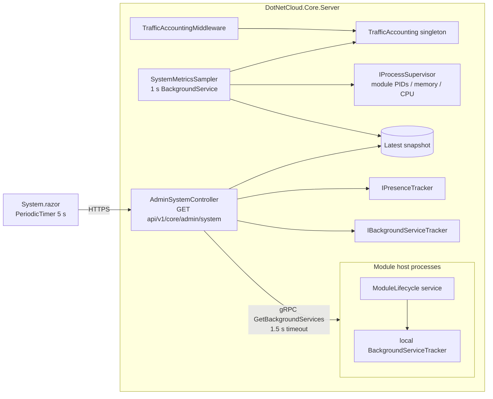

# Admin System Page — Implementation Plan

**Status:** implemented
**Target:** .NET 10 (`Directory.Build.props`), ASP.NET Core + Blazor (InteractiveAuto)
**Branch:** `feature/admin-system-page`

---

## 1. Goal

Add a new admin-only **System** page at `/admin/system` that refreshes every 5 seconds and shows:

| Metric           | Definition (locked)                                                                                                                    |
| ---------------- | -------------------------------------------------------------------------------------------------------------------------------------- |
| CPU usage        | App processes only — core process + every running module host. Percentage of total machine capacity (`ΔCPU / Δwall / ProcessorCount`). |
| Memory usage     | Working set per app process + total, plus core GC heap.                                                                                |
| Users online     | Distinct user IDs with an active SignalR connection, plus total active connection count.                                               |
| Data transferred | In / Out / Total, **global since core start**. No per-user attribution. Includes HTTP payload bytes and WebSocket/SignalR frames.      |
| Scheduled tasks  | Background services that are currently running, plus last-run status. Core + module hosts.                                             |

**Locked design decisions:**

1. App processes only — no machine-wide/cgroup metric package; no new NuGet dependencies.
2. Traffic counters are global, reset when the core process restarts. The page displays "since &lt;timestamp&gt;".
3. WebSocket/SignalR frames count toward in/out.
4. Module-host background services are in scope and aggregated over gRPC.
5. New page; `/admin/health` stays as-is (detailed checks). The System page links to it.
6. Polling (5 s GET), not push.

---

## 2. Architecture



Key properties:

- All client HTTP (including module REST, file uploads/downloads and Collabora) passes through the core via Kestrel/YARP, so **traffic is measured in one place**.
- The sampler is a single shared singleton: N admins polling cost N tiny JSON reads, not N samplers.
- No database access on the polling path.

---

## 3. Phase 1 — Metrics sampler (CPU / memory / uptime)

### Files

| Action | File                                                                     |
| ------ | ------------------------------------------------------------------------ |
| new    | `src/Core/DotNetCloud.Core.Server/Diagnostics/SystemMetricsSampler.cs`   |
| new    | `src/Core/DotNetCloud.Core.Server/Diagnostics/ProcessMetricsSnapshot.cs` |
| edit   | `src/Core/DotNetCloud.Core/Modules/Supervisor/ModuleProcessInfo.cs`      |
| edit   | `src/Core/DotNetCloud.Core.Server/Supervisor/ModuleProcessHandle.cs`     |
| edit   | `src/Core/DotNetCloud.Core.Server/Program.cs`                            |

### Design

- `SystemMetricsSampler` is a singleton **and** `IHostedService`; inject `TimeProvider` (testable).
- Sample every **1 s** (configurable via a constant; no new settings key required).
- Process set:
  - Core: a cached `Process.GetCurrentProcess()`.
  - Modules: `IProcessSupervisor.GetAllModuleInfo()` (already returns PID, `MemoryUsageBytes`, `StartedAt`).
- Add a `TimeSpan? CpuTime` property to `ModuleProcessInfo`, populated from a new `ModuleProcessHandle.TotalProcessorTime` accessor (`Process.TotalProcessorTime` inside the existing lock/try-catch; `null` when exited).
- CPU %:
  - Keep `(timestamp, cpuTime)` per process ID from the previous sample.
  - On each sample: `cpuPercent = ΔcpuTime / (Δwall × Environment.ProcessorCount) × 100`.
  - On PID change (module restart) or first sample, reset that process baseline and report `null` for one tick.
  - Aggregate app CPU = sum of per-process deltas over the same window (not a sum of percentages — compute from total delta).
- Memory:
  - `WorkingSet64` per process; total = sum.
  - Core only: `GC.GetTotalMemory(forceFullCollection: false)` and `GC.GetTotalAllocatedBytes()` rate (optional).
- Uptime: `Process.StartTime` in UTC, returned as `startedAtUtc` + `uptimeSeconds`.
- Snapshot includes `sampledAtUtc`, `processorCount`, and `cpuAvailable` (false until a second sample exists).
- Optional: keep a 60-sample ring buffer (1 minute) for sparklines. Include only if the UI wants a mini graph; otherwise omit.
- Defensive: per-process try/catch, skip exited/access-denied processes; a failed sample must not stop the hosted service.

---

## 4. Phase 2 — Traffic accounting (HTTP + WebSocket)

This is the only hot-path change. Guard rails: **never buffer**, **never break streaming**, **preserve sendfile**.

### Files

| Action | File                                                                             |
| ------ | -------------------------------------------------------------------------------- |
| new    | `src/Core/DotNetCloud.Core.Server/Diagnostics/TrafficAccounting.cs`              |
| new    | `src/Core/DotNetCloud.Core.Server/Diagnostics/CountingResponseBodyFeature.cs`    |
| new    | `src/Core/DotNetCloud.Core.Server/Diagnostics/CountingRequestBodyPipeFeature.cs` |
| new    | `src/Core/DotNetCloud.Core.Server/Diagnostics/CountingWebSocketFeature.cs`       |
| new    | `src/Core/DotNetCloud.Core.Server/Middleware/TrafficAccountingMiddleware.cs`     |
| edit   | `src/Core/DotNetCloud.Core.Server/Program.cs`                                    |

### .NET 10 API notes (verified against the 10.0.13 ref pack)

- `IHttpResponseBodyFeature` is public: `Stream`, `Writer`, `DisableBuffering()`, `StartAsync()`, `SendFileAsync()`, `CompleteAsync()`.
- `IHttpRequestBodyFeature` is **not** public in .NET 10 → wrap **`IRequestBodyPipeFeature.Reader`** instead (and let `Request.Body` derive from it). `IHttpRequestBodyDetectionFeature` can short-circuit requests that cannot have a body.
- `IHttpWebSocketFeature` is public: `IsWebSocketRequest`, `AcceptAsync(WebSocketAcceptContext)`.

### Middleware placement

Register **after** `app.UseAuthentication(); app.UseAuthorization();` in `Program.cs` (currently ~line 1006), before `ApiNoCacheMiddleware`:

```csharp
app.UseMiddleware<TrafficAccountingMiddleware>();
```

Consequences (accepted and documented in code comments):

- `UseResponseCompression` runs **before** auth in the pipeline, so the counter sees **uncompressed application payload** bytes. This is the metric definition ("payload bytes", not TLS/wire bytes).
- Auth has already run, so `HttpContext.User` is available for the authenticated-only filter.

### Counting rules

- Count only `HttpContext.User.Identity?.IsAuthenticated == true`. Anonymous traffic (login page, pre-auth assets) is excluded.
- Skip requests with `Content-Type: application/grpc` (module → core capability calls; not user traffic).
- `BytesIn`: `IRequestBodyPipeFeature.Reader` read results (`ReadResult.Buffer.Length`) for non-gRPC requests; also `Content-Length` when no body is read (draining/aborted uploads) — take the max of the two per request to avoid under/over counting.
- `BytesOut`: writes to the response stream/pipe writer + `SendFileAsync(count)`.
  - `CountingResponseBodyFeature` wraps both `Stream` and `Writer`; each counts its own writes, never both for the same data.
  - `SendFileAsync` delegates to the inner feature and adds `count` to `BytesOut` (do **not** route file bytes through the stream).
  - `DisableBuffering`, `StartAsync`, `CompleteAsync` delegate unchanged.
- WebSocket: `CountingWebSocketFeature.AcceptAsync` returns a `CountingWebSocket` delegating to the inner socket:
  - `SendAsync(...)` → add buffer `Count` to `BytesOut`.
  - `ReceiveAsync(...)` → add `result.Count` to `BytesIn`.
  - `CloseAsync`, `CloseOutputAsync`, `Dispose` delegate; counts include SignalR keepalives (small, correct as "traffic").
  - Applies to `/hubs/*` and the Blazor Server circuit endpoint.
- `TrafficAccounting` singleton:
  - `long BytesIn/BytesOut` via `Interlocked.Add` (no locks, no per-request allocation beyond the wrappers).
  - `StartedAtUtc` captured at construction.
  - Rate: computed by the sampler from a short ring buffer (e.g. 10 samples) → `inPerSecond`, `outPerSecond`; avoids per-request rate math.
- Failure isolation: the middleware wraps feature installation in try/catch; any exception falls back to the original features. Metrics must never fail or slow a request beyond one virtual call per I/O chunk.

### Explicit non-goals

- No per-user or per-endpoint breakdown (locked decision).
- No persistence; counters reset on core restart.
- No TLS/framing overhead accounting.

---

## 5. Phase 3 — Background tasks (core + modules)

### 5a. Tracker extension (core)

File: `src/Core/DotNetCloud.Core/Services/IBackgroundServiceTracker.cs`

- Add `void RecordRunStarting(string serviceName)`.
- Add to `BackgroundServiceStatus`:
  - `bool IsRunning { get; set; }`
  - `DateTimeOffset? CurrentRunStartedAt { get; set; }`
- `RecordRun(...)` (completion) clears `IsRunning` and records last-run fields as today.
- Update core callers to call `RecordRunStarting` immediately before the cycle **inside the existing try/finally** so the flag always clears:
  - `AuditLogPurgeHostedService`
  - `AdminBroadcastSchedulerHostedService`
  - `BackupHostedService`
  - `SearchReindexHostedService`
  - `DemoAccountCleanupService`

### 5b. Module aggregation over gRPC

File: `src/Core/DotNetCloud.Core.Grpc/Protos/module_lifecycle.proto`

```proto
rpc GetBackgroundServices (GetBackgroundServicesRequest) returns (GetBackgroundServicesResponse);

message GetBackgroundServicesRequest {}

message BackgroundServiceInfo {
  string service_name = 1;
  bool is_running = 2;
  google.protobuf.Timestamp current_run_started_at = 3; // optional
  google.protobuf.Timestamp last_run_at = 4;            // optional
  double last_run_duration_ms = 5;
  bool last_run_success = 6;
  string last_run_message = 7;
  int32 total_runs = 8;
  int32 total_failures = 9;
}

message GetBackgroundServicesResponse {
  repeated BackgroundServiceInfo services = 1;
}
```

- Use `google.protobuf.Timestamp` (`WellKnownTypes`) for optional timestamps.
- Add a shared mapper helper (e.g. `BackgroundServiceProtoMapper`) in `DotNetCloud.Core.Grpc` so each host has a one-liner.

Implement the RPC in **every module host lifecycle service** (`*LifecycleService` under `src/Modules/*/*.Host/Services/` — AI, About, Bookmarks, Calendar, Chat, Contacts, Email, Example, Files, Music, Notes, Photos, Tracks, Video, plus `Search.Extraction.Host`):

- Inject `IBackgroundServiceTracker` into the constructor.
- Return `tracker.GetAll()` mapped to the proto.
- Files already registers the tracker (`FilesServiceRegistration`); add
  `services.TryAddSingleton<IBackgroundServiceTracker, BackgroundServiceTracker>()`
  to the registration file of the other 7 modules that host background services:

| Module   | Background services (count)                        |
| -------- | -------------------------------------------------- |
| Files    | 13 (already tracked — verify all call the tracker) |
| Video    | 4                                                  |
| Chat     | 3                                                  |
| Tracks   | 3                                                  |
| Email    | 2                                                  |
| Photos   | 2                                                  |
| Music    | 1                                                  |
| Calendar | 1                                                  |

- Instrument the remaining module background services with `RecordRunStarting` + existing `RecordRun` pattern (try/finally). Files services already do this; add the "starting" call.

### 5c. Core-side merge

In the new controller (Phase 4), query all **running** modules in parallel:

- Follow the existing pattern in `AdminController.GetModuleHealthEntriesAsync` (create `ModuleLifecycle.ModuleLifecycleClient` per endpoint).
- Per-call `CancellationTokenSource` of **1.5 s**; failures add the module to `unavailableModules` instead of failing the request.
- Tag each task with `module` (`"core"` or module ID) and `moduleName`.
- Sort: running first, then last-run descending.

---

## 6. Phase 4 — Admin API

New controller (keeps the already-large `AdminController` focused):

| Action | File                                                                    |
| ------ | ----------------------------------------------------------------------- |
| new    | `src/Core/DotNetCloud.Core.Server/Controllers/AdminSystemController.cs` |

- Route: `[Route("api/v1/core/admin")]`, `[Authorize(Policy = AuthorizationPolicies.RequireAdmin)]`.
- `GET /api/v1/core/admin/system` (no parameters, no DB access).
- Injects: `SystemMetricsSampler`, `TrafficAccounting`, `IPresenceTracker`, `IBackgroundServiceTracker`, `IProcessSupervisor`, `ILogger`.

Response:

```json
{
  "sampledAtUtc": "2026-10-24T12:00:00Z",
  "startedAtUtc": "2026-10-24T09:00:00Z",
  "uptimeSeconds": 10800,
  "processorCount": 8,
  "cpuAvailable": true,
  "cpuPercent": 3.4,
  "workingSetBytes": 412000000,
  "gcHeapBytes": 84000000,
  "processes": [
    {
      "id": "core",
      "name": "DotNetCloud",
      "pid": 123,
      "cpuPercent": 2.1,
      "workingSetBytes": 250000000,
      "gcHeapBytes": 84000000
    },
    {
      "id": "dotnetcloud.files",
      "name": "Files",
      "pid": 456,
      "cpuPercent": 1.3,
      "workingSetBytes": 162000000,
      "gcHeapBytes": null
    }
  ],
  "users": { "online": 4, "connections": 6 },
  "traffic": {
    "bytesIn": 1234567,
    "bytesOut": 7654321,
    "bytesTotal": 8888888,
    "inPerSecond": 1024.5,
    "outPerSecond": 2048.0,
    "sinceUtc": "2026-10-24T09:00:00Z"
  },
  "tasks": [
    {
      "module": "core",
      "moduleName": "DotNetCloud",
      "serviceName": "Audit log purge",
      "isRunning": true,
      "currentRunStartedAt": "2026-10-24T11:59:58Z",
      "lastRunAt": "2026-10-24T11:00:00Z",
      "lastRunDurationMs": 120.0,
      "lastRunSuccess": true,
      "lastRunMessage": "Deleted 0 entries",
      "totalRuns": 12,
      "totalFailures": 0
    }
  ],
  "unavailableModules": ["dotnetcloud.video"]
}
```

- Wrap in the existing envelope convention (`success`, `data`) as used by `GetHealthAsync` / `GetBackgroundServices`.
- Online users: `await presence.GetOnlineUsersAsync()` → `.Count`; `GetActiveConnectionCountAsync()`.
- Module task calls are best-effort; the endpoint always returns 200 for an admin even if a module is down.

---

## 7. Phase 5 — UI

### Files

| Action | File                                                                |
| ------ | ------------------------------------------------------------------- |
| new    | `src/UI/DotNetCloud.UI.Web.Client/Pages/Admin/System.razor`         |
| new    | `src/UI/DotNetCloud.UI.Web.Client/Pages/Admin/System.razor.css`     |
| new    | `src/UI/DotNetCloud.UI.Web.Client/Services/AdminSystemDtos.cs`      |
| edit   | `src/UI/DotNetCloud.UI.Web.Client/Services/DotNetCloudApiClient.cs` |
| edit   | `src/UI/DotNetCloud.UI.Web/Components/Layout/NavMenu.razor`         |

### Page

- `@page "/admin/system"`, `@rendermode InteractiveAutoRenderMode(prerender: false)`, `[Authorize(Policy = "RequireAdmin")]`, `@implements IAsyncDisposable`.
- Layout:
  - Stat cards: **CPU**, **Memory**, **Users online**, **Data In/Out/Total** (reuse the `dash-stat-card` visual language from `Dashboard.razor`).
  - Process table: name, PID, CPU %, working set, GC heap.
  - Tasks table: running badge, module, service, current-run age, last run, duration, result.
  - Footer note: "Data transfer counted since &lt;startedAt&gt; (HTTP payload + WebSocket frames)."
- Polling:
  - `PeriodicTimer(TimeSpan.FromSeconds(5))`; `await` the fetch inside the loop (never overlap requests).
  - `CancellationTokenSource` cancelled in `DisposeAsync`.
  - Keep the last successful snapshot; on failure show a "stale — last updated Xs ago" badge and a _single_ toast (not one per tick).
  - Optional: pause polling via the Page Visibility API when the tab is hidden.
- Icons: `MaterialIcon` only (`monitor_heart` / `speed` / `memory` / `group` / `swap_vert`); add any missing SVG paths to `MaterialSvgIcons.cs`.
- Formatting helpers: `FormatBytes` (Dashboard has one), `FormatDuration`, `FormatTimeAgo`, `FormatPercent`.
- Nav: add a `System` item under the admin section in `NavMenu.razor` (`/admin/system`).

### API client

- `GetSystemStatusAsync(CancellationToken)` → `Task<AdminSystemStatusDto>` using `ApiEnvelope<AdminSystemStatusDto>` per existing conventions.
- DTOs mirror the JSON above; no computed properties on the wire.

---

## 8. Phase 6 — Tests and verification

### Unit tests (`tests/DotNetCloud.Core.Server.Tests/`)

| Test file                                                                  | Coverage                                                                                                                                                                                                        |
| -------------------------------------------------------------------------- | --------------------------------------------------------------------------------------------------------------------------------------------------------------------------------------------------------------- |
| `Diagnostics/CountingResponseBodyFeatureTests.cs`                          | Stream writes count; `Writer` writes count; `SendFileAsync` counts file length exactly once; `DisableBuffering`/`StartAsync`/`CompleteAsync` delegate; no double counting when both Stream and Writer are used. |
| `Diagnostics/CountingRequestBodyPipeFeatureTests.cs`                       | `ReadAsync` counts delivered bytes; empty/complete/cancelled reads; partial buffers.                                                                                                                            |
| `Diagnostics/CountingWebSocketTests.cs`                                    | Send/receive payload counts; fragmented messages; close frames count 0; delegation of state and `CloseAsync`.                                                                                                   |
| `Diagnostics/TrafficAccountingTests.cs`                                    | Interlocked totals under concurrency; rate math with a fake `TimeProvider`; counters never negative.                                                                                                            |
| `Diagnostics/SystemMetricsSamplerTests.cs`                                 | CPU delta math (1 core vs N cores); PID change resets baseline; `cpuAvailable=false` on first sample; exited module tolerated.                                                                                  |
| `Services/BackgroundServiceTrackerTests.cs` (extend existing/`Core.Tests`) | `IsRunning` set/cleared on success, failure and exception; concurrent starts.                                                                                                                                   |
| `Controllers/AdminSystemControllerTests.cs`                                | Payload shape; module timeout → `unavailableModules`; presence counts; requires admin (attribute/policy assertion).                                                                                             |

Naming: `MethodName_Condition_ExpectedResult` (per repo convention).

Classes in `Core.Server` stay `internal`; `InternalsVisibleTo` for `DotNetCloud.Core.Server.Tests` already exists.

### Integration / manual verification

1. `dotnet build` and full `dotnet test` — clean.
2. Deploy to mint22 dev, open `/admin/system` as admin:
   - CPU/memory update every 5 s; values plausible vs `top`.
   - Start a module via `/admin/modules`; it appears in the process table.
   - Upload and download a large file; In/Out counters increase (and only once).
   - Open chat/Blazor in another tab; WebSocket traffic increments In/Out.
   - Trigger a backup; the task shows `Running` then completes with last-run data.
   - Stop a module; its tasks disappear and it is listed in `unavailableModules`.
3. Performance check: large-file upload/download throughput before vs after (expect < 5 % delta); confirm `SendFileAsync` path is still used for static files (no CPU spike).
4. Soak: page open for 10+ minutes; server memory flat; no circuit/timer leaks after navigating away.
5. Non-admin: page and API return 403/are hidden from nav.

---

## 9. Risks and mitigations

| Risk                                    | Impact | Mitigation                                                                                                                             |
| --------------------------------------- | ------ | -------------------------------------------------------------------------------------------------------------------------------------- |
| Middleware breaks streaming/downloads   | High   | Wrap feature, not `Response.Body` directly; delegate `SendFileAsync`; no buffering; integration test with large file + range download. |
| Double counting proxied responses       | Medium | Count only at the client-facing layer; unit test a YARP-shaped response.                                                               |
| Request body counting misses pipe reads | Medium | Wrap `IRequestBodyPipeFeature.Reader` (not `Request.Body`); assert YARP/upload path in integration test.                               |
| WebSocket wrapper breaks SignalR        | High   | Delegate every `WebSocket` member verbatim; test chat + Blazor circuit; fail-open try/catch.                                           |
| Compression metric ambiguity            | Low    | Document "uncompressed payload bytes" in code and UI footer.                                                                           |
| Module gRPC latency/failure             | Low    | 1.5 s timeout, parallel calls, `unavailableModules` list; never fail the endpoint.                                                     |
| Stale "running" flag after a crash      | Low    | try/finally in every call site; UI flags runs older than a threshold as "possibly stale".                                              |
| Blazor timer leaks                      | Medium | `IAsyncDisposable` + `CancellationTokenSource`; no per-page server timers.                                                             |
| Extra CPU from counting                 | Low    | Increment per I/O chunk only; verify in perf check.                                                                                    |

---

## 10. Effort

| Phase                                                         | Estimate      |
| ------------------------------------------------------------- | ------------- |
| 1 — Sampler + supervisor CPU                                  | 0.5 day       |
| 2 — Traffic accounting (HTTP + WebSocket) + perf validation   | 1.5–2 days    |
| 3 — Tracker state + gRPC aggregation + module instrumentation | 1.5–2 days    |
| 4 — Admin API                                                 | 0.25 day      |
| 5 — UI page + nav + client                                    | 0.5–0.75 day  |
| 6 — Tests and end-to-end verification                         | 1 day         |
| **Total**                                                     | **~5–6 days** |

---

## 11. Post-implementation (repo rules)

- Update `docs/IMPLEMENTATION_CHECKLIST.md` (`✓`/`☐`) and `docs/MASTER_PROJECT_PLAN.md` (status, deliverables, notes) using **targeted edits**.
- Do **not** commit or push until build + tests + live verification are complete and the user has explicitly approved.
