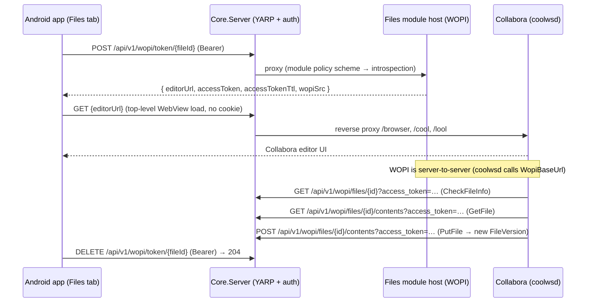

# Android — Collabora Online Document Editing in the Files Tab

**Status: ✓ IMPLEMENTED AND VERIFIED ON DEVICE (2026-10-10, branch `feature/android-sync`).** Build clean
(arm64 Debug — 0 warnings / 0 errors, signed APK produced), `DotNetCloud.Client.Android.Tests`
**551 pass / 0 fail / 1 skip** (37 new Collabora tests). Installed on `R5CWC356B2K` (SM-S928U) and
verified against `cloud.dotnetcloud.net`: an office document opens in the in-app editor, **a read-only
share opens in Collabora in view-only mode** (server-minted token carries `CanWrite: false`), the editor
reloads after a failure via **Retry**, and a main-frame HTTP error surfaces the app's own retry overlay
instead of Chromium's raw error page. §2 decision 5 needed the new **Shared With Me** entry point
(§5.5.1) because the server's shared-with-me *folder* only carries team/group mounted access. The version
bump (§6 Phase 5) remains deliberately outstanding.

Add the ability to **open and edit office documents (Word / Excel / PowerPoint / OpenDocument and
friends) from the Android app**, using the existing **Collabora Online / WOPI** stack that already
powers the Blazor web UI. The editor is shown **inside the app** in an embedded WebView. Edited
documents are saved **straight back to the server** (Collabora's WOPI `PutFile`), so there is no local
file to sync and **nothing is ever pulled from the server to the device**.

**Owner:** client agent (`monolith`). This is Android-client-only work. **No server changes are
expected** — the WOPI endpoints already accept the app's bearer token; if a change turns out to be
necessary it must be handed to the server agent (`cloud.kimball.home`) per the monolith role split.

**Related docs:** `docs/admin/COLLABORA.md` (Collabora CODE admin guide), `docs/modules/WOPI.md`
(WOPI protocol), `docs/modules/VERSIONING.md` (a WOPI save creates a new file version),
`docs/clients/android/{SETUP,DISTRIBUTION}.md`, `README.md` (Document Editing feature row).

---

## 1. Goal & scope

**Goal.** A user browsing files on Android can tap an office document and edit it in Collabora,
and the saved result lands on the server, without the app holding a local mirror.

**In scope**

- Embed the Collabora editor in an in-app WebView (Android MAUI).
- Deep-link / tap-to-edit for **all file types Collabora reports as supported** (driven by server
  discovery, not a hardcoded list).
- **Read-only** files still open in Collabora, in **view-only** mode.
- A **"New Document"** action that creates a blank document and opens it in the editor.
- Fail gracefully: when Collabora is not configured/unreachable, fall back to today's behavior.
- Unit tests for the pure decision logic and the WOPI HTTP client.

**Out of scope (explicitly)**

- Offline editing, or any local download→edit→re-upload workflow.
- Any server→device file mirroring or sync (see §2.3).
- Native (non-Collabora) preview for PDF/office because Collabora now covers it.
- The desktop SyncTray two-way sync engine (unaffected).
- Server-side changes (see the status note above).

---

## 2. Operator decisions (locked)

These were confirmed by the operator before planning:

1. **Editor surface = in-app WebView with the direct Collabora URL.** _Not_ the Blazor Files page.
2. **Sync model = online editor only.** Collabora saves to the server via WOPI; Android keeps no local
   copy; nothing syncs down.
3. **Entry point = tap-to-edit in the Files tab.**
4. **File types = all Collabora-supported types** (from server discovery).
5. **Read-only files open view-only.**
6. **"New Document" is included.**

### 2.1 Why _not_ the Blazor page (decision 1)

The user's original framing was "this will require showing Collabora from Blazor". Technically that is
**not required**, and actively harder:

- The Blazor shell `/apps/files` is `[Authorize]` + `InteractiveServer` and authenticates with the
  ASP.NET Core Identity **cookie** (`.AspNetCore.Identity.Application`). The Android app never has that
  cookie — it authenticates via OIDC PKCE in the **system browser** and stores **bearer tokens** in the
  Android Keystore.
- Loading the Blazor page in a WebView would therefore bounce to the login page unless the WebView ran
  its own OIDC login (a second, divergent session) or the app injected a cookie it has no way to obtain.
- Meanwhile `POST /api/v1/wopi/token/{fileId}` **accepts the bearer token** and returns a
  **self-authenticating** `editorUrl` (`?WOPISrc=…&access_token=…&access_token_ttl=…`). Loading that URL
  **top-level** (not in an iframe) needs no cookie at all.

So the app reproduces what the Blazor `DocumentEditor` overlay does — _mint a token, then show the
editor_ — minus the cookie-authenticated page shell.

### 2.2 Equivalent behavior

| Blazor web UI                                    | Android app (this plan)                           |
| ------------------------------------------------ | ------------------------------------------------- |
| `FileBrowser` double-click → `DocumentEditor`    | Files tab tap → pushed `DocumentEditorPage`       |
| `POST /api/v1/wopi/token/{fileId}` (cookie)      | `POST /api/v1/wopi/token/{fileId}` (**bearer**)   |
| Renders the returned URL in a same-origin iframe | Loads the returned URL **top-level** in a WebView |
| Server picks `edit`/`view` from caller perms     | Same — no client-side permission math             |

### 2.3 "Nothing syncs from server to Android" is already true

Android has **no file sync of any kind** today — not partial, not one-way. The Files tab is entirely
on-demand: it lists live from the server, downloads a file only when the user taps it, and the only
device→server paths are manual uploads and the MediaStore auto-upload. Consequently:

- "Modified files should sync to server" = satisfied **automatically** by Collabora's WOPI `PutFile`.
- "Do not want anything synced from server to Android" = **nothing to disable**; the design simply does
  not add a download/mirror path.

---

## 3. Architecture



Key points:

- The app only needs to reach the **public origin** (the Collabora `/browser` UI is reverse-proxied
  there by `MapCollaboraReverseProxy`).
- The WebView carries **no app credentials** — the editor URL is self-authenticating via its query token.
- The `access_token` is short-lived (default 480 min) and file-scoped. Delete it when the editor closes.

---

## 4. Server-side facts (verified — no changes needed)

### 4.1 WOPI endpoints (Files module host, proxied by Core.Server at the public origin)

| Method   | Route                                                | Auth                                 | Response                                                                 |
| -------- | ---------------------------------------------------- | ------------------------------------ | ------------------------------------------------------------------------ |
| `POST`   | `/api/v1/wopi/token/{fileId}`                        | Bearer (introspection) **or** cookie | Enveloped `WopiAccessTokenDto`                                           |
| `DELETE` | `/api/v1/wopi/token/{fileId}`                        | Bearer / cookie                      | `204 No Content`                                                         |
| `GET`    | `/api/v1/wopi/discovery`                             | Bearer / cookie                      | Enveloped `{ available, supportedExtensions[], actionCount, fetchedAt }` |
| `GET`    | `/api/v1/wopi/discovery/supports/{extension}`        | Bearer / cookie                      | Enveloped `{ extension, supported }`                                     |
| `GET`    | `/api/v1/wopi/files/{fileId}?access_token=`          | `access_token` query (WOPI)          | Raw `CheckFileInfo` JSON                                                 |
| `GET`    | `/api/v1/wopi/files/{fileId}/contents?access_token=` | `access_token` query                 | Raw bytes (`GetFile`)                                                    |
| `POST`   | `/api/v1/wopi/files/{fileId}/contents?access_token=` | `access_token` query                 | Raw (`PutFile`)                                                          |

Source: `src/Modules/Files/DotNetCloud.Modules.Files.Host/Controllers/WopiController.cs`,
`.../Files.Data/Services/WopiTokenService.cs`, `.../Files.Data/Services/WopiService.cs`.

### 4.2 `POST /api/v1/wopi/token/{fileId}` response (`WopiAccessTokenDto`, camelCase)

```json
{
  "success": true,
  "data": {
    "accessToken": "…",
    "accessTokenTtl": 1760000000000,
    "wopiSrc": "https://host/api/v1/wopi/files/<id>",
    "editorUrl": "https://host/browser/<hash>/cool.html?WOPISrc=…&access_token=…&access_token_ttl=…"
  }
}
```

- **Enveloped** (`{ success, data }`). `accessTokenTtl` is **Unix milliseconds of expiry**, not a duration.
- There is **no `canWrite` field** — the server encodes write capability by choosing the
  `edit` vs `view` URL template when minting. **The client does not compute permissions.**

### 4.3 `GET /api/v1/wopi/discovery` response

```json
{
  "success": true,
  "data": {
    "available": true,
    "supportedExtensions": ["doc", "docx", "odt", "pdf", "ppt", "pptx", "…"],
    "actionCount": 24,
    "fetchedAt": "2026-10-10T…Z"
  }
}
```

- Field is **`available`** (not `isAvailable`). When Collabora is unconfigured/unreachable:
  `{ "available": false, "supportedExtensions": [] }`.
- Discovery is cached server-side (~1 h), so this call is cheap for the app to make per session.

### 4.4 Creating a blank document (mirrors the Blazor "new document" flow)

There is **no dedicated "create document" endpoint**. Blazor
(`FileBrowser.razor.cs → CreateDocumentAsync`) uses the standard chunked-upload pipeline with a
**zero-byte** payload:

1. `POST /api/v1/files/upload/initiate` with `{ fileName, parentId, totalSize: 0, mimeType, chunkHashes: [] }`
   → `UploadSessionDto`.
2. (no chunks to upload)
3. `POST /api/v1/files/upload/{sessionId}/complete` → raw `FileNodeDto` (a genuine 0-byte file).

Collabora populates the file on first `PutFile`. Name collisions are resolved to `Untitled (1).docx`.
Then the Blazor UI immediately opens the editor.

### 4.5 Node metadata & read-only

- `GET /api/v1/files/{nodeId}` → raw `FileNodeDto` (not enveloped). It exposes `isReadOnly`, **but
  `FileService.ToDto` does not populate it for real files** (only synthetic "shared-with-me"/virtual
  nodes set it). **Do not build the view/edit decision on it.**
- The authoritative write check is `IPermissionService.GetEffectivePermissionAsync(...)` server-side;
  the WOPI token service already applies it. Read-only → `view` template → the editor opens non-editable.

### 4.6 Envelope / routing notes

- YARP maps `api/v1/wopi` → module `dotnetcloud.files`.
- `/api/v1/wopi/files/` is **excluded** from the response envelope (raw WOPI protocol); `/api/v1/wopi/token`
  and `/api/v1/wopi/discovery` are **not** excluded and are single-enveloped by the controller.
- The Android client's `ReadEnvelopeDataAsync` already tolerates both enveloped and raw responses, so no
  special handling is needed.

---

## 5. Design

### 5.1 New components (Android app)

| Component                                | Type        | Responsibility                                                      |
| ---------------------------------------- | ----------- | ------------------------------------------------------------------- |
| `IWopiRestClient` / `HttpWopiRestClient` | client      | `GetDiscoveryAsync`, `OpenEditorAsync`, `CloseEditorAsync` (bearer) |
| `WopiDtos`                               | records     | `WopiDiscovery`, `WopiEditorSession`                                |
| `CollaboraEditability`                   | pure static | editable/creatable decisions, MIME map, preferred new-doc order     |
| `DocumentEditorViewModel`                | VM          | mint token, expose `EditorUrl`, end session on close                |
| `DocumentEditorPage`                     | view        | full-bleed `WebView` + header + loading/error overlays              |
| Files-tab additions                      | —           | `SelectItemAsync` branch + **New Document** command/button          |

### 5.2 `IWopiRestClient`

```
Task<WopiDiscovery> GetDiscoveryAsync(string serverBaseUrl, string accessToken, CancellationToken ct)
Task<WopiEditorSession> OpenEditorAsync(string serverBaseUrl, string accessToken, Guid nodeId, CancellationToken ct)
Task CloseEditorAsync(string serverBaseUrl, string accessToken, Guid nodeId, CancellationToken ct)   // 204
```

Registered exactly like `IFileRestClient`:

```csharp
builder.Services.AddHttpClient<IWopiRestClient, HttpWopiRestClient>()
    .AddHttpMessageHandler<TimeoutHandler>()
    .AddHttpMessageHandler<AuthenticatedHttpClientHandler>()
    .ConfigurePrimaryHttpMessageHandler(OAuthHttpClientHandlerFactory.CreateHandler);
```

`AuthenticatedHttpClientHandler` gives proactive token refresh + a 401 retry for free.

### 5.3 `CollaboraEditability` (pure, testable)

```
bool IsEditable(string fileName, IReadOnlyCollection<string> supportedExtensions)
IReadOnlyList<string> CreatableExtensions(IReadOnlyCollection<string> supportedExtensions)
string MimeTypeFor(string extension)         // docx/xlsx/pptx/odt/ods/odp/txt/…
```

- `IsEditable` = `Path.GetExtension(fileName)` (lowercased, no dot) ∈ `supportedExtensions`, **minus**
  the native-editor extensions (see §12.1).
- `CreatableExtensions` = the preferred order `docx, xlsx, pptx, odt, ods, odp` ∩ discovery, then any
  remaining discovery types. (Mirrors Blazor's `_collaboraNewFileExtensions`.)
- No Android/MAUI dependencies → compiled into `DotNetCloud.Client.Android.Tests` (plain `net10.0`).

### 5.4 `DocumentEditorPage` / `DocumentEditorViewModel`

- Pushed Shell page; `Shell.NavBarIsVisible="False"`, `Shell.FlyoutBehavior="Disabled"` (template:
  `ImageViewerPage`).
- Layout: `Grid RowDefinitions="Auto,*"` → header (close/back button + file name) over a full-bleed
  `WebView`, plus a centered loading overlay (spinner + "Opening…") and an error state with a Retry.
- Query params: `NodeId` (Guid-as-string) and `Name` (both strings, matching the app's
  `IQueryAttributable` / `[QueryProperty]` conventions — Shell `Convert.ChangeType` cannot handle `Guid`).
- Lifecycle:
  - `Initialize` → `GetCredentialsAsync` → `OpenEditorAsync` → assign `EditorUrl` to the WebView source.
  - `Close` → best-effort `CloseEditorAsync` (swallow errors) → `GoToAsync("..")`.
  - `OnDisappearing` → end the session if not already ended (idempotent guard).
- `WebView.Navigating`: keep `http`/`https` navigation **inside** the WebView (do **not** reuse
  `MarkdownWebView`, which intentionally pushes http/https to the system browser and blocks inline HTML).

### 5.5 Files-tab wiring

`FileBrowserViewModel.SelectItemAsync` today has three branches: folder → image viewer → everything else
(download & open). Add a fourth, before the fallback:

```
if (CollaboraEditability.IsEditable(item.Name, _supportedExtensions))
    → Shell.GoToAsync("DocumentEditor", { NodeId, Name })
else
    → DownloadAndOpenFileAsync(item)     // unchanged
```

- `_supportedExtensions` is loaded lazily once per VM via `GetDiscoveryAsync` and cached; a failed/empty
  discovery leaves it empty, so the app simply behaves as it does today.
- The **New Document** toolbar button is shown only when discovery reports `available` with a non-empty
  creatable set. Flow: action sheet of extensions → `DisplayPromptAsync` for the name →
  `CreateDocumentAsync` → `GoToAsync("DocumentEditor", …new node…)`.

### 5.5.1 Shared With Me entry (added during verification)

§2 decision 5 ("read-only files open view-only") turned out to be **unreachable through the folder
tree**: the server's `_DotNetCloud → Shared With Me` virtual folder is built from
`FileService.ListMountedAccessAsync` ("nodes the caller can access through **team or group** shares"),
and the process-isolated Files host does not even register `ISharedWithMeModuleRegistry` (a core-process
singleton), so a **direct user share** never appears there on either client — the tree path is empty in
Blazor too, while the Blazor sidebar works because it calls a different endpoint.

So the app gets its own entry point, built on the endpoint that already works:

- A pinned **"Shared With Me"** row (👥) at the top of the user's root, next to the pinned AutoUpload
  folder. It is a synthetic node with a client-side sentinel id; the id is never sent to the server.
- Entering it lists `GET /api/v1/files/shared-with-me` → `FileShareDto[]` (**raw** array, not enveloped),
  mapped to the same `FileItemViewModel` rows as the rest of the browser. The granted permission drives a
  **"view only"** chip; the server still makes the real decision when it mints the token.
- Shared folders are browsable (their children come from the ordinary listing endpoint, which enforces
  the share's permission).
- The shares tree is marked read-only in the UI: New Document / New folder / Upload are hidden and the
  swipe-to-delete action is disabled, because the nodes belong to the sharer.
- Navigation entries carry a `SharedWithMe` flag, and breadcrumb jumps match **by position** — the user's
  root and the shares root both have a null folder id, so the previous id-based match would land on the
  wrong level.

### 5.6 List refresh after editing

Free: `FileBrowserPage.OnAppearing` always re-runs `LoadFilesCommand`, so returning from the editor
re-lists the folder and the edited file's size/date update. No messaging plumbing required.

---

## 6. Implementation steps

### Phase 1 — Data layer

- ✓ `Files/WopiDtos.cs` — `WopiDiscovery { bool Available; IReadOnlyList<string> SupportedExtensions }`,
  `WopiEditorSession { string AccessToken; long AccessTokenTtl; string WopiSrc; string EditorUrl }`.
- ✓ `Files/IWopiRestClient.cs` + `Files/HttpWopiRestClient.cs` — the three methods above; envelope-tolerant
  reads; `Authorization: Bearer` via the existing handler (copy `HttpFileRestClient`'s shape).
- ✓ `IFileRestClient` / `HttpFileRestClient` — add
  `Task<FileItem> CreateDocumentAsync(serverUrl, token, fileName, parentId, mimeType, ct)`:
  initiate (`totalSize 0`, `chunkHashes []`) → complete; and
  `Task<IReadOnlyList<SharedItem>> GetSharedWithMeAsync(serverUrl, token, ct)` for the pinned
  "Shared With Me" entry (§5.5.1), which tolerates the endpoint's **raw** array response.
- ✓ `Services/CollaboraEditability.cs` — pure helpers (§5.3).
- ✓ `MauiProgram.cs` — register `IWopiRestClient` (§5.2).

### Phase 2 — Editor page

- ✓ `ViewModels/DocumentEditorViewModel.cs` — token mint + close, query params, error/retry state.
- ✓ `Views/DocumentEditorPage.xaml` / `.xaml.cs` — WebView + header + overlays; `Navigated` handler
  (a `Navigating` handler is not needed: a plain `WebView` already keeps http/https navigation in place,
  unlike `MarkdownWebView`).
- ✓ `AppShell.xaml.cs` — `Routing.RegisterRoute("DocumentEditor", typeof(DocumentEditorPage));`.

### Phase 3 — Files tab

- ✓ Inject `IWopiRestClient` into `FileBrowserViewModel`; add cached `_supportedExtensions` +
  lazy `EnsureCollaboraCapabilitiesAsync`.
- ✓ Add the editable branch to `SelectItemAsync`.
- ✓ Add the pinned **Shared With Me** entry (synthetic row, shares tree, read-only location, "view only"
  chip) and the `GetSharedWithMeAsync` client call — see §5.5.1.
- ✓ Add `NewDocumentCommand` + toolbar button (only when creatable set is non-empty) and the
  action-sheet/name-prompt/create-and-open flow.
- ✓ Update `Views/FileBrowserPage.xaml` toolbar grid to accommodate the new button.

### Phase 4 — Tests & hardening

- ✓ `Android.Tests.csproj` `<Compile Include>` for `Files/IWopiRestClient.cs`, `Files/WopiDtos.cs`,
  `Services/CollaboraEditability.cs` (this project uses explicit includes).
- ✓ Tests: `CollaboraEditabilityTests` (editable / not-editable / creatable order / MIME),
  `HttpWopiRestClientTests` (discovery + token + delete wire parsing via a stub `HttpMessageHandler`,
  mirroring `HttpMusicRestClient` tests), `HttpFileRestClientSharedWithMeTests` (raw array, enveloped,
  read-only vs read-write, skipped rows) and `DocumentEditorViewModelTests` (failure/retry state).
- ✓ Verify build is warning-free (repo has `TreatWarningsAsErrors`).

### Phase 5 — Docs & version

- ✓ `docs/IMPLEMENTATION_CHECKLIST.md` — add a section with ✓/☐ items (targeted edit).
- ✓ `docs/MASTER_PROJECT_PLAN.md` — Quick Status Summary + step Status/Deliverables/Notes (targeted edit).
- ✓ Version numbers **unchanged by design** — the operator bumps client versions only when preparing a
  release, so `Directory.Build.props` and `DotNetCloud.Client.Android.csproj`
  (`ApplicationDisplayVersion`) stay at **0.6.13** for this branch. No action item.

---

## 7. Files to create / modify

**Create**

- `src/Clients/DotNetCloud.Client.Android/Files/IWopiRestClient.cs`
- `src/Clients/DotNetCloud.Client.Android/Files/HttpWopiRestClient.cs`
- `src/Clients/DotNetCloud.Client.Android/Files/WopiDtos.cs`
- `src/Clients/DotNetCloud.Client.Android/Services/CollaboraEditability.cs`
- `src/Clients/DotNetCloud.Client.Android/ViewModels/DocumentEditorViewModel.cs`
- `src/Clients/DotNetCloud.Client.Android/Views/DocumentEditorPage.xaml` (+ `.xaml.cs`)
- `tests/DotNetCloud.Client.Android.Tests/…` (editability + WOPI client tests)

**Modify**

- `src/Clients/DotNetCloud.Client.Android/ViewModels/FileBrowserViewModel.cs`
- `src/Clients/DotNetCloud.Client.Android/Files/IFileRestClient.cs`
- `src/Clients/DotNetCloud.Client.Android/Files/HttpFileRestClient.cs`
- `src/Clients/DotNetCloud.Client.Android/Views/FileBrowserPage.xaml`
- `src/Clients/DotNetCloud.Client.Android/AppShell.xaml.cs`
- `src/Clients/DotNetCloud.Client.Android/MauiProgram.cs`
- `tests/DotNetCloud.Client.Android.Tests/DotNetCloud.Client.Android.Tests.csproj`

**Reference only (no changes):**

- `src/Modules/Files/DotNetCloud.Modules.Files.Host/Controllers/WopiController.cs`
- `src/Modules/Files/DotNetCloud.Modules.Files.Data/Services/WopiTokenService.cs`
- `src/Modules/Files/DotNetCloud.Modules.Files.Data/Services/WopiService.cs`
- `src/Core/DotNetCloud.Core.Server/Program.cs` (YARP module proxy + envelope exclusions)
- `src/Modules/Files/DotNetCloud.Modules.Files/Options/CollaboraOptions.cs`

---

## 8. Error handling & edge cases

| Case                                                    | Behavior                                                                                  |
| ------------------------------------------------------- | ----------------------------------------------------------------------------------------- |
| Collabora not configured / discovery `available=false`  | Files tab behaves exactly as today (download & open); New Document button hidden.         |
| Token mint fails (401/403/5xx)                          | Editor page shows an error + Retry; never a blank WebView.                                |
| Concurrent-session cap reached (`503` on CheckFileInfo) | Collabora shows its own busy state; the app surfaces the WebView content unchanged.       |
| Read-only file                                          | Server mints a `view` token → editor opens non-editable. No client-side permission check. |
| WebView load fails (offline / DNS / cert)               | Error overlay with Retry + "Open in browser" fallback.                                    |
| WebView load returns an HTTP error (502/403/404 …)      | Same overlay, with the status named (§11.2 verified live: a 404 produced "The document could not be found on the server"). MAUI reports these loads as *success* — Chromium paints its own error document — so the page installs an `EditorWebViewClient` that reports main-frame `onReceivedHttpError` and keeps the failure sticky against the trailing success. |
| User leaves the page without pressing close             | `OnDisappearing` ends the WOPI session (best-effort) so the concurrency slot is released. |
| File renamed/deleted while open                         | Ruled out by the editor session; the re-list on return reflects the server truth.         |

---

## 9. Security considerations

- **No web cookie, no second login.** The app never stores or injects a browser session; the editor URL
  is self-authenticating and file-scoped.
- **WOPI token exposure.** The `access_token` appears in the URL (WOPI requires this) and therefore in
  WebView history — identical to the existing browser path. Mitigations already in place: short lifetime
  (default 480 min), HMAC-SHA256 signing, file-id binding, explicit `DELETE` on close.
- **Bear evidence.** `POST /token` accepts the bearer via the module policy scheme (token introspection
  against Core.Server); the app's existing proactive-refresh handler keeps it valid.
- **TLS.** The WebView uses Chromium's network stack, which does **not** accept the self-signed certs
  that `OAuthHttpClientHandlerFactory` tolerates for private/LAN hosts. On a real cert (e.g. Let's Encrypt
  on the cloud instance) this is a non-issue. See §11.2.
- **Cleartext.** `http://` servers reachable by the REST client may be blocked inside the WebView on
  API 28+ (no cleartext allowance is declared). Documented limitation.

---

## 10. Platform limitations (accepted)

- **Editing starts behind the pencil.** On mobile, Collabora renders the document and waits: the user taps
  the pencil FAB (bottom-right) to enter edit mode, and only then do the caret, keyboard and formatting
  bars appear. Nothing is wrong when a freshly opened document ignores keystrokes — it is not in edit mode
  yet. Verified on `R5CWC356B2K`.
- **Popups / new windows.** Collabora may use `window.open` for some secondary flows; a single-window
  `WebView` renders them in place or silently drops them. Core editing is unaffected.
- **No service-worker guarantee.** Live co-editing uses WebSockets (`/cool`, `/lool`), which the WebView
  supports; we do not rely on service workers.
- **`About`/`javascript:` schemes** are not needed here (the editor is served over http/https).

---

## 11. Verification plan

### 11.1 Build & unit tests

- `dotnet build` of the Android project for **arm64 Debug** completes with **0 warnings / 0 errors**.
- `DotNetCloud.Client.Android.Tests` green, including the new `CollaboraEditabilityTests` and
  `HttpWopiRestClientTests`.

### 11.2 On-device end-to-end (R5CWC356B2K against `cloud.dotnetcloud.net`, which has Collabora deployed)

**Done (2026-10-10):** installed over the previous debug build (app data preserved); a `.docx` opens in
the in-app editor with its saved content; a driven **HTTP 404** (WebView debug socket → `Page.navigate`)
shows the app's own overlay with Retry/Open-in-browser; **Retry** re-mints and reloads; a non-office
`.epub` still uses download-and-open (step 6); logcat shows the `POST`/`DELETE /api/v1/wopi/token/{id}`
pair and the `HTTP status 404` failure line. **Step 5 done** through the new Shared With Me entry
(§5.5.1): `ShareTest.docx` shows a "view only" chip and opens with Collabora's own **Read-only** badge,
and the minted token decodes to `{"CanWrite":false,…}`; closing the editor sends the `DELETE` that
releases the session slot (step 7's client half). **Step 4 done** in `Temp`: New Document offered the preferred formats first (`.docx`, `.xlsx`, `.pptx`,
`.odt`, `.ods`, `.odp`) then the remaining Collabora types, and creating twice with the default name
produced `Untitled.docx` then **`Untitled (1).docx`** (client-side de-duplication against the current
listing) — each via `upload/initiate` → `upload/{id}/complete` → `wopi/token/{id}`, opening a blank page.
Both test files were then deleted, leaving `Temp` as it was. **Step 3 done (2026-10-11 04:57Z):** `CheckFileInfo` exposes `Version = "{CurrentVersion}_{UpdatedAt.Ticks}"`, so
the version counter is observable without server access. Baseline before the edit was
`18_639272886867172411` / `Size 5529` / `SHA256 dd0d41be…`; after saving the line "Saved via Android app"
from the in-app editor it read `20_639272914534118006` / `Size 5545` / `SHA256 54569eca…` — the save
created real `FileVersion` rows with new content. A later byte-identical `PutFile` (posting the file's own
bytes back) advanced the counter again with an unchanged content hash, and the editor's close-flush adds
one more, i.e. each `PutFile` creates a version. **Step 7 client half done:** the `DELETE
/api/v1/wopi/token/{id}` on close releases the session slot. The **cap itself** is covered by the existing
server tests (`WopiSessionTrackerTests`, 10/10 green — `TryBeginSession_AtCapacity_ReturnsFalse`,
`EndSession_ExistingSession_DecreasesCount`, `TryBeginSession_AfterEndSession_CanAddNewSession`,
`TryBeginSession_SameUserSameFile_RefreshesAndReturnsTrueWithoutConsuming`) and a denial maps to **503** on
CheckFileInfo; exercising that end-to-end needs 20 concurrent **server-wide** sessions, so it stays a
server-side load test. **Note:** after ~05:00Z the *header-less* WOPI probe (plain curl) began returning
**404** consistently while the app's own sessions kept working, so those readings — taken before that
change — are the ones recorded above. **Still to do (server-side):** the concurrency-cap load test.

1. Tap a `.docx` in the Files tab → editor loads in-app. ✓
2. Edit + save → go back → the Files list shows the new size/timestamp → reopen shows the change. ✓
3. Confirm on the server that the save created a **new FileVersion** (and a version-history entry). ✓
   — observed from the client through `CheckFileInfo.Version` (`CurrentVersion_ticks`): `18_…` → `20_…`
   with `Size 5529` → `5545` and a new SHA-256.
4. **New Document** → creates a blank file and opens it; a second same-name create yields `Untitled (1)`. ✓
5. A **read-only** share opens in Collabora in **view-only** mode. ✓
6. A **non-office** file still uses the old download-and-open path.
7. `adb logcat -s DotNetCloud` shows the token mint and the DELETE (204); a second concurrent open works
   up to the configured cap.
8. Reproduce pre-fix behavior? No — this is net-new; simply confirm the CLI/live WOPI path is untouched
   for the web UI.

### 11.3 Regression

- Existing image viewer, upload, folder navigation, and delete flows are unchanged.
- Blazor document editing is untouched.

---

## 12. Further considerations (open)

1. **Native-extension exclusions.** Blazor deliberately keeps `txt/md/json/csv/...` on its native editor
   (`NativeEditorExtensions`). Should Android mirror that exclusion (txt/csv stay download-and-open), or
   open **every** discovery type (matching the "all supported types" decision literally)?
   **Decided: mirror the exclusion.** `CollaboraEditability` carries the same `NativeEditorExtensions`
   set, so the Android and web UIs agree on which files the office editor owns (and the "New Document"
   action offers the same office formats on both).
2. **LAN self-signed TLS.** Accept the Chromium interstitial, or add a custom `WebViewClient` that
   proceeds past cert errors? _Recommendation: accept; the cloud instance uses a real cert._
3. **Collabora popups.** Accept single-window behavior for v1, or add multi-window `WebViewClient`
   handling? _Recommendation: accept._
4. **New Document placement.** Toolbar button + action sheet _(recommended)_, or a full create-dialog page
   matching the web UI's dialog?
