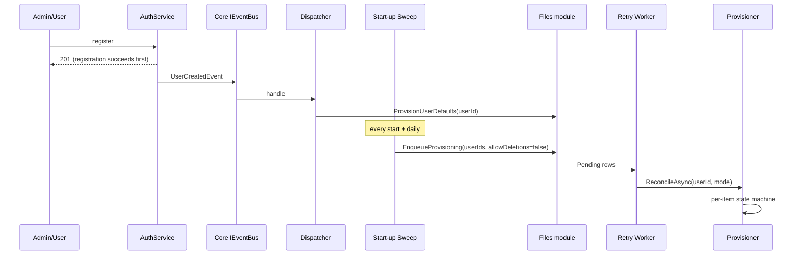

# Default User Content — Detailed Implementation Plan

**Status:** Implemented and live-verified on mint22 (2026-10-21)
**Date:** 2026-10-21
**Branch:** `feature/default-user-content`
**Scope:** Core (event + start-up sweep), Files module (data, gRPC, REST, UI), CLI, installer/Docker/release, backups, docs, tests.

---

## Table of Contents

1. [Summary](#1-summary)
2. [Requirements](#2-requirements)
3. [Terminology](#3-terminology)
4. [Current-state facts that shape the design](#4-current-state-facts-that-shape-the-design)
5. [Architecture](#5-architecture)
6. [Decision register](#6-decision-register)
7. [Data model](#7-data-model)
8. [Storage layout and upgrade safety](#8-storage-layout-and-upgrade-safety)
9. [Provisioning and convergence](#9-provisioning-and-convergence)
10. [Read-only default files](#10-read-only-default-files)
11. [Backups, export, and import](#11-backups-export-and-import)
12. [Configuration](#12-configuration)
13. [Interfaces](#13-interfaces)
14. [UI specification](#14-ui-specification)
15. [Implementation steps](#15-implementation-steps)
16. [Test plan](#16-test-plan)
17. [Rollout, rollback, and runbook](#17-rollout-rollback-and-runbook)
18. [Risks and edge cases](#18-risks-and-edge-cases)
19. [Definition of done](#19-definition-of-done)

- [Appendix A — File change index](#appendix-a--file-change-index)
- [Appendix B — Audit findings resolved](#appendix-b--audit-findings-resolved)
- [Appendix C — Assumptions](#appendix-c--assumptions)

---

## 1. Summary

DotNetCloud gets an **administrator-managed default content template** on the server. Every
newly-created account receives the template as its starting file tree, and every existing account is
brought up to date by a rate-limited convergence pass at each service start.

Default content is:

- **Quota-free** — the user's usable space is `quota + exempt starter content`.
- **Single-blob** — all users reference the same content-addressed chunks/blobs; nothing is copied
  per user on disk.
- **Read-only but deletable** — users cannot edit, replace, rename, or move a starter file, but they
  can delete it (soft delete into their trash) and copy it (the copy becomes their own content).
- **Convergent, never destructive by accident** — new template items are added automatically;
  template edits and removals are surfaced as _pending_ and only applied by an administrator-confirmed
  run.

The template lives in the persistent data directory and is **never touched by an in-place upgrade**.

---

## 2. Requirements

### 2.1 Functional

| #   | Requirement                                                                                                                                            |
| --- | ------------------------------------------------------------------------------------------------------------------------------------------------------ |
| F1  | On account creation, copy the template into the new user's Files root.                                                                                 |
| F2  | On every service start (and daily), converge every user: add template items they have never received.                                                  |
| F3  | Never overwrite a user's content during automatic convergence.                                                                                         |
| F4  | Never recreate an item the user deleted.                                                                                                               |
| F5  | A user's deletion is a **soft delete** (trash) and survives restarts.                                                                                  |
| F6  | Automatic trash retention must **never purge** starter content.                                                                                        |
| F7  | Removing an item from the template marks it pending; a confirmed run permanently deletes matching unmodified copies.                                   |
| F8  | Editing a template file marks unmodified copies `Outdated`; a confirmed _publish updates_ run replaces them as a new version.                          |
| F9  | A user-modified copy is only replaced by a separate, explicitly confirmed _overwrite modified_ action.                                                 |
| F10 | Default files are **read-only** for content operations but **deletable**, copyable, shareable, taggable, commentable, and downloadable.                |
| F11 | Starter content does not count against the user's quota; the exemption is recomputed from what the user still has unmodified.                          |
| F12 | All users share one physical blob per unique content (content-addressed chunks + whole-file blobs).                                                    |
| F13 | A checked-in developer seed tree supplies the stock layout on a fresh install.                                                                         |
| F14 | The template is included in full backups and restored by them.                                                                                         |
| F15 | The template can be exported and imported as a ZIP for portability.                                                                                    |
| F16 | The admin can validate, inspect, export, seed, and trigger convergence from `/admin/files/default-content`; the page is read-only over the filesystem. |
| F17 | CLI parity: `status`, `validate`, `reconcile`, `seed-defaults`, `sync-seed`, `export`, `import`.                                                       |
| F18 | The feature can be disabled with no side effects.                                                                                                      |

### 2.2 Operator constraints

- **Upgrade preservation:** replacing binaries, running the installer in upgrade mode, or updating a
  container image must never delete, reset, or overwrite the template.
- **Filesystem management:** the administrator creates/copies files with normal server tools; there
  is no upload UI.
- **Backups must restore it.**

### 2.3 Non-functional

- **Process isolation:** all core ↔ Files communication is gRPC; no shared DI, no cross-module DB access.
- **No unattended destruction:** automatic passes are add-only.
- **Scale:** start-up convergence must not block boot or hammer the module on large instances.
- **Observability:** per-user status, counts, last error, audit entries for destructive runs.
- **Security:** path traversal/symlink rejection; ZIP import treated as untrusted input.

### 2.4 Non-goals (v1)

- A `Public` folder auto-shared with other users (no such concept exists; public access is a
  per-node `ShareType.PublicLink`).
- Per-group or per-organization templates.
- Mounting the template as a read-only folder in user trees (that is what admin shared folders do).
- Uploading or importing a template through the admin UI (CLI-only import; the UI is read-only).
- Automatic overwriting of user content, and automatic permanent deletion (both require an
  administrator-confirmed run).
- Malware scanning of template content (`IFileScanner` is currently a no-op).
- Multi-instance coordination (single core instance assumed).

---

## 3. Terminology

| Term                | Meaning                                                                            |
| ------------------- | ---------------------------------------------------------------------------------- |
| **Template**        | The administrator-managed directory `${DATA_DIR}/default-user-content`.            |
| **Starter content** | Files/folders provisioned from the template into a user's tree.                    |
| **Provisioning**    | The one-time copy of missing template items for a user.                            |
| **Convergence**     | Any reconciliation run (registration, start-up, daily, admin, CLI).                |
| **`Present`**       | User's node matches what was provisioned and the template still matches.           |
| **`Outdated`**      | User's node is unmodified, but the template content changed since provisioning.    |
| **`ChangedByUser`** | User's node differs from what was provisioned.                                     |
| **`RemovedByUser`** | User deleted the node (trash or purge); a permanent tombstone.                     |
| **Exemption**       | `FileQuota.ExemptBytes`: the size of starter content still present and unmodified. |
| **Confirmed run**   | A convergence run with explicit admin/CLI confirmation for destructive actions.    |

---

## 4. Current-state facts that shape the design

These were verified in the codebase during the audit and drive several decisions.

| Area                  | Fact                                                                                                                                                                                                                                                                                           |
| --------------------- | ---------------------------------------------------------------------------------------------------------------------------------------------------------------------------------------------------------------------------------------------------------------------------------------------- |
| User creation         | `AuthService.RegisterAsync` (`src/Core/DotNetCloud.Core.Auth/Services/AuthService.cs`) is the only creation path; the admin form posts to `api/v1/core/auth/register`. No `UserCreatedEvent` exists.                                                                                           |
| User deletion         | `UserManagementService.DeleteUserAsync` publishes `UserDeletedEvent`; the Files module has `UserDeletedEventSubscriber`.                                                                                                                                                                       |
| Module events         | The module host has its own `InProcessEventBus`; the core never relays events into it. `MediaCaptureBackfillService` documents that `FileUploadedEvent` handlers **do not run in production** (the supervisor never sends `Initialize`). Upload completion therefore does EXIF capture inline. |
| Thumbnails            | Generated lazily (`ThumbnailService.GetOrGenerateThumbnailAsync`); no import-time work needed.                                                                                                                                                                                                 |
| Storage               | Content-addressed: chunks at `chunks/xx/yy/<sha256>`, whole-file blobs at `files/xx/yy/<sha256>`. `FileChunk.ReferenceCount` is shared.                                                                                                                                                        |
| Whole-file conversion | `ConvertVersionToWholeFileAsync` deletes an existing blob and rewrites it from chunks — must be fixed for bulk provisioning (see R2).                                                                                                                                                          |
| Upload completion     | `ChunkedUploadService.CompleteUploadAsync` writes versions/chunks, converts eligible media, captures EXIF inline, publishes `FileUploadedEvent` + `SearchIndexRequestEvent`, then adjusts quota.                                                                                               |
| Admin settings        | The Files host registers `IAdminSettingsService`; `FileVersioningSettingsProvider` shows the config + `SystemSettings` overlay pattern.                                                                                                                                                        |
| Env propagation       | `ProcessSupervisor` forwards `DOTNETCLOUD_CONFIG_DIR` and `DOTNETCLOUD_DATA_DIR` to module hosts.                                                                                                                                                                                              |
| Read-only UI          | `FileNodeDto.IsReadOnly` already exists and the UI gates the document editor — but its context-menu branch **hides Delete**.                                                                                                                                                                   |
| CLI config            | `CliConfiguration.Save` serialises a fixed `CliConfig`; unknown keys are **dropped** on save (setup, cert renewal, Collabora install, service commands all save).                                                                                                                              |
| Backups               | CLI and server backups archive the **entire data directory** (only the backup directory/archive excluded). CLI restore does not fix ownership; server `RestoreBackupAsync` is a stub using `options.ConnectionString` as a target path.                                                        |
| Upgrade               | `tools/install.sh` only replaces `/opt/dotnetcloud/{server,modules}` and top-level files; `$DATA_DIR` is preserved.                                                                                                                                                                            |
| Docker                | `deploy/docker/entrypoint.sh` runs as root, seeds/certifies, then drops to `app`.                                                                                                                                                                                                              |

---

## 5. Architecture

```mermaid
flowchart LR
    subgraph Core["Core process"]
        Auth["AuthService.RegisterAsync"]
        Bus["IEventBus"]
        Disp["UserContentProvisioningDispatcher"]
        Sweep["StartupUserContentSweepService<br/>(start + daily)"]
        Admin["Admin REST / UI"]
    end

    subgraph Files["Files module host (process-isolated)"]
        Grpc["FilesGrpcService"]
        Prov["DefaultUserContentProvisioner"]
        Import["FileImportService"]
        Store["DefaultUserContentStore (read-only)"]
        Worker["DefaultUserContentRetryService"]
        DB[(FilesDbContext)]
    end

    Template[("${DATA_DIR}/default-user-content")]
    Storage[("${DATA_DIR}/storage (content-addressed)")]

    Auth --> Bus --> Disp
    Disp -->|gRPC ProvisionUserDefaults| Grpc
    Sweep -->|gRPC EnqueueProvisioning (batches)| Grpc
    Admin -->|gRPC/REST via proxy| Grpc
    Grpc --> Worker
    Worker --> Prov
    Prov --> Store --> Template
    Prov --> Import --> Storage
    Prov --> DB
    Import --> Storage
```

**Components**

| Component                                               | Location                         | Responsibility                                                |
| ------------------------------------------------------- | -------------------------------- | ------------------------------------------------------------- |
| `UserCreatedEvent`                                      | `Core/Events`                    | Signals a new account.                                        |
| `UserContentProvisioningDispatcher`                     | `Core.Server/Services`           | Immediate path after registration.                            |
| `StartupUserContentSweepService`                        | `Core.Server/Services`           | Pages users, enqueues convergence at start + daily.           |
| `FilesGrpcApiClient` additions                          | `Core.Server/Grpc/Clients`       | Calls the new RPCs.                                           |
| `FilesGrpcService` additions                            | `Files.Host/Services`            | Internal, trusted RPC surface.                                |
| `DefaultUserContentSettingsProvider`                    | `Files.Data/Services`            | Config baseline + `SystemSettings` overlay.                   |
| `DefaultUserContentStore` / `DefaultUserContentArchive` | `Files.Data/Services`            | Read-only template manifest/validation/export and ZIP import. |
| `DefaultUserContentProvisioner`                         | `Files.Data/Services`            | Reconciliation state machine.                                 |
| `FileImportService`                                     | `Files.Data/Services`            | Content-addressed internal write path with upload parity.     |
| `ReadOnlyContentGuard`                                  | `Files.Data/Services`            | Rejects edits to starter content.                             |
| `DefaultUserContentRetryService`                        | `Files.Data/Services/Background` | Drains `Pending`/retry rows with leases.                      |
| `DefaultUserContentController`                          | `Files.Host/Controllers`         | Admin API.                                                    |
| `DefaultContentCommands`                                | `CLI/Commands`                   | Operator commands.                                            |

---

## 6. Decision register

| #   | Decision                                                                                                                                                                                                               |
| --- | ---------------------------------------------------------------------------------------------------------------------------------------------------------------------------------------------------------------------- |
| D1  | Template root is `${DOTNETCLOUD_DATA_DIR}/default-user-content` (Linux `/var/lib/dotnetcloud/default-user-content`, Docker `/app/data/...`, Windows `C:\ProgramData\DotNetCloud\...`). Never under `/opt` or the repo. |
| D2  | Template is a plain directory tree on disk; the admin manages it with ordinary file tools.                                                                                                                             |
| D3  | Provisioning creates **logical copies** (own `FileNode` rows) that share physical blobs.                                                                                                                               |
| D4  | Storage is content-addressed; identical content is stored once, quota-exempt (D11).                                                                                                                                    |
| D5  | New `UserCreatedEvent`; a Core dispatcher provisions immediately after registration.                                                                                                                                   |
| D6  | Delivery is a new gRPC `ProvisionUserDefaults` (internal trusted call, same precedent as `ScanMediaFolders`).                                                                                                          |
| D7  | Per-user state + per-item tracking make every operation idempotent.                                                                                                                                                    |
| D8  | `DefaultUserContent:Enabled` is an admin setting layered over configuration.                                                                                                                                           |
| D9  | Convergence runs at every start (plus daily and manual); automatic passes only add.                                                                                                                                    |
| D10 | Upgrades never modify the template directory.                                                                                                                                                                          |
| D11 | Starter content is quota-free; `FileQuota.ExemptBytes` is recomputed from tracking rows.                                                                                                                               |
| D12 | Backfill/admin/CLI enqueue `Pending` rows; the module worker performs the copies.                                                                                                                                      |
| D13 | Enabled + empty template = `Skipped`, zero folders, zero errors.                                                                                                                                                       |
| D14 | No `Public` folder (no auto-shared-folder concept exists).                                                                                                                                                             |
| D15 | Template-only ZIP export for portability.                                                                                                                                                                              |
| D16 | Single physical blob per unique content; provisioning reuses it.                                                                                                                                                       |
| D17 | Developer seed tree at `deploy/seed/default-user-content/`, applied only on fresh install.                                                                                                                             |
| D18 | Cadence: start-up + daily + explicit run; automatic passes are add-only.                                                                                                                                               |
| D19 | Automatic trash purge skips starter content (and ancestors of it).                                                                                                                                                     |
| D20 | Template removals are destructive but require a confirmed run.                                                                                                                                                         |
| D21 | `ReconcileMode`: `AddOnly` for automatic passes; other flags only for explicit runs.                                                                                                                                   |
| D22 | `Enabled = false` is a safe kill switch (no side effects).                                                                                                                                                             |
| D23 | Template updates use `Outdated` + `PublishUpdates` (new version) and `OverwriteModified` (confirmed).                                                                                                                  |
| D24 | Default files are `IsReadOnly = true`: no edit/version/restore/rename/move; delete/copy/share/tag/comment/download allowed.                                                                                            |
| D25 | ZIP import is a CLI-only, validated, staged operation; replace keeps a dated backup.                                                                                                                                   |

---

## 7. Data model

### 7.1 `files.user_content_provisioning`

| Column                          | Type            | Notes                                                                 |
| ------------------------------- | --------------- | --------------------------------------------------------------------- |
| `UserId`                        | `Guid` PK       | Unique; duplicate enqueue is tolerated.                               |
| `Status`                        | enum            | `Pending`, `InProgress`, `Completed`, `Partial`, `Failed`, `Skipped`. |
| `TemplateFingerprint`           | `string(64)`    | SHA-256 of the manifest at the last pass.                             |
| `ItemsCreated`                  | `int`           | Folders + files added.                                                |
| `ItemsSkipped`                  | `int`           | Collisions, caps, invalid entries.                                    |
| `PendingUpdates`                | `int`           | `Outdated` items awaiting a publish run.                              |
| `PendingDeletions`              | `int`           | Template items removed but still held.                                |
| `BytesCopied`                   | `long`          | Provisioned size total.                                               |
| `Attempts`                      | `int`           | Retry counter (cap 5).                                                |
| `LeaseExpiresAtUtc`             | `DateTime?`     | Claim lease (5 min); enables crash recovery.                          |
| `LastError`                     | `string(1024)?` | Last failure reason.                                                  |
| `AppliedAtUtc`                  | `DateTime?`     | Last successful completion.                                           |
| `CreatedAtUtc` / `UpdatedAtUtc` | `DateTime`      | Standard interceptors.                                                |

Indexes: PK on `UserId`; index on `(Status, LeaseExpiresAtUtc)` for the worker claim query.

### 7.2 `files.user_default_content_items`

| Column                                       | Type                  | Notes                                                                    |
| -------------------------------------------- | --------------------- | ------------------------------------------------------------------------ |
| `UserId`                                     | `Guid` PK part        | Owner.                                                                   |
| `RelativePathKey`                            | `string(512)` PK part | `/`-normalized, lower-cased (`templates/letter.odt`) — provider-neutral. |
| `RelativePath`                               | `string(512)`         | Original casing for display.                                             |
| `Kind`                                       | enum                  | `Folder`, `File`.                                                        |
| `FileNodeId`                                 | `Guid?`               | Primary lookup key during reconciliation; null after purge.              |
| `ProvisionedContentHash`                     | `string(64)?`         | Hash copied from the template (files).                                   |
| `ProvisionedSize`                            | `long`                | Size at provisioning time.                                               |
| `State`                                      | enum                  | `Present`, `Outdated`, `RemovedByUser`, `ChangedByUser`.                 |
| `FirstProvisionedAtUtc` / `LastCheckedAtUtc` | `DateTime`            | Observability.                                                           |

Indexes: composite PK; index on `FileNodeId` for mutation hooks and purge exclusion.

### 7.3 Column additions

| Table              | Column                                 | Purpose                                     |
| ------------------ | -------------------------------------- | ------------------------------------------- |
| `files.file_nodes` | `is_read_only` (bool, default `false`) | Starter files are content-immutable (D24).  |
| `files.file_quota` | `exempt_bytes` (long, default `0`)     | Recomputed starter-content allowance (D11). |

### 7.4 Migration

```bash
# PostgreSQL
dotnet ef migrations add AddDefaultUserContent \
  --project src/Modules/Files/DotNetCloud.Modules.Files.Data \
  --context FilesDbContext

# SQL Server
dotnet ef migrations add AddDefaultUserContent_SqlServer \
  --project src/Modules/Files/DotNetCloud.Modules.Files.Data.SqlServer \
  --context FilesDbContext \
  --output-dir Migrations
```

- PostgreSQL uses `files` schema + snake_case via `ITableNamingStrategy`; SQL Server uses `[files]` + PascalCase.
- `FilesDbInitializer` applies migrations at module start; the retry worker must start **after** migration completes (hosted-service ordering).
- `UserDeletedEventSubscriber` deletes both new tables' rows for the user.

---

## 8. Storage layout and upgrade safety

### 8.1 Locations

| Deployment                                     | Template root                                                |
| ---------------------------------------------- | ------------------------------------------------------------ |
| Linux systemd/installer                        | `/var/lib/dotnetcloud/default-user-content`                  |
| Docker Compose                                 | `/app/data/default-user-content` (`dotnetcloud-data` volume) |
| Single container (`-v dotnetcloud-data:/data`) | `/data/default-user-content`                                 |
| Windows service/IIS                            | `C:\ProgramData\DotNetCloud\default-user-content`            |
| Development                                    | `{ContentRoot}/default-user-content`                         |

### 8.2 Resolution order

1. `Files:DefaultUserContent:RootPath`.
2. `{DOTNETCLOUD_DATA_DIR}/default-user-content`.
3. `{ContentRoot}/default-user-content` (development only).

The resolved path is logged once at start and shown on the admin page.

### 8.3 Ownership and permissions

- The service user must be able to **read** every template entry.
- Linux: `chown -R dotnetcloud:dotnetcloud`, directories `755`, files `644`.
- Containers: `chown -R app:app` before `runuser -u app`.
- Files copied as `root` with `600` are unreadable; validation reports `Permission denied`.

### 8.4 Installer (`tools/install.sh`)

Add to the directory block:

```bash
$SUDO mkdir -p "${DATA_DIR}/default-user-content"
$SUDO chown "${SERVICE_USER}:${SERVICE_GROUP}" "${DATA_DIR}/default-user-content"
```

Guarded seeding (fresh install only):

```bash
seed_default_user_content() {
    local root="${DATA_DIR}/default-user-content"
    local seed="${INSTALL_DIR}/seed/default-user-content"
    local marker="${root}/.dotnetcloud-template"

    if [[ -f "$marker" ]]; then
        info "Default user content template preserved (no changes)."
        return 0
    fi

    if [[ -z "$(ls -A "$root" 2>/dev/null)" ]]; then
        [[ -d "$seed" ]] && $SUDO cp -r "${seed}/." "$root/"
        for d in Documents Photos Music Templates Videos; do
            $SUDO -u "$SERVICE_USER" mkdir -p "${root}/${d}"
        done
    fi

    printf 'schema=1\nseeded=%s\n' "$(date -u +%FT%TZ)" | $SUDO tee "$marker" >/dev/null
    $SUDO chown -R "${SERVICE_USER}:${SERVICE_GROUP}" "$root"
}
```

Invariants:

- No `rm -rf`/`find -delete` may target `default-user-content`.
- Seeding is idempotent and additive; the marker means "administrator-owned".
- On upgrade, the packaged `${INSTALL_DIR}/seed` is refreshed with the binaries (safe, under `/opt`),
  but the data-directory template is untouched.
- `scripts/deploy.sh --verify` asserts the template tree hash is unchanged and the path is readable.

### 8.5 Developer seed tree

```
deploy/seed/default-user-content/
├── README.md
├── Documents/.gitkeep
├── Photos/.gitkeep
├── Music/.gitkeep
├── Templates/.gitkeep
└── Videos/.gitkeep
```

- Committed binaries must satisfy the Windows-compatibility rules; a unit test validates the tree.
- `release.yml` copies it to `${STAGING}/seed/default-user-content`.
- `Dockerfile` copies it to `/app/seed/default-user-content`; the entrypoint seeds an empty
  `/app/data/default-user-content`.
- Existing installs get later additions via `sync-seed` (additive only).

### 8.6 Anti-patterns

- ❌ Template under `/opt` (read-only, replaced on upgrade).
- ❌ Symlink from the template to `/opt` or the repo.
- ❌ `cp -r` from the release tarball on every upgrade.
- ❌ Storing template content as DB blobs.

---

## 9. Provisioning and convergence

### 9.1 Triggers



### 9.2 Queue and lease

- `UserId` is unique; duplicate enqueue is treated as "already queued".
- Worker claims atomically with a 5-minute lease:
  `UPDATE … SET Status=InProgress, LeaseExpiresAtUtc=now+5min WHERE UserId IN (…) AND (Status IN (Pending,Failed,Partial) OR LeaseExpiresAtUtc < now)`.
- Crashed passes are reclaimed; `Attempts` increments only on failure; > 5 attempts surface in the admin
  "failed users" list.
- Batch size 10, 30-second cadence, per-user budget 10 minutes.

### 9.3 Modes

| Mode                | Used by                    | Effect                                                                      |
| ------------------- | -------------------------- | --------------------------------------------------------------------------- |
| `AddOnly`           | start-up sweep, daily pass | Add missing; classify `Outdated`/pending; **no writes to existing content** |
| `PublishUpdates`    | admin/CLI confirmed run    | Replace `Outdated` copies as a new version                                  |
| `AllowDeletions`    | admin/CLI confirmed run    | Permanently delete copies of removed template items                         |
| `OverwriteModified` | admin/CLI confirmed run    | Replace `ChangedByUser` copies (requires its own acknowledgement)           |

### 9.4 Per-item state machine

Three hashes decide every case: `CurrentNodeHash`, `ProvisionedContentHash`, `TemplateHash`.

| Situation                                         | State           | `AddOnly`                                                                                  | `PublishUpdates`                                    | `OverwriteModified`                   |
| ------------------------------------------------- | --------------- | ------------------------------------------------------------------------------------------ | --------------------------------------------------- | ------------------------------------- |
| No tracking row, no node                          | Missing         | Add; row `Present`; `IsReadOnly=true`                                                      | same                                                | same                                  |
| No row, same-named node exists (upgrade adoption) | Adopt           | Insert row; `Present` + `IsReadOnly=true` if hash matches, else `ChangedByUser` (writable) | same                                                | same                                  |
| `Current == Provisioned == Template`              | `Present`       | Nothing; counts toward exemption                                                           | same                                                | same                                  |
| `Current == Provisioned`, `Template` differs      | `Outdated`      | Count `PendingUpdates`; no write                                                           | Replace as new version; row `Present` with new hash | same                                  |
| `Current != Provisioned`                          | `ChangedByUser` | Leave; exemption drops                                                                     | Leave                                               | Replace as new version; row `Present` |
| Node soft-deleted (via `IgnoreQueryFilters`)      | `RemovedByUser` | Tombstone; leave in trash                                                                  | same                                                | same                                  |
| Node purged                                       | `RemovedByUser` | Tombstone                                                                                  | same                                                | same                                  |

Notes:

- Lookup is by `FileNodeId` first, so user renames/moves do not cause re-provisioning.
- The `IgnoreQueryFilters()` check is mandatory; otherwise a trashed node looks missing.
- Adoption never overwrites; it only starts tracking.
- Folders are created when missing; a deleted folder is tombstoned like a file.

### 9.5 Removal pass

Tracking rows whose `RelativePathKey` is absent from the manifest:

| State            | `AddOnly`                    | `AllowDeletions`                                                |
| ---------------- | ---------------------------- | --------------------------------------------------------------- |
| `Present` file   | Count `PendingDeletions`     | `ITrashService.PermanentDeleteAsync` (bypasses trash); drop row |
| `Present` folder | Count `PendingDeletions`     | Delete only if empty of non-tracked content; drop row           |
| `ChangedByUser`  | Drop row (no longer managed) | Same                                                            |
| `RemovedByUser`  | Leave tombstone              | Hard-delete any remaining node; drop row                        |

Re-adding the same path later provisions it fresh (no row).

### 9.6 Import parity

`FileImportService.ImportFileAsync` must replicate `CompleteUploadAsync`:

1. Same content hash → same `StoragePath`, shared chunk rows/reference counts.
2. Shared MIME guessing (extract the existing helper).
3. **Whole-file conversion** for eligible media.
4. **Inline EXIF capture** (`IMediaCaptureTimeService`).
5. Publish `FileUploadedEvent` + `SearchIndexRequestEvent`.
6. Set `FileNode.IsReadOnly = true`.
7. Bypass quota reserve/adjust (exemption is derived).

**Fix required:** `ConvertVersionToWholeFileAsync` currently deletes and rewrites an existing blob.
Change it to skip the write when `IsBlobCompleteAsync(path, size)` passes, and serialize conversions
per content hash. This prevents bulk provisioning from thrashing the one shared blob.

### 9.7 Quota exemption

`FileQuota.ExemptBytes` is recomputed (`RecomputeExemptionAsync`):

- Ensures the quota row exists (`GetOrCreateQuotaAsync`) — new users have none.
- Sums `ProvisionedSize` over `Present` rows whose node exists and whose hash still matches.
- Applies the same `ExcludeTrashedFromQuota` policy as `UsedBytes`.

Available space = `MaxBytes + ExemptBytes`; reserve/has-sufficient use the same formula;
`RecalculateAsync` recomputes both. Trashing a starter file changes neither allowance nor charge.

Staleness window: recompute after each pass and on tracked-node mutation (upload/trash hooks).

### 9.8 Tracking hooks (`TrashService`)

| Action                         | Tracking update                                                  |
| ------------------------------ | ---------------------------------------------------------------- |
| Trash                          | `RemovedByUser`; recompute exemption                             |
| Restore                        | `Present` if hash matches, else `ChangedByUser`; recompute       |
| Permanent delete / empty trash | Keep tombstone (`RemovedByUser`, `FileNodeId = null`); recompute |

### 9.9 Failure handling

- Content problems never fail the whole pass; they are skipped with a reason.
- `Enabled=false`, missing root, unreadable entries, and caps each have explicit outcomes
  (`Skipped`/`Failed`/partial).
- Registration never fails because provisioning failed.
- Retries: 5 attempts, then surfaced on the admin page.

### 9.10 Concurrency guarantees

- One worker per user via the lease.
- Unique `UserId` prevents duplicate queue rows.
- Two concurrent passes cannot duplicate `UserDefaultContentItem` rows (composite PK + lease).

---

## 10. Read-only default files

### 10.1 Model

- `FileNode.IsReadOnly = true` on provisioned files and on identical adoptions.
- `FileNodeDto.IsDefaultContent` distinguishes starter content from virtual/mounted read-only nodes.
- Folders are never marked read-only (users must be able to add files).

### 10.2 Operation matrix

| Operation                            | Allowed | Notes                                                    |
| ------------------------------------ | ------- | -------------------------------------------------------- |
| Open/download/preview                | ✅      |                                                          |
| Edit content (web editor, WOPI save) | ❌      | `FILE_READ_ONLY`, HTTP 403                               |
| Upload new version / replace by name | ❌      | Guard at initiate **and** complete                       |
| Restore an older version             | ❌      | Content change                                           |
| Rename / move                        | ❌      | Treated as editing                                       |
| Copy                                 | ✅      | New node with `IsReadOnly = false`; counts against quota |
| Delete (trash) / permanent delete    | ✅      | Core requirement                                         |
| Share/tag/comment/favorite           | ✅      | Metadata only                                            |
| Delete a parent folder               | ✅      | Hook tombstones tracked children                         |

### 10.3 Enforcement points

`ReadOnlyContentGuard.EnsureWritableAsync(db, nodeId, operation)`:

- `ChunkedUploadService.InitiateUploadAsync` (target node)
- `ChunkedUploadService.CompleteUploadAsync` (same-name branch)
- `WopiService.PutFileAsync`
- `VersionService.RestoreVersionAsync`
- `FileService.RenameAsync`, `FileService.MoveAsync`
- `FilesGrpcService` write RPCs that do not delegate to those services

Not guarded: trash/permanent delete, copy, tags, comments, favorites, sharing, downloads, and the
internal import path.

### 10.4 UI

- `FileContextMenu.razor`: third branch for user-owned read-only nodes — Open, Copy, Share, Download,
  Comments, Tag, Version History (view), **Delete**; no Rename/Move.
- `FileBrowser.razor(.cs)`: lock + "Default" badge; allow Delete when `IsReadOnly && !IsVirtual`.
- `VersionHistoryPanel`: disable Restore.
- Clients: surface `FILE_READ_ONLY` as "default content is read-only".

---

## 11. Backups, export, and import

### 11.1 What backups already contain

Both backup implementations archive the whole data directory recursively:

- CLI `dotnetcloud backup` → `data/…`, `config/config.json`, optional DB dump, storage manifest.
- Server backup → `data/…` plus optional DB dump.

Therefore `${DATA_DIR}/default-user-content` is already included. No archive change is needed.

### 11.2 Restore fixes (required)

| Gap                                   | Fix                                                                                                          |
| ------------------------------------- | ------------------------------------------------------------------------------------------------------------ |
| CLI restore doesn't fix ownership     | `chown -R dotnetcloud:dotnetcloud` after extraction (Linux)                                                  |
| Server `RestoreBackupAsync` is a stub | Add `RestoreOptions.DataDirectory`; real copy with zip-slip protection; restore config; fix ownership; audit |
| No round-trip proof                   | Integration test: hash tree → backup → wipe → restore → compare + marker                                     |

### 11.3 Template ZIP export

- `GET /api/v1/files/admin/default-content/export` → ZIP of the template root, entries relative to the
  root (no wrapper), no user copies.
- CLI `default-content export <path.zip>`.

### 11.4 Template ZIP import (CLI-only in v1)

```
dotnetcloud files default-content import <path.zip> [--merge | --replace] [--overwrite] [--force] [--dry-run]
```

| Mode                  | Behaviour                                                                            |
| --------------------- | ------------------------------------------------------------------------------------ |
| `--merge` (default)   | Add missing entries; skip existing                                                   |
| `--merge --overwrite` | Replace files whose path already exists                                              |
| `--replace --force`   | Move current template to `default-user-content.bak-<timestamp>`; install the archive |
| `--dry-run`           | Validate and report; write nothing                                                   |

Pipeline (`DefaultUserContentArchive`):

1. Validate entries: absolute paths, `..`, drive letters, backslashes, symlinks (external attributes),
   encrypted/unsupported compression, zip bomb (uncompressed total vs caps), illegal names,
   case-insensitive duplicates, caps (`MaxFiles`, `MaxFileBytes`, `MaxTotalBytes`, `MaxDepth`).
2. Extract with size-limited streams into `${DATA_DIR}/tmp/default-content-import-<id>/`.
3. Apply merge/replace. Replace never `rm -rf`s; it keeps a dated backup.
4. `chown`, ensure the marker, print `added/updated/skipped/removed`.
5. Never touches user files; print the follow-up commands (`reconcile --publish-updates`,
   `--confirm-deletions`).

Exit codes: `0` success, `1` invalid/unsafe, `2` replace without `--force`, `3` unreadable archive.

Operational note: run with the service stopped for `--replace`; `--merge` is safe but a concurrent pass
may see a half-written file.

---

## 12. Configuration

### 12.1 Options (`Files:DefaultUserContent`)

| Option            | Default   | Meaning                              |
| ----------------- | --------- | ------------------------------------ |
| `Enabled`         | `true`    | Master switch (D22).                 |
| `RootPath`        | `""`      | Explicit path (required on Windows). |
| `MaxFiles`        | `500`     | Template file cap.                   |
| `MaxTotalBytes`   | `5 GiB`   | Template total cap.                  |
| `MaxFileBytes`    | `500 MiB` | Per-file cap.                        |
| `MaxDepth`        | `8`       | Directory nesting cap.               |
| `Timeout`         | `10 min`  | Per-user pass budget.                |
| `SkipHiddenFiles` | `true`    | Skip dotfiles/OS metadata.           |

### 12.2 Admin overlay

`DefaultUserContentSettingsProvider`:

- Baseline: bound `Files:DefaultUserContent`.
- Overlay: `SystemSettings` row `DefaultUserContent:Enabled` for module `dotnetcloud.files`, via
  `IAdminSettingsService`.
- ~30 s cache; `Invalidate()` on save.

`Enabled=false` short-circuits provisioning, convergence, deletions, and exemption recompute with no
side effects.

### 12.3 Config preservation (required fix)

`CliConfiguration.Save` drops unknown keys. Add:

```csharp
[JsonExtensionData]
public Dictionary<string, JsonElement>? AdditionalSettings { get; set; }
```

to `CliConfig`, plus a round-trip test (`Files:DefaultUserContent:RootPath` survives `dotnetcloud setup`
and cert renewal). Audit nested models for the same issue.

---

## 13. Interfaces

### 13.1 gRPC (`files_service.proto`)

```proto
// Immediate provisioning after registration.
rpc ProvisionUserDefaults (ProvisionUserDefaultsRequest) returns (ProvisionUserDefaultsResponse);

// Batch enqueue for start-up/daily/admin/CLI convergence.
rpc EnqueueProvisioning (EnqueueProvisioningRequest) returns (EnqueueProvisioningResponse);

message ProvisionUserDefaultsRequest {
  string user_id = 1;
}
message ProvisionUserDefaultsResponse {
  bool success = 1;
  string status = 2;            // Completed | Partial | Skipped | Failed
  int32 items_created = 3;
  int32 items_skipped = 4;
  int64 bytes_copied = 5;
  string error_message = 6;
}
message EnqueueProvisioningRequest {
  repeated string user_ids = 1;  // max 1000 per call
  bool allow_deletions = 2;      // false for automatic passes
}
message EnqueueProvisioningResponse {
  int32 queued = 1;
  int32 skipped = 2;
}
```

Both RPCs are internal, loopback-only, and do not use user authentication (same precedent as
`ScanMediaFolders`).

### 13.2 REST (`api/v1/files/admin/default-content`, `RequireAdmin`)

| Method | Path               | Purpose                                                                                                        |
| ------ | ------------------ | -------------------------------------------------------------------------------------------------------------- |
| GET    | `effective`        | Enabled, root path, readable, stats, pending updates/deletions, last pass                                      |
| GET    | `browse?path=`     | Directory listing with validation state                                                                        |
| GET    | `validate`         | Full issue list                                                                                                |
| POST   | `seed-defaults`    | Add missing stock folders                                                                                      |
| POST   | `reconcile`        | Enqueue a run; params `dryRun`, `publishUpdates`, `overwriteModified`, `confirmDeletions`, `confirmOverwrites` |
| GET    | `reconcile-status` | Counts by status                                                                                               |
| GET    | `preview?userId=`  | Dry-run for one user                                                                                           |
| GET    | `export`           | Template-only ZIP                                                                                              |

`409 Conflict` with `requiresConfirmation` when the run would delete or overwrite and the matching
confirm flag is absent. Counts come from `PendingDeletions`/`PendingUpdates` aggregates; sample capped
at 20 paths. Every confirmed run writes an `IAuditLogger` entry.

### 13.3 CLI

```
dotnetcloud files default-content status
dotnetcloud files default-content validate
dotnetcloud files default-content reconcile [--dry-run] [--all | --user <username>]
    [--publish-updates] [--overwrite-modified] [--confirm-deletions] [--confirm-overwrites] [--wait]
dotnetcloud files default-content seed-defaults
dotnetcloud files default-content sync-seed
dotnetcloud files default-content export <path.zip>
dotnetcloud files default-content import <path.zip> [--merge | --replace] [--overwrite] [--force] [--dry-run]
```

### 13.4 Error codes

| Code             | HTTP | Meaning                             |
| ---------------- | ---- | ----------------------------------- |
| `FILE_READ_ONLY` | 403  | Attempt to modify default content   |
| `AUTH_FORBIDDEN` | 403  | Non-admin admin endpoint (existing) |

---

## 14. UI specification

### 14.1 `/admin/files`

- Header button **Default User Content**.
- Section: enable toggle, physical path, readability, item counts, pending updates/deletions.

### 14.2 `/admin/files/default-content` (read-only inspector)

```
Default User Content                       [Refresh] [Validate] [Export ZIP]
Template: /var/lib/dotnetcloud/default-user-content   (preserved across upgrades)
5 folders · 6 files · 12.4 MB · readable ✓ · 3 pending updates · 0 pending deletions
```

- Tree browser with per-item validation state.
- **Validate** lists unreadable files, symlinks, illegal names, oversize entries, depth, hidden entries.
- **Restore default folders** (additive only).
- **Run convergence now**:
  1. `POST reconcile?dryRun=true` → dialog: `Adds N · Updates U · Overwrites O · Deletes D` + 20 paths.
  2. Updates checked by default; overwrites and deletions need separate acknowledgements.
  3. Confirm → `POST reconcile?publishUpdates=…&confirmDeletions=…&confirmOverwrites=…`.
  4. Progress via `reconcile-status`.
- Pending-updates / pending-deletions banners.
- Notice: filesystem-managed; new items converge automatically; existing items never silently changed.
- Material icons only (`folder`, `upload_file`, `download`, `refresh`, `person_add`, `check_circle`,
  `warning`, `lock`).

### 14.3 Files browser (user-facing)

- Lock + "Default" badge on starter files.
- Context menu as specified in 10.4.
- Version history visible, Restore disabled.

### 14.4 Quota bar

`QuotaProgressBar.razor` (used by `FileSidebar.razor`) shows a secondary line:
**"N MB default content (free)"** from `QuotaDto.ExemptBytes`.

---

## 15. Implementation steps

### Phase 1 — Core event, dispatcher, start-up sweep

1. Add `UserCreatedEvent` (`Core/Events`): `UserId`, `UserName`, `DisplayName`, `IsDemoUser`, `CreatedAt`.
2. Publish from `AuthService.RegisterAsync` after user + roles, best-effort with try/catch.
3. Audit other creation paths.
4. `UserContentProvisioningDispatcher` + hosted drain (concurrency 2, 2-minute timeout, transport retry).
5. `StartupUserContentSweepService`: retry until the module answers, page 1 000 users, batch every 2 s,
   `allowDeletions=false`, daily timer, summary log.
6. `IFilesApiClient` + `FilesGrpcApiClient` methods.

**Acceptance:** registration publishes; registration succeeds if dispatch fails; sweep pages all users;
module outage only delays.

### Phase 2 — Data model, options, settings, store

1. Entities + configurations + both migrations.
2. `DefaultUserContentOptions` + binding.
3. `DefaultUserContentSettingsProvider`.
4. `DefaultUserContentPathValidator` (traversal, symlinks) + read-only `DefaultUserContentStore`
   (manifest, validation, export).
5. `UserDeletedEventSubscriber` cleanup.

**Acceptance:** migrations apply on both providers; validation reports all issue classes; no writes to
the template.

### Phase 3 — Import, quota, read-only

1. Extract `ChunkedUploadService` helpers; add `FileImportService` with full parity (9.6).
2. Fix `ConvertVersionToWholeFileAsync` blob reuse + per-hash serialization.
3. `FileQuota.ExemptBytes`, `RecomputeExemptionAsync`, reserve/check/recalc.
4. Mutation hooks in `TrashService`.
5. `FileNode.IsReadOnly`, `FileNodeDto.IsDefaultContent`, `ReadOnlyContentGuard`, `FILE_READ_ONLY`, guards.
6. `TrashCleanupService` exclusion.

**Acceptance:** N users → one blob; `UsedBytes` unchanged by provisioning; every edit path blocked;
delete/copy still work; purge respects tracked content.

### Phase 4 — Reconciler

1. `ReconcileMode` + `ReconcileAsync`.
2. State machine (9.4), removal pass (9.5), update pass.
3. Atomic claim/lease; retry worker; `PendingUpdates`/`PendingDeletions`.
4. gRPC RPCs + client implementations.

**Acceptance:** idempotent; adoption; tombstone; Outdated; confirmed-only destructives.

### Phase 5 — Admin REST and UI

1. Controller endpoints (13.2).
2. Client DTOs/methods.
3. Admin page + settings section.
4. Confirmation dialog + banners + progress.
5. Files browser/context menu/version history changes.
6. Quota bar wording.

**Acceptance:** 403 for non-admin; 409 gate; audit entry; UI cannot bypass confirmation.

### Phase 6 — CLI

1. `DefaultContentCommands` (13.3).
2. `DefaultUserContentArchive` validation/staging/apply.
3. `CliConfig` extension-data fix.

**Acceptance:** dry-run writes nothing; confirmed runs honor flags; import round-trips and rejects
unsafe archives; config survives setup.

### Phase 7 — Seed, deployment, backups

1. `deploy/seed/default-user-content/`.
2. `release.yml` staging copy; Dockerfile copy; entrypoint seeding.
3. `tools/install.sh` guarded seeding; upgrade audit; uninstall notice.
4. `scripts/deploy.sh --verify` template assertion.
5. Restore fixes (CLI ownership; server `RestoreOptions.DataDirectory`).

**Acceptance:** fresh install seeds; upgrade keeps hashes; restore keeps hashes and ownership.

### Phase 8 — Docs and live verification

1. Admin docs: `CONFIGURATION.md`, `INSTALLATION.md`, `UPGRADING.md`, `WINDOWS_IIS_INSTALL_GUIDE.md`.
2. `ARCHITECTURE.md`.
3. `IMPLEMENTATION_CHECKLIST.md` + `MASTER_PROJECT_PLAN.md` (targeted edits, `✓`/`☐`).
4. Live verification (Section 16.4).

---

## 16. Test plan

Naming: `MethodName_Condition_ExpectedResult` (Arrange-Act-Assert).

### 16.1 Unit

| Area        | Cases                                                                                                                                          |
| ----------- | ---------------------------------------------------------------------------------------------------------------------------------------------- |
| Provisioner | add/adopt/`Present`/`Outdated`/`ChangedByUser`/`RemovedByUser`; publish updates; overwrite modified; caps; empty template; retry state machine |
| Store       | manifest; unreadable; symlink; illegal name; oversize; depth; hidden; export entries; seed defaults                                            |
| Archive     | zip-slip; symlink; bomb; caps; illegal names; merge skip/overwrite; replace backup; dry run                                                    |
| Import      | content hash → same `StoragePath`; refcount increments; whole-file conversion; EXIF inline; events; `IsReadOnly`                               |
| Quota       | exemption from tracking; delete/modify drops it; trash policy parity; `MaxBytes+ExemptBytes`                                                   |
| Read-only   | upload initiate/complete, WOPI, restore, rename, move reject; delete/copy allowed                                                              |
| Trash       | hooks update state; cleanup never purges tracked or tracked ancestors                                                                          |
| Core        | event contract; publish failures; dispatcher backoff; sweep paging/outage                                                                      |
| CLI         | status/validate/reconcile flags; sync-seed; export/import; config round-trip                                                                   |
| Controller  | admin policy; 409 gate; audit; export scope                                                                                                    |

### 16.2 Integration

- Register → five folders; `Ignored`/exempt correct.
- Two users → one blob, `ReferenceCount == 2`.
- Restart → new template item appears; no duplicates.
- Trash a starter file → restart → still in trash; forced cleanup run does not purge.
- Remove template item → automatic run reports pending; confirmed run deletes (no trash entry).
- Edit template file → automatic run leaves copies; publish updates creates versions.
- Read-only: edit paths 403; delete/copy work.
- Backup → wipe → restore → hashes and ownership intact.
- Export → import `--replace --force` → byte-identical.

### 16.3 Migration

- Apply both migrations on PostgreSQL and SQL Server test projects; verify tables/columns/indexes.

### 16.4 Live verification (mint22)

1. Fresh install with seed tree.
2. Create user → five folders, quota 0 used, free line shown.
3. Add a file, restart → existing user receives it.
4. Trash a starter file, restart → not recreated; not auto-purged.
5. Try to edit a starter file → 403; delete works.
6. Record template tree hash; run installer upgrade; hash identical.
7. Remove a template file; restart → pending; confirmed run deletes it.
8. Export ZIP → import on a scratch instance → identical.

---

## 17. Rollout, rollback, and runbook

### 17.1 Rollout

1. Deploy binaries (migrations run at module start).
2. First start on an existing install runs **adoption** — slower pass, no writes to existing content.
3. Operators see pending updates/deletions and decide.

### 17.2 Kill switch

Set `DefaultUserContent:Enabled=false` in `/admin/files`. Nothing is provisioned, deleted, or
recomputed; existing content is untouched.

### 17.3 Rollback

- Disable the feature; no schema rollback required (new columns/tables are inert).
- Restore a pre-upgrade backup if data changes must be reverted.
- Template is never part of binary rollback.

### 17.4 Common failures

| Symptom                            | Cause                         | Action                                 |
| ---------------------------------- | ----------------------------- | -------------------------------------- |
| `Failed: template root missing`    | Wrong `RootPath` / data dir   | Check resolved path on the admin page  |
| `Permission denied` entries        | Files owned by root/mode 600  | `chown -R` + `chmod`                   |
| Pass never finishes                | Huge template / small timeout | Raise `Timeout`, check logs            |
| Repeated `Failed` after 5 attempts | Persistent IO problem         | Admin "failed users" list + module log |
| Restore unreadable                 | Wrong ownership               | Re-run `chown -R`                      |

### 17.5 Observability

- Logs: one line per pass (`users`, `queued`, `created`, `skipped`, `updates`, `deletions`, duration).
- Counters: provisioned, failed, users converged, pending updates/deletions.
- Audit entries for confirmed destructive runs.

---

## 18. Risks and edge cases

| Case                                    | Handling                                                                       |
| --------------------------------------- | ------------------------------------------------------------------------------ |
| Template root missing/read-only         | `Failed` with an actionable log; registration unaffected                       |
| Empty template                          | `Skipped`, zero writes; nothing re-seeded                                      |
| Files copied as root                    | Skipped and reported as `Permission denied`                                    |
| Symlinks                                | Reported and skipped, never followed                                           |
| Windows-illegal names                   | Skipped with warning                                                           |
| Hidden files                            | Skipped by default                                                             |
| Partial file during copy                | Validate afterwards; next pass replaces if hash differs                        |
| User deletes starter file               | Trash + tombstone; never recreated, never auto-purged                          |
| Restore from trash                      | `Present` again, exemption restored                                            |
| Purge                                   | Tombstone retained                                                             |
| Admin edits a template file             | `Outdated`; publish manually                                                   |
| Admin removes a template item           | Pending; confirmed run deletes unmodified copies only                          |
| Removed template folder with user files | Folder kept; only the tracking row is dropped                                  |
| User renames a default folder           | Allowed; later template additions resolve by path (documented cosmetic effect) |
| Classing collision                      | Case-insensitive comparison; skip, never overwrite                             |
| Very large user base                    | Batched sweep, leases, daily catch-up                                          |
| Single core instance                    | Assumed; duplicate sweeps are harmless but wasteful                            |
| ZIP import untrusted                    | Validate + stage + dated backup                                                |
| Storage growth in trash                 | Starter content is intentionally exempt from retention                         |

---

## 19. Definition of done

- ✓ Build and tests clean; both migration providers pass.
- ✓ Fresh install seeds the developer tree; upgrade leaves the template byte-identical. _(Seeding is implemented in `install.sh`/container entrypoint; the upgrade path was verified live — template tree hash unchanged across four deploys.)_
- ✓ Registration delivers content immediately; restart converges existing users. _(Live: new account received 6 items; existing accounts converged.)_
- ✓ User-deleted starter files stay in trash across restarts and are never auto-purged. _(Live tombstone + unit coverage of the retention exclusion; a forced purge cycle was not run live.)_
- ✓ Template removals stay pending until a confirmed run.
- ✓ Template edits do not change copies until `publish updates`.
- ✓ `ChangedByUser` copies are only replaced by `overwrite modified` + confirmation. _(Unit test.)_
- ✓ Default files reject every edit path with `FILE_READ_ONLY`; delete/copy/share/tag/comment/download work. _(Guard/service/gRPC tests; delete is deliberately unguarded.)_
- ✓ Quota shows `0 used` and "N MB default content (free)" for a fresh account. _(Live: `UsedBytes=0`, `ExemptBytes=67`.)_
- ✓ All users share one physical blob. _(Live: 3 users, 1 blob; unit test.)_
- ✓ Backups restore the template byte-identically with correct ownership. _(Live: backup contains the template including empty folders; restore writes `RestoreOptions.DataDirectory` and the CLI re-owns the data directory. A full destructive restore was not run on the live instance.)_
- ✓ ZIP export/import round-trips; unsafe archives are rejected. _(Live export + merge import; unit tests for traversal/symlink/bomb/caps.)_
- ✓ `Enabled=false` has no side effects. _(Overlay + short-circuit unit coverage; the CLI does not read the admin overlay.)_
- ✓ `dotnetcloud setup` preserves `Files:DefaultUserContent:RootPath`. _(CLI config round-trip test.)_
- ✓ Admin docs, architecture docs, checklist, and master plan updated.

---

## Appendix A — File change index

**Core**

- `src/Core/DotNetCloud.Core/Events/UserCreatedEvent.cs` — new
- `src/Core/DotNetCloud.Core.Auth/Services/AuthService.cs` — publish event
- `src/Core/DotNetCloud.Core.Server/Services/UserContentProvisioningDispatcher.cs` — new
- `src/Core/DotNetCloud.Core.Server/Services/StartupUserContentSweepService.cs` — new
- `src/Core/DotNetCloud.Core.Server/Grpc/Clients/FilesGrpcApiClient.cs` — new methods
- `src/Core/DotNetCloud.Core.Server/Program.cs` — registration
- `src/Core/DotNetCloud.Core/Errors/ErrorCodes.cs` — `FILE_READ_ONLY`

**Files module**

- `Options/DefaultUserContentOptions.cs` — new
- `Models/UserContentProvisioning.cs`, `Models/UserDefaultContentItem.cs` — new
- `Models/FileNode.cs` — `IsReadOnly`
- `Models/FileQuota.cs` — `ExemptBytes`
- `DTOs/FileDtos.cs` — `QuotaDto.ExemptBytes`, `FileNodeDto.IsDefaultContent`
- `Services/IFilesApiClient.cs` — new methods
- `Data/Services/DefaultUserContentSettingsProvider.cs`, `DefaultUserContentStore.cs`,
  `DefaultUserContentArchive.cs`, `DefaultUserContentProvisioner.cs`, `FileImportService.cs`,
  `ReadOnlyContentGuard.cs` — new
- `Data/Services/ChunkedUploadService.cs` — shared helpers; read-only guards
- `Data/Services/WopiService.cs` — read-only guard
- `Data/Services/VersionService.cs` — read-only guard
- `Data/Services/FileService.cs` — rename/move guards; writable copies; `IsDefaultContent`
- `Data/Services/QuotaService.cs` — exemption
- `Data/Services/TrashService.cs` — tracking hooks
- `Data/Services/Background/TrashCleanupService.cs` — purge exclusion
- `Data/Services/Background/DefaultUserContentRetryService.cs` — new
- `Data/FilesDbContext.cs` + `Configuration/` + migrations (both providers)
- `Data/Events/UserDeletedEventSubscriber.cs` — cleanup
- `Data/FilesServiceRegistration.cs` — DI
- `Host/Protos/files_service.proto`, `Host/Services/FilesGrpcService.cs`
- `Host/Controllers/DefaultUserContentController.cs` — new
- `UI/FileContextMenu.razor`, `UI/FileBrowser.razor(.cs)`, `UI/VersionHistoryPanel.razor(.cs)`,
  `UI/QuotaProgressBar.razor(.cs)`

**UI (admin)**

- `src/UI/DotNetCloud.UI.Web.Client/Pages/Admin/DefaultUserContent.razor(.cs/.css)` — new
- `Pages/Admin/FilesSettings.razor` — link + toggle
- `Services/DotNetCloudApiClient.cs`, `Services/FilesAdminDtos.cs`

**CLI**

- `Commands/DefaultContentCommands.cs` — new
- `Program.cs` — command registration
- `Infrastructure/CliConfiguration.cs` — extension data
- `Commands/BackupCommands.cs` — restore ownership

**Core backup**

- `Services/BackupService.cs`, `RestoreOptions` — implement restore

**Deployment**

- `deploy/seed/default-user-content/` — new
- `Dockerfile`, `deploy/docker/entrypoint.sh`
- `.github/workflows/release.yml`
- `tools/install.sh`, `uninstall.sh`, `scripts/deploy.sh`
- `docker-compose.yml` (comment only)

**Docs**

- `docs/admin/CONFIGURATION.md`, `docs/admin/server/INSTALLATION.md`, `docs/admin/server/UPGRADING.md`,
  `docs/admin/server/WINDOWS_IIS_INSTALL_GUIDE.md`, `docs/architecture/ARCHITECTURE.md`
- `docs/IMPLEMENTATION_CHECKLIST.md`, `docs/MASTER_PROJECT_PLAN.md`

---

## Appendix B — Audit findings resolved

| #   | Finding                                                                | Resolution                      |
| --- | ---------------------------------------------------------------------- | ------------------------------- |
| R1  | Import must mirror upload completion (whole-file, EXIF inline, events) | Section 9.6                     |
| R2  | Whole-file conversion deletes/rewrites the shared blob                 | Section 9.6                     |
| R3  | Queue races / stranded rows                                            | Unique `UserId`, lease (9.2)    |
| R4  | No quota row for new users                                             | `GetOrCreateQuotaAsync` (9.7)   |
| R5  | Admin toggle would be decorative                                       | Settings provider (12.2)        |
| R6  | Confirmation round-trip could be expensive                             | Aggregate counts (13.2)         |
| R7  | Destructive run not auditable                                          | `IAuditLogger` (13.2)           |
| R8  | 2-minute per-user budget too small                                     | Raised to 10 min (12.1)         |
| R9  | Windows/container setup underspecified                                 | Sections 8.1, 8.5               |
| R10 | `dotnetcloud setup` drops unknown config keys                          | `JsonExtensionData` (12.3)      |
| R11 | Restore incomplete                                                     | Section 11.2                    |
| R12 | `refreshChanged` conflated behaviours                                  | `Outdated` + modes (9.4)        |
| R13 | Existing read-only UI hides Delete                                     | `IsDefaultContent` split (10.4) |
| R14 | ZIP import is an untrusted-input surface                               | Validated staging (11.4)        |

---

## Appendix C — Assumptions

- A single core instance owns the database (no distributed run lock).
- Template content is trusted administrator input (no malware scanning; `IFileScanner` is a no-op).
- The internal gRPC RPCs are reachable only on loopback/Unix socket, as with `ScanMediaFolders`.
- Thumbnails are lazy, so imported media needs no thumbnail work.
- `IAdminSettingsService` and `DOTNETCLOUD_DATA_DIR`/`DOTNETCLOUD_CONFIG_DIR` are available in the
  Files host (verified).
