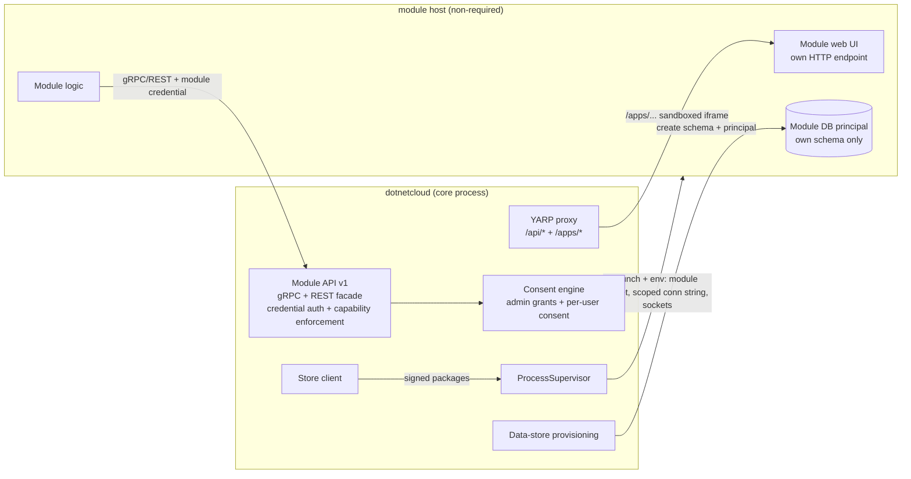

# Third-Party Module Sandbox & Module Store — Implementation Plan

> **Status:** Approved — ready for implementation · **security review applied 2026-09-15 (§2.1)** · **reconciled against current code 2026-11-06 (§0, §2.1)** · **all decisions D1–D6 locked 2026-11-06 (§14)** · **security verification 2026-11-06 (§15)** · **phase A0 implemented 2026-11-06 (§5)** · **phase A1 implemented 2026-11-06 (§5)** · **phase A2 implemented 2026-11-07 (§5)** · **phase A3 implemented 2026-11-07 (§5)** · **phase A4 implemented 2026-11-07 (§5)** · **phase A5 implemented 2026-11-07 (§5)** · **phase A6 implemented 2026-11-07 (§5)** · **phase B1 implemented 2026-11-07 (§6)** · **phase B2 implemented 2026-11-07 (§6, separate repository)** · **phase B3 implemented 2026-11-07 (§6, local feed + `--file`; remote index deferred per D6)**
> **Branch:** `feature/third-party-modules` (the plan's original name `feature/third-party-module-support` was never created)
> **Last Updated:** 2026-11-07 (phase B3 complete — `ModulePackageInstaller` state machine with health-check rollback, `IModuleStoreService` + local feed, CLI `install --file|--from-feed`/`verify`/`info`/`rollback`, admin install/inspect/rollback API and `/admin/store`, `Modules:Store` trust configuration)
> **Code baseline:** version `0.7.0` (`Directory.Build.props`), .NET SDK `10.0.100` (`global.json`)
> **Audience:** implementation agents (assumes knowledge of .NET 10 / EF Core / gRPC / Blazor, not of this repo's module history)

---

## 0. Code reconciliation — 2026-11-06

The plan was written on 2026-09-15. Several security and module-runtime changes have landed since, and the plan's description of the current state (§3) had become materially wrong. This revision was produced by reading the current working tree; every corrected statement is reflected in the sections below. The deltas that change **how** the work is done:

| Area                    | Plan assumption (2026-09-15)                                                                           | Current code (2026-11-06)                                                                                                                                                                                                                                                                     | Effect on this plan                                                                                                                                                  |
| ----------------------- | ------------------------------------------------------------------------------------------------------ | --------------------------------------------------------------------------------------------------------------------------------------------------------------------------------------------------------------------------------------------------------------------------------------------- | -------------------------------------------------------------------------------------------------------------------------------------------------------------------- |
| Module→core identity    | `module-id` metadata was the only claim; any local process could impersonate a module                  | `ProcessSupervisor` mints a per-launch 32-byte secret (`DOTNETCLOUD_MODULE_SECRET`); `AuthenticationInterceptor` validates `module-id` + `module-secret` with a constant-time compare; `ModuleCredentialStore` is **in-memory** and rotates on every module start                             | A0's stopgap and A2's "invent tokens" are largely **done**; A2 becomes an _extension_ (D2 rename, audit/rotation surface, proto versioning), not a greenfield scheme |
| Caller identity         | `CallerContextInterceptor` trusted `caller-user-id`, `caller-type` (incl. `System`) and `caller-roles` | Those headers are no longer read at all: the interceptor verifies a core-signed `caller-user-assertion` (`ModuleAssertionKeyRing`), re-resolves roles from the identity store, and cannot produce `CallerType.System`                                                                         | Claimed-identity hardening is **done**; residual A0 work is narrower (§5, A0)                                                                                        |
| Capability enforcement  | `CapabilityValidator` was dead code; `CoreCapabilitiesServiceImpl` enforced nothing                    | `CapabilityGrantInterceptor` enforces `ModuleCapabilityGrants` per call for 12 RPCs; `CapabilityValidator.GetCapabilityTier` is live; `ValidateAsync` still has **no call site**                                                                                                              | Gap #3 is **partially** closed. A0 maps the remaining RPCs; A2 replaces the interceptor with `ModuleAccessEvaluator`                                                 |
| Core→module channel     | Anonymous                                                                                              | All 14 module hosts and the search-extraction host register `ModulePeerAuthenticationInterceptor`; `GrpcChannelManager` presents the same secret as gRPC call credentials                                                                                                                     | The "symmetric core→module authentication" item in §13 is **partly done**; A4/A5 must preserve it                                                                    |
| Transport               | Loopback TCP                                                                                           | Per-module Unix socket (Linux) / named pipe (Windows) by default, selected once from `Modules:Transport`; `Modules:Transport=Tcp` is the documented fallback. `ProcessSupervisorOptions.PreferTcpTransport` defaults to `false` and is honoured, not forced                                   | A4 is **done** (§5); `PreferTcpTransport` no longer overrides the setting at two call sites                                                                          |
| Manifest                | v1 fields as listed                                                                                    | Same v1 model — but `schemaProvider` is parsed and **never read** (`DbContextSchemaProvider`'s hard-coded dictionary decides), and `minCoreVersion` is parsed and **never enforced**                                                                                                          | A1 must make the manifest authoritative and add version enforcement                                                                                                  |
| Example module          | "Reference implementation"                                                                             | Its host has **no Kestrel listener and never reads `DOTNETCLOUD_GRPC_ENDPOINT`**; it also has no DataProtection setup. It is not supervisor-addressable today                                                                                                                                 | A1 must first make Example runnable under the supervisor                                                                                                             |
| Module DB / config      | Shared `config.json` + core credentials                                                                | Unchanged: `DOTNETCLOUD_CONFIG_DIR`/`DOTNETCLOUD_DATA_DIR` are still forwarded; `config.json` carries the core connection string, TLS paths, admin email and the plaintext `WopiTokenSigningKey`                                                                                              | A1's scope is unchanged (still the largest gap)                                                                                                                      |
| Settings plane          | `IModuleSettings` available for `dataStore: "none"` modules                                            | `IModuleSettings` is an **empty marker interface with no implementation**; `GetSetting`/`SetSetting` are no-op stubs returning "not found"/"success"                                                                                                                                          | New dependency: `dataStore: "none"` needs the settings plane built first (§11 R16)                                                                                   |
| Consent                 | OIDC consent page exists                                                                               | `OidcClientSeeder` sets `ConsentTypes.Explicit`, but `/connect/authorize` **signs the user in immediately** — there is no consent page or step                                                                                                                                                | A3 grows by a consent-UI workstream (§5, A3)                                                                                                                         |
| Credential entity       | `ModuleCredential` DB table                                                                            | No such entity; the live credential is the in-memory `ModuleCredentialStore`                                                                                                                                                                                                                  | Decided (D1): keep credentials ephemeral — no table                                                                                                                  |
| Optional-module schemas | "already have dedicated schemas"                                                                       | True, but 7 of the 9 non-required modules are **core-migration-managed** through `DbContextSchemaProvider` (tracks, photos, music, video, ai, bookmarks, email); Example is self-managed and About has no DbContext                                                                           | A1/Track C must move them to self-migration without breaking migration history (§11 R20)                                                                             |
| Module install          | Install from a package                                                                                 | `dotnetcloud module install` only inserts a DB row with `Version = "1.0.0"`; there is no package install/uninstall path                                                                                                                                                                       | B3 replaces the stub                                                                                                                                                 |
| Documentation           | `CROSS_MODULE_TRUST.md` only                                                                           | 10+ documents repeat the false transport claims (`SECURITY_MODEL.md`, `ARCHITECTURE.md` §5, `MODULE_DEVELOPMENT.md`, `docs/modules/chat/ARCHITECTURE.md`, `AI_ASSISTANT.md`, `SEARCH.md`, `admin/PIM_MODULES.md`, `admin/server/INSTALLATION.md`, `SECURITY_REVIEW_FINDINGS.md`, SOC2 report) | A0's truth-pass scope is larger than originally stated                                                                                                               |

**None of the phases in §5–§7 has been started.** There is no `module_api.proto`, no `src/SDK`, no `.dncpkg` tooling, no store client, no staging feed, and no `ModuleDataStore`/`ModuleUserConsent`/`ModuleCredential` entity. The only sandbox work already in the tree is the module transport identity described above, which the 2026-09-15 plan had assigned to A0/A2.

---

## 1. Purpose

DotNetCloud's architecture promises that modules are safely isolated, that third-party developers can build modules with the same power as first-party ones, and that an official module registry exists. Today, only the _process_ isolation is real. This program delivers the rest:

1. **Third-party modules must never have direct access to the DotNetCloud database.** Today every module process receives the core's DB connection string (via `config.json`) and connects directly with full credentials.
2. **Third-party modules may have their own data** — through a core-provisioned, scoped database principal they exclusively own, or no database at all.
3. **All access to DotNetCloud data flows through the server API** — a hardened, token-authenticated, capability-enforced gRPC API (canonical) with a REST/JSON facade, plus per-user consent for personal data.
4. **A module store** (Play-Store style, Nextcloud-app-store style) in a separate repository, with signed packages, a review pipeline, and a first-class install/update experience in the CLI, admin UI, and API.
5. **Dogfooding:** every _non-required_ module — first-party or third-party — must use exactly this sandboxed model.

### Goals

- Close every security gap documented in §3.2, with tests proving each closure.
- Ship a non-required module end-to-end through the sandbox + store pipeline (the Example module first).
- Keep required modules (Files, Chat, Contacts, Calendar, Notes, About) working exactly as today.
- Make the third-party developer experience workable: SDK, packaging tool, local-feed testing, plain documentation.

### Non-goals (out of scope for this program)

- Per-module OS user isolation (Linux systemd per-module users). Out of implementation scope, but **re-evaluated as a public-store launch gate** — the sandbox is not an OS boundary while all modules share the core service account (§2.1, §4.1, §13).
- Moving required modules out of the `core` schema or off their current access model.
- Store features beyond the first pass: ratings/reviews, paid modules, publisher self-service portals, automated behavior analysis.
- macOS client work (unrelated to this program).
- Zero-knowledge encryption interactions with module data (unchanged rules apply).

---

## 2. Locked decisions

These were explicitly decided with the project owner. **Do not revisit during implementation.**

| #   | Decision                                                                                                                                                                                                                                                                                                                                        | Rationale                                                                                                                          |
| --- | ----------------------------------------------------------------------------------------------------------------------------------------------------------------------------------------------------------------------------------------------------------------------------------------------------------------------------------------------- | ---------------------------------------------------------------------------------------------------------------------------------- |
| 1   | Module-owned data: manifest-declared `dataStore: "isolated" \| "none"`; core provisions a scoped DB principal + schema; module self-migrates.                                                                                                                                                                                                   | Keeps EF Core developer experience; makes cross-schema access impossible at the DB layer.                                          |
| 2   | Authorization is **hybrid**: admin-granted capabilities (system scope) **plus per-user consent** for personal data (OIDC scopes + consent UI).                                                                                                                                                                                                  | Admin controls platform power; users control their own data. Mirrors the existing OpenIddict scopes.                               |
| 3   | Module→core API: **gRPC canonical** (extend/harden the existing capability service) + **internal REST/JSON facade** for language-agnostic module backends.                                                                                                                                                                                      | Matches the mandatory gRPC architecture; REST keeps the sandbox approachable.                                                      |
| 4   | Required modules keep today's access (shared `core` schema, core-managed migrations, current credentials, in-process Blazor UI). **All non-required modules** (first-party optional + third-party) use the unified sandboxed model and must be dogfooded.                                                                                       | Required modules are a core part; everything else must prove the third-party path works.                                           |
| 5   | Module UI: module-hosted web UI embedded in a **sandboxed iframe** via the core proxy + `postMessage` handshake.                                                                                                                                                                                                                                | Third-party assemblies cannot load into the core process without destroying process isolation.                                     |
| 6   | Store: full platform in repo **`DotNetCloud.ModuleStore`** (private initially, public at launch); frontend lives in that repo; Ed25519 signing (curated store key + verified-publisher keys); sites `www.dotnetcloud.net` + `modules.dotnetcloud.net` **self-hosted on IIS (Windows, host `portal6`)**, independent of the live cloud instance. | Self-contained store; private-first development; no coupling to `cloud.dotnetcloud.net`; no third-party CDN/edge account required. |
| 7   | SDK (`DotNetCloud.Modules.Sdk`) distributed via **GitHub Packages**.                                                                                                                                                                                                                                                                            | Avoids a NuGet.org dependency while keeping the dev workflow one command.                                                          |
| 8   | Transport hardening: **per-module Unix sockets (0600) / Named Pipes (ACL'd)** for gRPC + proxied HTTP, plus **per-module credentials** for identity. (Identity is implemented as per-launch module secrets — see §0/§4.3; the sockets are still to do.)                                                                                         | Removes cross-module reachability and header spoofing in one move.                                                                 |
| 9   | PostgreSQL provisioning requires `CREATEROLE` on the app role (accepted). SQL Server uses **contained database users** (see A1).                                                                                                                                                                                                                | Both keep the app account's existing privilege level as low as each engine allows.                                                 |
| 10  | Iframe home widgets ship **in the first pass**. Package hosting at launch = **GitHub Release assets**.                                                                                                                                                                                                                                          | Widget parity for non-required modules; stable, CDN-backed downloads.                                                              |
| 11  | Execution is two **parallel tracks** (sandbox + store), converging at public launch.                                                                                                                                                                                                                                                            | Store distribution without the sandbox would expose users; sequential would stall momentum.                                        |

### 2.1 Security review record (2026-09-15, applied; re-verified 2026-11-06)

The 2026-09-15 review's corrections remain the basis of this plan. Re-verifying them against the current tree shows **four of the eight are now partly or fully implemented** — the remaining work is listed per item so A0/A2 are not planned twice.

| Review finding                                                              | Status at 2026-11-06                                                                                                                                                                                                                                            | Remaining work                                                                                                                                               |
| --------------------------------------------------------------------------- | --------------------------------------------------------------------------------------------------------------------------------------------------------------------------------------------------------------------------------------------------------------- | ------------------------------------------------------------------------------------------------------------------------------------------------------------ |
| Enforcement never happens (`CapabilityValidator` dead, no grant checks)     | **Partly closed.** `CapabilityGrantInterceptor` enforces 12 RPCs against `ModuleCapabilityGrants`; `GetCapabilityTier` is live; `ValidateAsync` still unused                                                                                                    | Map the unmapped RPCs (`LogAudit`, `SubmitSearchIndex`, `GetGroupsForUser`); fix `BroadcastRealtimeEvent`'s Public-tier mapping; A2 replaces the interceptor |
| Claimed-identity spoofing (`caller-user-id`, `caller-type`, `caller-roles`) | **Closed.** Headers no longer read; core-signed `caller-user-assertion` verified; roles resolved server-side; `System` unreachable from module transport                                                                                                        | Keep it closed: A2/A5 must not reintroduce trusted claim headers                                                                                             |
| Same-OS-user trust boundary                                                 | **Unchanged** — still API/config/data-layer only; credentials do not isolate same-UID processes (F1)                                                                                                                                                            | A2 (identity), A4 (transport), honest docs (§4.1), §13 launch gate                                                                                           |
| Token design (audience, lifecycle, secret handling)                         | **Partly exists but out of plan.** Per-launch secret + constant-time compare + peer authentication exist; no audience binding, no persistence, no rotation/revocation API, no admin surface                                                                     | A2 extends the existing scheme (§4.3, §14 D1/D2)                                                                                                             |
| Consent plane                                                               | **Not started**, and the consent UI the plan assumed **does not exist**                                                                                                                                                                                         | A3, including building the consent page                                                                                                                      |
| Event & audit authenticity                                                  | **Partly closed.** `PublishEvent` no longer trusts a caller field and uses the verified module identity; `LogAudit` uses the verified context when present. Undeclared event types are still not validated; `SubmitSearchIndex` still trusts `request.ModuleId` | A0 (identity fields), A2 (manifest-validated events)                                                                                                         |
| Distribution hardening                                                      | **Not started** (no packaging exists)                                                                                                                                                                                                                           | B1/B3 as written                                                                                                                                             |
| Docs truth pass                                                             | **Not started**; scope is larger than the original single file                                                                                                                                                                                                  | A0 documents the inventory; Track D completes it                                                                                                             |

---

## 3. Current-state inventory (read this first)

### 3.1 How a module runs today (verified 2026-11-06)

- `ProcessSupervisor.SpawnModuleProcess` (`src/Core/DotNetCloud.Core.Server/Supervisor/ProcessSupervisor.cs:362`) launches each module host with:
  - `DOTNETCLOUD_MODULE_ID`, `DOTNETCLOUD_MODULE_SECRET` (per-launch, from `ModuleCredentialStore.Issue`), `DOTNETCLOUD_ASSERTION_PUBLIC_KEY`, `DOTNETCLOUD_GRPC_ENDPOINT` (loopback TCP port), `DOTNETCLOUD_CORE_ENDPOINT` (lines 413–418)
  - forwarded `DOTNETCLOUD_CONFIG_DIR` and `DOTNETCLOUD_DATA_DIR` (lines 422–423, with an explicit comment that modules need them for `config.json`, DataProtection keys, and file storage)
- **Path containment** exists but uses a weak `StartsWith(modulesDir)` prefix test at lines 369–386 (the sibling-prefix bypass is still present). `ModuleDiscoveryService` already does this correctly with `Path.GetFullPath` + `Path.GetRelativePath` (lines 103–119) — reuse that pattern.
- Module hosts share the core DataProtection key ring: core `Program.cs:274–283` and 13 of 14 hosts persist keys to `<DOTNETCLOUD_DATA_DIR>/data-protection-keys` with `SetApplicationName("DotNetCloud")`. **Example is the exception** — it configures neither DataProtection nor Kestrel.
- Runtime transport (phase A4, implemented 2026-11-07) is cleartext h2c over a **per-module Unix domain socket** on Linux/macOS (`<dataDir>/modules/<moduleId>/run/module.sock`, mode `0600`) or a **per-module Windows named pipe** (`\\.\pipe\dotnetcloud-<moduleId>`, `PipeOptions.CurrentUserOnly`), chosen once by `ModuleTransportSelection` from `Modules:Transport`. `Modules:Transport=Tcp` (or the legacy `ProcessSupervisor:PreferTcpTransport=true`) keeps loopback TCP inside `TcpPortRange` for deployments where the core and its module processes do not share a filesystem. Every host binds through the shared `ModuleGrpcEndpointBinding` helper, so `unix://` / `net.pipe://` endpoints are no longer rewritten to `http://`. The core's own module-facing gRPC listener stays on loopback TCP (`TcpPortRangeStart`) — modules dial it with `DOTNETCLOUD_CORE_ENDPOINT`.
- Module hosts load `config.json` from `DOTNETCLOUD_CONFIG_DIR` and connect a module-owned `DbContext` to the **same database with the same credentials** as core. That file contains `ConnectionString`, `DatabaseProvider`, `TlsCertificatePath`, `UseLetsEncrypt`, `AdminEmail`, `WopiTokenSigningKey` (plaintext) and the data/log/backup directories (`CliConfig`, `src/CLI/DotNetCloud.CLI/Infrastructure/CliConfiguration.cs:179–336`).
- Module→core capability calls use `module_capabilities.proto` (`dotnetcloud.capabilities`, 15 RPCs) implemented by `CoreCapabilitiesServiceImpl` in `Grpc/Services/GrpcHealthServiceImpl.cs:24`. **Current enforcement:** `AuthenticationInterceptor` (module id + per-launch token), `CallerContextInterceptor` (core-signed user assertion), and `ModuleAccessInterceptor` → `ModuleAccessEvaluator` (per-call grants for all 15 RPCs plus the canonical `module_api` surface — `LogAudit`→`IAuditLogger`, `SubmitSearchIndex`→`ISearchProvider`, `GetGroupsForUser`→`ITeamDirectory`, `BroadcastRealtimeEvent`→`IRealtimeBroadcaster`; mapping keyed by fully-qualified method in the shared `CapabilityCatalog`). `GetCurrentUser` returns the verified caller since A0; `GetSetting`/`SetSetting` are persistent since A1.
- Capability grants are **auto-provisioned from the manifest** at startup (`EnsureManifestGrantsAsync`, `ProcessSupervisor.cs:908`) for every Restricted/Privileged capability, with no operator step. The manifest is treated as the install-time request.
- `InstalledModule` rows are reconciled on every startup: `SyncDiscoveredModulesToDatabaseAsync` (`ProcessSupervisor.cs`) upserts version, `IsRequired`, trust tier (never silently promoted), data-store mode and sandbox state, while preserving the operator-controlled `Status`. (The pre-A1 tree was insert-only.) Operator lifecycle changes made through the CLI are applied by the supervisor, which reconciles `Disabled`/`Enabled`/`RestartPending` against the live processes every 30 s and skips `Disabled` modules at startup.
- Core→module REST calls are reverse-proxied by YARP (`MapModuleApiProxies`, `Program.cs:1255`; 23 `api/v1/*` prefixes at 1263–1288). The transformer forwards the user's auth cookie, appends `X-Forwarded-Proto`, and **mints the core-signed `caller-user-assertion`** (lines 1400–1440). No `/apps/` proxy exists.
- Module UI is compiled into the core process: `ModuleUiRegistrationHostedService` (13 static page descriptors, `Initialization/ModuleUiRegistrationHostedService.cs:17–123`, including an extra `tracks.item` fullscreen page), `WidgetUiRegistrationHostedService` (12 widgets, no About widget), and `AddAdditionalAssemblies` (`Program.cs:1079`). Descriptor icons are **emoji string literals**, not `MaterialIcon` names.
- `DotNetCloud.Core.Server.csproj` holds **49** module `ProjectReference`s (RCL + Data + Data.SqlServer triples for 11 modules, Files split out, About RCL, and 12 Widget projects). No module `Host` projects are referenced.
- `manifest.json` v1 fields (`ModuleManifestLoader.cs:9–50`): `id`, `name`, `version`, `description`, `author` (free text), `requiredCapabilities`, `publishedEvents`, `subscribedEvents`, `minCoreVersion`, `restartPolicy`, `memoryLimitMb`, `schemaProvider` (default `"self"`). There is no `manifestVersion`, `moduleApiVersion`, `publisher` object, `dataStore`, `ui`, or `userConsentScopes`.
- Manifest validation today checks only: lowercase, dot-separated id matching the directory name, semver, restart-policy enum and positive memory limit. Parsing is case-insensitive and allows comments/trailing commas. **`schemaProvider` and `minCoreVersion` are parsed but never consumed.**
- Schema strategy: required modules share the `core` schema; optional modules have dedicated schemas — but all with the same core credentials. **Which provider runs is decided by `DbContextSchemaProvider.ModuleDbContextTypes`** (`Services/DbContextSchemaProvider.cs:35–49`), not by the manifest. That dictionary covers 12 modules — the five required ones plus 7 non-required (tracks, photos, music, video, ai, bookmarks, email) — and `SelfManagedSchemaProvider` is the fallback for Example/About. `ModuleSchemaService` dispatches first-match under a per-module lock.
- Supervisor lifecycle: only `HealthCheck` and `Stop` RPCs are called (`ProcessSupervisor.cs:557–560`, `677`); `ModuleLifecycle.Initialize`/`Start` are never invoked. `ProcessSupervisorOptions.UnhealthyThreshold` (default 3) **is honoured since A6**: consecutive probe failures are counted per module and, at the threshold, the supervisor force-kills the process and hands it to the normal restart policy (back-off, max attempts, alert-only).
- The search-extraction host (`src/Core/DotNetCloud.Core.Search.Extraction.Host`) is a **core-owned process**, not a module; it already authenticates core→host calls with `ModulePeerAuthenticationInterceptor` and is out of scope for this program.

### 3.2 Security gaps being closed

| #   | Gap                                                                                                                                                                                                                                                   | Current evidence (2026-11-06)                                                                                            | Closed by                                                                                              |
| --- | ----------------------------------------------------------------------------------------------------------------------------------------------------------------------------------------------------------------------------------------------------- | ------------------------------------------------------------------------------------------------------------------------ | ------------------------------------------------------------------------------------------------------ |
| 1   | Every module process can read core DB credentials (`config.json` contains `connectionString`, TLS paths, admin email, the WOPI signing key) and read/write any schema in the database.                                                                | `ProcessSupervisor.cs:422–423` still forwards the dirs; `CliConfiguration.cs:179–336` still holds those values           | A1 (scoped principals, config split)                                                                   |
| 2   | Module identity is bound to a **per-launch in-memory secret** with no rotation API, revocation surface or audit trail. Anyone running as the core service account can read the secret from the module's environment.                                  | `ModuleCredentialStore.cs` (`ConcurrentDictionary`, "intentionally in-memory"); `AuthenticationInterceptor.cs:78–113`    | A2 (ephemeral, auditable credential lifecycle — D1)                                                    |
| 3   | Capability enforcement is **incomplete**, not absent: all 15 RPCs are mapped since A0, but enforcement is per-call in an interceptor rather than an evaluator, and settings persistence is still stubbed.                                             | `CapabilityGrantInterceptor.cs:33–46`; `GrpcHealthServiceImpl.cs:128–140, 268–292, 563`                                  | A0 (map remaining RPCs, fix identity echo) + A2 (`ModuleAccessEvaluator` + shared `CapabilityCatalog`) |
| 4   | Module processes share the core DataProtection key ring (cookie forgery risk), listen on loopback TCP (any local process can connect), and share one data directory. Example additionally lacks DataProtection and a supervisor-addressable listener. | 13 hosts' `AddDataProtection(...)`; `Listen(IPAddress.Loopback, ...)`; `DOTNETCLOUD_DATA_DIR`; `Example.Host/Program.cs` | A1 (key ring + dirs + Example host) + A4 (per-module sockets)                                          |
| 5   | Third-party module UI is impossible, and optional first-party UI/widgets run **in-process** in the core web app.                                                                                                                                      | `ModuleUiRegistrationHostedService`, `WidgetUiRegistrationHostedService`, csproj references                              | A5 (iframe plane) + Track C                                                                            |
| 6   | **Restricted/privileged capabilities are auto-granted from the manifest at startup** (`EnsureManifestGrantsAsync`), so an installed module self-authorizes. Harmless for in-repo modules; unacceptable for store packages.                            | `ProcessSupervisor.cs:908–960`                                                                                           | A1 (trust-tier gate) + B3 (admin review step)                                                          |
| 7   | **`dataStore: "none"` has no persistence plane**: `IModuleSettings` is an empty interface, `GetSetting`/`SetSetting` are stubs, and there is no module settings table.                                                                                | `IModuleSettings.cs`; `GrpcHealthServiceImpl.cs:294–315`                                                                 | A1 (settings plane, new deliverable)                                                                   |
| 8   | **Compatibility metadata is decorative**: `minCoreVersion` is enforced at start since A0; `schemaProvider` is parsed but never consumed (removed in A1 per D5).                                                                                       | `ModuleManifestLoader.cs:36, 49` (rg: no consumers)                                                                      | A0 (manifest v1 enforcement) + A1 (v2 loader)                                                          |

**Additional findings from the 2026-09-15 review, re-validated 2026-11-06:**

- **Claimed-identity spoofing — CLOSED.** `CallerContextInterceptor.cs:130–170` verifies a core-signed assertion and resolves roles server-side; `CallerType.System` is unreachable. Remove this item from A0; keep it as a regression suite.
- **Supervisor path-containment bug — STILL PRESENT.** `SpawnModuleProcess` uses a `StartsWith(dir)` prefix test with a sibling-prefix bypass (`/data/modules-evil/…` passes for `/data/modules`). Fixed in A0 with a regression test.
- **Core gRPC server sets `EnableDetailedErrors = true` — STILL PRESENT** and unconditional (`SupervisorServiceExtensions.cs:84`). Only `ErrorHandlingInterceptor` masks messages outside Development. Fix in A0.
- **Security documentation states controls that do not exist — STILL PRESENT, and broader than one file.** `docs/security/CROSS_MODULE_TRUST.md` (dated May 14) claims Unix sockets, 0600 permissions and mutual TLS; deployed reality is cleartext h2c on loopback TCP authenticated by the supervisor-issued secret. The same false transport claim appears in `SECURITY_MODEL.md:9,44–45`, `ARCHITECTURE.md:83,107–108`, `guides/MODULE_DEVELOPMENT.md:32`, `modules/chat/ARCHITECTURE.md:5,15`, `modules/AI_ASSISTANT.md:55`, `modules/SEARCH.md:58`, `admin/PIM_MODULES.md:312`, `admin/server/INSTALLATION.md:48–50`, `SECURITY_REVIEW_FINDINGS.md:206,336` and the SOC2 auditor report. Truth pass ships in A0 with that inventory; Track D completes it.

### 3.3 What stays unchanged

For **required modules only** — `dotnetcloud.files`, `dotnetcloud.chat`, `dotnetcloud.contacts`, `dotnetcloud.calendar`, `dotnetcloud.notes`, `dotnetcloud.about` (`RequiredModules.cs`):

- Shared `core` schema, core-managed migrations, current connection-string delivery.
- In-core Blazor pages and home widgets.
- They DO receive the A2 hardening (credential auth + runtime capability enforcement) because those are transport/authorization changes to the core API, not access-model changes.

### 3.4 Infrastructure to reuse (do not reinvent)

- **Module transport identity (already implemented):** `ModuleIdentityMetadata` (`module-id`, `module-secret`, `caller-user-assertion` headers + env var names — renamed to `dnc-module-id`/`dnc-module-token`/`dnc-user-assertion` in A2 per D2), `ModuleCredentialStore`, `ModuleAssertionKeyRing`, `ModulePeerAuthenticationInterceptor`, `GrpcChannelManager` call credentials, and `ModuleApiProxyTransformer` assertion minting. A2 extends and renames these in one release.
- `IModuleSchemaProvider` split (`DbContextSchemaProvider` / `SelfManagedSchemaProvider` / `ModuleSchemaService`) — extend, don't replace; extract the module→DbContext dictionary into registration the manifest can drive.
- `CapabilityValidator` tier lists (`src/Core/DotNetCloud.Core.Server/ModuleLoading/CapabilityValidator.cs:65–88`) — extract to a shared `CapabilityCatalog` in `DotNetCloud.Core` used by the interceptor/evaluator, provisioning and the SDK. Note it currently lives in the **Server** project, so the SDK cannot reference it.
- `CapabilityGrantInterceptor` — template for `ModuleAccessEvaluator` (same deny code, audit hook, 60 s cache).
- `ModuleManifestLoader` + `ModuleDiscoveryService` — extend for v2; keep v1 leniency for required modules.
- `ModuleUiRegistry` / `WidgetUiRegistry` (`src/UI/DotNetCloud.UI.Web/Services/`) and the two registration hosted services — the registration seam for iframe descriptors.
- `GitHubUpdateService` + `UpdateController` + `IMemoryCache`/semver patterns — template for the store index client.
- OpenIddict seeding (`OidcClientSeeder`) with `files:read|write` and `bookmarks:read|write` scopes and `ConsentTypes.Explicit` — template for module OIDC clients. **The consent page must be built**: `/connect/authorize` (`Extensions/OpenIddictEndpointsExtensions.cs:87–152`) currently calls `Results.SignIn` unconditionally.
- `IAuditLogger` + `AuditLogService` (`AuditAction` has 9 CRUD/share values only) — add module-lifecycle actions; all new security events are audit-logged.
- `IProcessSupervisor` health monitoring (15 s probe, exponential restart) + `ResourceLimiter` (cgroups v2 / Job Objects) + `ModulesAggregateHealthCheck` (feeds `/health/ready`, reports per-module sandbox status since A6).
- `ModuleConfigurationLoader` + `SystemSettings` — the existing per-module config read path; `IModuleSettings` should be implemented on top of it rather than a new store.
- `Extensions/ModuleDbContextConfiguration` / `DbResiliencePolicy` — module DbContext provider + migrations-assembly wiring used by both core and hosts.
- Test infrastructure (all exist): `tests/DotNetCloud.Core.Server.Tests` (incl. `Grpc/ModuleTransportAuthenticationTests.cs`), `tests/DotNetCloud.Integration.Tests.PostgreSQL`, `tests/DotNetCloud.Integration.Tests.SqlServer`, `tests/DotNetCloud.CLI.Tests`, `tests/DotNetCloud.Modules.Example.Tests`.

### 3.5 Related repositories (separate workstreams)

| Repo                                               | Role in this program                                                                                         | Notes                                                                          |
| -------------------------------------------------- | ------------------------------------------------------------------------------------------------------------ | ------------------------------------------------------------------------------ |
| `DotNetCloud.ModuleStore` (new, private initially) | Store packages, index, tooling, policy, store frontend                                                       | Goes public at launch                                                          |
| `DotNetCloud-WebSite` (existing)                   | `www.dotnetcloud.net` marketing site                                                                         | Static HTML/CSS/JS; add a Modules/Store entry; deploy to IIS on `portal6` (B4) |
| This repo (`DotNetCloud`)                          | Core sandbox (Track A), store client (B3), packaging tool (B1), dogfood migrations (Track C), docs (Track D) | Branch `feature/third-party-modules`                                           |

**Rule:** no committed document in this repo may reference private deployment topology (host names, IPs, machine names). The store and sites must not depend on the production cloud instance.

---

## 4. Target architecture



### 4.1 Trust tiers

| Tier                                      | Modules                                                     | DB access to `dotnetcloud`                      | Config visibility            | UI hosting                 |
| ----------------------------------------- | ----------------------------------------------------------- | ----------------------------------------------- | ---------------------------- | -------------------------- |
| **Required** (in-repo, shipped with core) | files, chat, contacts, calendar, notes, about               | Current: shared `core` schema, core credentials | `config.json` (unchanged)    | In-core Blazor (unchanged) |
| **Bundled optional** (in-repo, dogfooded) | ai, bookmarks, email, music, photos, video, tracks, example | Own schema via scoped principal only            | Sanitized `module.json` only | Module-hosted iframe       |
| **Store** (third-party)                   | any                                                         | Own schema via scoped principal only, or none   | Sanitized `module.json` only | Module-hosted iframe       |

**Trust-boundary statement (security review, 2026-09-15).** While all module hosts run as the same OS user as the core process, the sandbox is an **API, configuration, and data-layer boundary — not an OS boundary**. Concretely:

- Socket files (0600) and named-pipe ACLs do **not** prevent one module from connecting to another module's socket; per-module directories and the env-variable config split are isolation-by-configuration, and anything the core service user can read (e.g. files under the data directory) remains readable to module processes by path.
- Per-module credentials (A2) distinguish modules at the API layer and block other OS users, but they are **not** an identity guarantee against a same-UID process. A module can read a sibling's environment (`/proc/<pid>/environ`), its scoped DB connection string and its files, then call the core as that module. Until per-module OS isolation exists (§13), a malicious module running as the core service account can impersonate any other module; credential rotation, audit and store review bound the window but do not close it (**finding F1, §15**).
- These limitations must be stated honestly in user-facing/security documentation (see §2.1, §11 R11 and §15). Before the public store launch, per-module OS isolation is re-evaluated as a launch gate (§13).

### 4.2 Data plane

- A non-required module never sees the core connection string. It receives `DOTNETCLOUD_MODULE_DB_CONNECTION_STRING` (only when `dataStore: "isolated"`), valid **only** for its own schema and principal.
- The core provisions principals idempotently at install/first-start and stores the connection string encrypted with DataProtection in `ModuleDataStore`.
- The module self-migrates (existing self-managed pattern from the Example module; the `schemaProvider` field is removed per D5).
- **The manifest must become authoritative.** Today `DbContextSchemaProvider.ModuleDbContextTypes` (`Services/DbContextSchemaProvider.cs:35–49`) decides core-vs-self, and `manifest.schemaProvider` is never read. A1 replaces that dictionary with per-module registration and makes the v2 `dataStore` value the switch; required modules keep their hard-wired entries.
- **Migration-history continuity.** Optional modules are already migrated by the core (`MigrateAsync` inside `DbContextSchemaProvider`), so `<moduleSchema>.__EFMigrationsHistory` exists and is owned by the core role. Adoption (§9) must transfer ownership **including that table**, otherwise the module's first self-migration either sees no history and re-applies migrations or is denied write access. Add a per-module assertion to the adoption tests.
- **`dataStore: "none"` needs a settings plane that does not exist yet.** `IModuleSettings` (`src/Core/DotNetCloud.Core/Capabilities/IModuleSettings.cs`) is an empty marker interface, `GetSetting`/`SetSetting` are no-op stubs, and `ModuleConfigurationLoader` only _reads_ `SystemSettings`. A1 implements a module-settings table/service (D4, decided), so `none` is a supported mode.
- **Config split contents.** `config.json` today carries more than the connection string: TLS certificate paths, `AdminEmail`/`AdminUsername`, WOPI signing key, and backup/log/data paths. A1's sanitized `module.json` must not become a copy of it; enumerate the allowed keys explicitly.
- Setup currently creates the app DB role with `CREATEDB` but **not `CREATEROLE`** (`src/CLI/DotNetCloud.CLI/Infrastructure/DatabaseSetupHelper.cs:76`), so PostgreSQL provisioning will fail on every existing install until setup grants it. A1 updates setup and the prerequisite check.
- Uninstall destroys the principal + schema on explicit admin confirmation; a "keep data" option marks the store orphaned instead.

### 4.3 API plane

- One service definition (`module_api.proto`, package `dotnetcloud.moduleapi.v1`) is the canonical module→core contract; the legacy `module_capabilities.proto` surface keeps working for required modules and maps to the same implementation.
- **Build on the existing identity scheme; rename it once (D2, decided).** The code already ships per-launch module secrets with `module-id` + `module-secret` metadata (`ModuleIdentityMetadata`), a core-signed `caller-user-assertion`, and a module-side `ModulePeerAuthenticationInterceptor`. A2 renames the metadata to `dnc-module-id` / `dnc-module-token` / `dnc-user-assertion`, and the secret env var to `DOTNETCLOUD_MODULE_TOKEN` (from `DOTNETCLOUD_MODULE_SECRET`; `DOTNETCLOUD_MODULE_ID` and `DOTNETCLOUD_ASSERTION_PUBLIC_KEY` keep their names), in **one release** across `ModuleIdentityMetadata`, all 14 hosts, `GrpcChannelManager`, `ModuleApiProxyTransformer`, `ModulePeerAuthenticationInterceptor` and the tests. No dual-scheme compatibility window is needed because every producer and consumer is in-repo and ships together; header-name drift between core and SDK is the failure mode to avoid.
- Every call is authenticated by the module credential; the credential is generated by `ModuleCredentialStore.Issue` (32 CSPRNG bytes, standard Base64) and compared in constant time, and it rotates on every module start. A2 adds an auditable issuance record (issued-at/revoked-at/hint — never the secret) and an explicit rotate/revoke admin action, and keeps the credential **ephemeral** (D1, decided): no database table and no secret at rest.
- Every RPC maps to a capability name; `ModuleAccessEvaluator` checks grants (cached, invalidated on grant/revoke), denies with `PERMISSION_DENIED`/403 + `error-code: CAPABILITY_NOT_GRANTED`, and audit-logs denials. It replaces `CapabilityGrantInterceptor`, whose map covers only 12 of 15 RPCs.
- **Close the four known authorization holes in the legacy service (A0):**
  - `GetCurrentUser` returns `request.Caller?.UserId` instead of the verified `UserState["CallerContext"]` (`GrpcHealthServiceImpl.cs:128–140`).
  - `SubmitSearchIndex` trusts `request.ModuleId` and is not in the interceptor map (`:268–292`).
  - `LogAudit` and `GetGroupsForUser` are not in the interceptor map.
  - `BroadcastRealtimeEvent` maps to Public `INotificationService`, so any authenticated module can broadcast any allowed event (`:563`).
- **Subject binding (F4):** every user-scoped RPC derives the acting user from the verified `dnc-user-assertion`, never from a request field. Where a payload carries a user id, the core compares it to the assertion subject and rejects mismatches (the pattern `FilesGrpcService` already uses). `GetUser`/`SearchUsers` return a minimal profile (no email/phone) unless a per-target consent or an admin grant allows more; otherwise they are a PII enumeration vector. Negative tests for cross-user reads are required.
- **Settings scoping (F7):** `GetSetting`/`SetSetting` are namespaced by the **authenticated module id**; a module cannot read or write another module's keys or `SystemSettings`. `ModuleSetting` uses (`ModuleId`,`Key`) and the core stamps `ModuleId` from the credential.
- **Storage namespacing (F5):** `IStorageProvider` is confined to a per-module container/prefix and to the acting user where data is user-owned. The core enforces the namespace; a module never addresses another module's or user's blobs by path.
- **Notification/realtime authenticity (F6):** `INotificationService` and `BroadcastRealtimeEvent` must attribute the module (and its publisher) in the rendered notification, escape and length-limit module-supplied content, rate-limit per module, and never render arbitrary links from module text. Re-tier them away from Public (A0/A2): a Public notification capability is a platform-branded phishing channel.
- REST/JSON facade on the same internal listener (`/internal/moduleapi/v1/...`) with identical auth + evaluation, per-module rate limits, and the standard error envelope. **No such facade exists today**; the only module REST surface is the browser-facing YARP proxy.
- **Token audience binding:** module credentials are usable only for the module→core API. Proxy-injected user context (currently the `caller-user-assertion`, renamed `dnc-user-assertion` in A2 per D2) is audience-restricted to the specific module, scope-restricted to the module's declared scopes ∩ the user's consent, short-lived, and rejected by core user APIs and by other modules. `ModuleApiProxyTransformer` already mints the assertion; A2/A5 add audience + scope claims to it rather than introducing a second token type.
- **Token/secret lifecycle:** generated at **every module start** (32 CSPRNG bytes, Base64; constant-time comparison), rotated on credential rotation and on module update/reinstall; per-start rotation limits the value of a secret leaked to a sibling process (F1, §4.1). Secret material never appears in files, logs or the admin UI (only a hint).
- **Claimed-identity hardening — already implemented.** `caller-type`/`caller-roles` are never accepted from module metadata; `System` is derived server-side only; `caller-user-id` is not trusted at all (the signed assertion is). Keep this invariant in the new proto: do not add a `caller` message field that the caller can populate (the current `PublishEventRequest` already reserves field 1 for exactly this reason).
- **Event & audit authenticity:** `PublishEvent` validates event types against the authenticated module's manifest `publishedEvents` (undeclared types rejected + audited); the core stamps `sourceModule`; consumers never trust sender fields. `BroadcastRealtimeEvent` is limited to declared realtime event names with payload/rate validation. `LogAudit` attributes entries to the authenticated module identity — never a request field. Today only the identity half is done.
- **Legacy surface:** every legacy RPC (including `CleanupAdminSharedFolder`, `SubmitSearchIndex`, `GetGroupsForUser`) maps to an explicit capability, and `TokenIntrospectionServiceImpl` is protected by the same credential scheme plus **scope filtering** — today it validates the caller module id but returns the token's full scope set with `ValidateAudience = false` (`TokenIntrospectionServiceImpl.cs:45–56, 117`).
- The core gRPC server disables `EnableDetailedErrors` outside Development (`SupervisorServiceExtensions.cs:84`).

### 4.4 Consent plane

- Personal-data access requires a per-user consent grant for the (module, user, scope) tuple — on top of the admin's capability grant.
- **What consent is for — a concrete example.** The admin installs a third-party "Receipt Scanner" module whose manifest declares `userConsentScopes: ["files:read"]`. The admin's capability grant only means "this module may call the storage API at all"; it must not silently mean "this module may read every user's files". When the module calls a storage RPC for Alice, the core checks the admin grant **and** `(module, Alice, files:read)` in `ModuleUserConsent`. If Alice never approved it, the call fails with `MODULE_CONSENT_REQUIRED` and the module UI asks core chrome to render: "Receipt Scanner wants to read your files — Allow / Deny". Alice's decision is stored, listed on her "Connected apps" page, and revocable at any time. Without this layer, installing a module would give its publisher access to every user's data with no user-visible decision: the admin installs software for the server, but each user owns their own files, mail, contacts and calendar.
- **Consent is not a second login and does not replace admin control.** It is a per-user approval record for a specific module + scope. System capabilities (notifications, event bus, settings, audit, search submit) never need it because they do not expose personal data.
- Consent is modelled on OpenIddict: each installed module is registered as an OAuth2 client (`dnc-module-<short>`); user consent is an explicit authorization grant for the module's declared scopes.
- **The consent UI does not exist and is a net-new deliverable.** `OidcClientSeeder` registers the desktop/mobile/browser-extension clients with `ConsentTypes.Explicit`, but `/connect/authorize` authenticates and calls `Results.SignIn` immediately (`Extensions/OpenIddictEndpointsExtensions.cs:87–152`). A3 must add the consent page/step and only then can `ConsentTypes.Explicit` become meaningful. **D3 decided:** the three first-party clients are switched to `ConsentTypes.Implicit` (or an explicit allow-list exemption) in the same change, so their sign-in is unchanged; only `dnc-module-*` clients are `Explicit` and prompt. This also removes the need to build a consent path into the device flow for the browser extension.
- **Consent decisions are security-sensitive forms (F9):** grant/deny/revoke are POST-only, anti-forgery protected, and served on a non-frameable page (`frame-ancestors 'none'`), never inside a module iframe or a popup the module can navigate. Add tests for auto-approve and clickjack attempts.
- **Scope catalog is new.** Only `files:read|write` and `bookmarks:read|write` are registered today (in three client seeders, not in a shared catalog). The plan's scope list must be created once in `DotNetCloud.Core` and reused by `OidcClientSeeder`, the consent UI, the module clients and `TokenIntrospectionServiceImpl` filtering.
- A user-facing "Connected apps" page lists modules with access, scopes, and a revoke action; admins see consent stats on module detail pages.
- When an update introduces new scopes, the module runs until it needs the new scope, then users are re-prompted.
- **Shared/team data semantics (must be decided before Track C media migrations):** per-user consent alone does not define whose consent applies when a module processes data owned by user A but accessed via user B (shared folders, teams, admin shared folders). Decide and document the model (e.g. owner-of-record consent, or share-context consent) — otherwise consent is either bypassed or functionality breaks.
- **Event delivery is consent-filtered:** events carrying user data are delivered to a subscriber module only where the (module, user, scope) consent exists (or payloads are minimized for admin-granted, consent-free event types). Without this, the event bus bypasses the consent plane.
- **Consent UI is rendered by core chrome only** — never inside a module's sandboxed iframe (fake/clickjacked consent).
- **Revocation semantics:** capability-grant and consent caches are invalidated on revoke; revocation stops future calls, not data already held by the module (store review + audit are the compensating controls).
- `notifications:send` means "this module may notify me" (user consent); the admin capability grant still gates the code path. OIDC client secrets are **not** shipped into module processes if the modules never need them (consent flows are browser↔core).
- `GetSetting`/`SetSetting` are not personal data and stay consent-free, but they must actually persist (see §4.2).

### 4.5 UI plane

- Non-required modules serve their UI from their own host process; the core proxies `/apps/{moduleId}/**` (YARP, per-module socket) and embeds it in `ModuleAppHost.razor` with `sandbox="allow-scripts allow-forms allow-popups"` (deliberately **no** `allow-same-origin`).
- A `postMessage` handshake provides theme/locale/token and supports `navigate`, `resize`, `title`, `openExternal`, `requestConsent`, `notify` events. The SDK ships `dncModuleBridge.js`.
- The proxy strips `Set-Cookie` from module responses, injects the short-lived `dnc-user-assertion` for module backend calls, and sets `frame-ancestors 'self'`. **Adapt to what exists:** the internal user context is the core-signed `caller-user-assertion` minted by `ModuleApiProxyTransformer` (Program.cs:1426–1440), and `ModulePeerAuthenticationInterceptor` already authenticates core→host. A5 should extend that assertion (audience + scopes) rather than ship a JWT if the module side has no OIDC client.
- Proxy hardening details: strip inbound `Authorization` from browser requests (only the injected aud-scoped token reaches the module), strip `Server`/`X-Powered-By`, and set `frame-ancestors 'self'` plus `base-uri 'none'`, `object-src 'none'`, `form-action 'self'`, `nosniff` on module responses.
- **`postMessage` validation:** sandboxed (opaque-origin) frames all report `event.origin === "null"`, so the host validates `event.source === iframe.contentWindow` from a per-module registry, validates the message schema, rejects unknown types, and rate-limits `dnc:notify`. The bridge validates `event.source === window.parent`.
- **Sandbox is not a network origin boundary (F2).** A module document still runs on the core origin, so its scripts can issue **credentialed, same-site** requests (the browser attaches the user's core cookies) to core endpoints, including state-changing ones. Opaque origin prevents reading responses and DOM access — not sending. Mandatory controls: (a) cookie-authenticated mutating endpoints accept only requests carrying an anti-forgery token or a custom header that cross-origin JS cannot add without a preflight, and module UI is never issued those; (b) where a module must call core APIs, it uses the scoped assertion path, not cookies; (c) add an automated test proving a module frame cannot mutate a core endpoint. If these cannot be guaranteed, the dedicated `apps.<host>` origin (§13) becomes a first-pass requirement, not a future option.
- `dnc:openExternal` accepts `https:` only (no `javascript:`/`data:`), opened with `noopener,noreferrer`; `dnc:navigate` targets pass a core allow-list (no open redirect).
- Home widgets for non-required modules render as iframe widget cards using the same plane; widgets use the same source-bound message rules (a widget cannot spoof height/notify messages for another widget).
- **Registration seam:** `ModuleUiRegistry` and `WidgetUiRegistry` already exist (`src/UI/DotNetCloud.UI.Web/Services/`) and are fed by the two hosted services. A5 adds an iframe descriptor shape; it does not need a new registry.
- **Icon rule:** the existing static descriptors use emoji literals (`📁`, `💬`, …) which violate this repo's mandatory `MaterialIcon` rule. v2 manifests must carry Material icon names (`ui.navItems[].icon`, e.g. `widgets`) and `ModuleIconProvider` must be the single mapping point.
- **Fullscreen pages:** Tracks registers an extra `tracks.item` page (`ModuleUiRegistrationHostedService.cs:66–67`). The iframe plane needs an equivalent route/`navigate` target contract before Tracks can be migrated.
- **Host component standards:** `ModuleAppHost.razor` and widget cards must follow the repo's Blazor rules — markup only in `.razor`, logic in `.razor.cs`, styles in `.razor.css`, Material icons only.

### 4.6 Distribution plane

- `.dncpkg` package = deterministic zip (manifest v2, per-RID binaries, Ed25519 signature, LICENSE/README/CHANGELOG/icon).
- Store index (v1 JSON) lists packages/versions with hashes, signatures, compatibility ranges, declared capabilities/scopes, and review status; index signed with the curated store key.
- Core installer (first release, D6): local feed / `--file` → verify → review capabilities/scopes with the admin → provision → install/update → health-check → rollback support. Remote index fetch, mirrors and automatic updates are **deferred**.
- **Package extraction is hardened independently of signatures:** `.dncpkg` extraction rejects absolute paths, `..` traversal, symlink entries, and case-collisions (zip-slip class); the embedded `manifest.id` must equal the store entry id and the install directory name. A valid signature over a malicious archive structure is still rejected.
- **Signature canonicalization must be specified, not implied (F8):** `signature.json` cannot live inside the bytes it signs. Choose exactly one scheme: (a) a detached `<package>.sig` over the finished archive, or (b) a canonical `package.lock` (manifest hash + sorted per-file SHA-256) signed with Ed25519, with the verifier rejecting any file not listed. Hash exactly the bytes that are later extracted, re-check after download, and verify before extracting. Do not accept an `alg` field from the package — the key id selects the algorithm.
- **Archive resource limits (F13):** cap entry count, uncompressed size and compression ratio (zip-bomb), reject duplicate entries, Windows reserved names/alternate data streams, and over-long paths. Any index-provided `downloadUrl` must be `https:` and resolve to a public address — block private/link-local/metadata IPs and re-check after redirects (SSRF).
- **Index anti-replay:** the client rejects an index with a `generatedAt` older than its cached index, pins the accepted `keyId` set (current + previous), and re-verifies hash + signature on every offline/`--file` install (the local cache is written by the same OS user as module processes and is treated as untrusted).
- **Revocation levels:** clear semantics — deprecation (block new installs/updates), security revocation (warn admins about installed copies; optionally stop critical-severity modules with explicit admin override) — with an operator runbook.
- Provenance/attestations (e.g. GitHub Actions attestations/SLSA) are recommended for official packages; publisher signing-key requirements are codified in the publisher agreement.

### 4.7 Manifest v2 (non-required modules)

```json
{
  "manifestVersion": 2,
  "id": "org.example.customapp",
  "name": "Custom App",
  "version": "1.2.0",
  "description": "…",
  "publisher": {
    "id": "example-org",
    "name": "Example Org",
    "url": "https://example.org"
  },
  "moduleApiVersion": 1,
  "minCoreVersion": "0.7.0",
  "maxCoreVersion": "1.0.0",
  "dataStore": "isolated",
  "handlesUserErasure": true,
  "capabilities": ["INotificationService", "IStorageProvider"],
  "userConsentScopes": ["files:read", "calendar:write"],
  "events": {
    "publishes": ["ThingCreatedEvent"],
    "subscribes": ["FileUploadedEvent"]
  },
  "ui": {
    "type": "iframe",
    "entryPath": "/",
    "navItems": [
      { "id": "custom", "label": "Custom App", "icon": "widgets", "path": "/" }
    ]
  },
  "resources": {
    "memoryLimitMb": 256,
    "cpuPercent": 25,
    "dataDirMb": 1024,
    "databaseMb": 2048,
    "connectionLimit": 10
  },
  "restartPolicy": "backoff"
}
```

Validation rules (enforced by `ModuleManifestLoader`):

- `manifestVersion` defaults to 1. **Required modules keep today's behavior under v1 manifests; every non-required module — including already-installed ones — is migrated to the v2 sandboxed model per §9** (no v1 escape hatch for non-required modules beyond the transitional override in §9).
- `dataStore` must be `"isolated"` or `"none"`; any other value fails validation. Default for v2 non-required modules without `dataStore`: `"none"` (safe default; supported because D4 ships the settings plane in A1).
- `ui.type` only supports `"iframe"` for non-required modules.
- `resources` values are **requests, not entitlements**: the effective limit is `min(manifest request, admin/store policy, Modules:Quotas:Max*)`. Supported keys: `memoryLimitMb`, `cpuPercent`, `dataDirMb`, `databaseMb`, `connectionLimit` (see §4.11). A manifest requesting more than policy is rejected at install and store review.
- `handlesUserErasure` must be `true` for any module with `dataStore != "none"` or at least one `userConsentScopes` entry; store review rejects packages without it (§4.12).
- Required modules must NOT declare `dataStore`/`ui`; new fields are ignored for them.
- IDs remain reverse-DNS, lowercase, and are restricted to a strict character set with length caps; all derived schema/principal names inherit the same validation (PostgreSQL truncates identifiers at 63 bytes — generated-name collisions must be impossible by construction). Today's loader enforces only "lowercase" + "contains a dot" + "matches directory"; v2 needs the strict regex/limits while v1 stays as-is.
- v2 manifests are parsed strictly: unknown top-level fields fail validation (v1 stays lenient for required-module compatibility). The current single `ModuleManifestData` record is deserialized with `PropertyNameCaseInsensitive = true`, `ReadCommentHandling = Skip` and `AllowTrailingCommas = true` — all three must be off for v2 (a separate strict model/options object is the least risky change).
- `manifest.id` must equal the install directory name (already enforced; keep it and add the same check in the package installer, §4.6).
- **Trust tier is derived from provenance, never from identity (F3).** Required/bundled status and manifest-derived capability auto-grants are keyed to the core-shipped module set; a store package that claims a required or bundled id is rejected, and replacing a bundled module with a store package requires explicit admin approval plus a tier-change audit entry. Never infer `TrustTier` from `manifest.id` or the directory name.
- **Capability ↔ scope consistency (F18):** a manifest's `userConsentScopes` must be a subset of what its declared capabilities can reach, and every declared capability that exposes user data must have a corresponding scope. Validate this at install and in the store review; reject unknown scopes.

**Loader changes required (new, from reconciliation):**

- `schemaProvider` is dead today — the runtime uses `DbContextSchemaProvider`'s dictionary. **D5 decided: remove it.** Schema mode becomes trust tier + `dataStore` (required = core-managed; `isolated` = module self-migrates; `none` = no schema). The provider (MSSQL/PostgreSQL) comes from core `DatabaseProvider`, so the field is redundant for both engines.
- `minCoreVersion` is dead today. Enforce it at discovery/start (A0 for v1, B3 for packages) so an incompatible module is refused with an admin-visible reason instead of failing at runtime. Note **every** in-repo manifest (including about, chat and files) currently declares `"minCoreVersion": "1.0.0"` while the product version is `0.7.0` — enabling enforcement without correcting those manifests would refuse to start every module, so fix the manifests in the same change.
- `manifest.json` is currently duplicated for Bookmarks and Email (a checked-in RCL copy that is excluded from publish). Packaging (B1) must consume a single source or the signature will cover a different file than the running module.
- `CreateDefaultManifest` fabricates a `0.0.0` manifest when the file is missing. For non-required modules in v2, a missing/invalid manifest must be a hard failure (no silent default).

### 4.8 New database objects (Core.Data, both providers)

| Entity                           | Key                           | Columns                                                                                                                                                                                                                                                                                                                                                                                        |
| -------------------------------- | ----------------------------- | ---------------------------------------------------------------------------------------------------------------------------------------------------------------------------------------------------------------------------------------------------------------------------------------------------------------------------------------------------------------------------------------------- |
| `ModuleDataStore`                | `ModuleId`                    | `Provider`, `SchemaName`, `PrincipalName`, `EncryptedConnectionString` (DataProtection), `Status` (`Pending`/`Active`/`Error`/`Orphaned`/`Dropping`), `LastError?`, `CreatedAtUtc`, `UpdatedAtUtc`                                                                                                                                                                                             |
| `ModuleUserConsent`              | (`ModuleId`,`UserId`,`Scope`) | `GrantedAtUtc`, `ExpiresAtUtc?`, `RevokedAtUtc?`, `GrantSource` (`OidcConsent`/`Admin`)                                                                                                                                                                                                                                                                                                        |
| `InstalledModule` (extend)       | —                             | `TrustTier` (`Required`/`Bundled`/`Store`), `PublisherId?`, `SignedByKeyId?`, `DataStoreMode`, `SandboxStatus` (`Active`/`PendingProvisioning`/`Error`/`QuotaExceeded`/`LegacyOverride`). Today: `ModuleId`, `Version`, `Status`, `IsRequired`, `InstalledAt`, `UpdatedAt`, `CapabilityGrants` — and the supervisor only **inserts** rows, never updates them (`ProcessSupervisor.cs:846–880`) |
| `ModuleCapabilityGrant` (exists) | (`ModuleId`,`CapabilityName`) | Already shipped (`Entities/Modules/ModuleCapabilityGrant.cs`): `Id`, `GrantedAt`, `GrantedByUserId?`, unique per (module, capability). Reuse it; do not add a parallel grant table. Note `GrantedByUserId` is null for the manifest auto-grants created at startup                                                                                                                             |
| `ModuleSetting` (new)            | (`ModuleId`,`Key`)            | Required by `dataStore: "none"` (D4, decided — implemented in A1): `Value`, `IsSecret`, `UpdatedAtUtc`, `UpdatedByUserId?`. Back `GetSetting`/`SetSetting` and `IModuleSettings`; the existing `SystemSettings` table is a read-only config source, not a module KV store                                                                                                                      |
| `ModuleQuota` (new)              | `ModuleId`                    | `MemoryLimitMb`, `CpuPercent`, `DataDirMb`, `DatabaseMb`, `ConnectionLimit`, `RequestsPerMinute`, `EventsPerMinute`, `NotificationsPerMinute`, `AuditEntriesPerMinute`, `UpdatedAtUtc`, `UpdatedByUserId?` (F10, §4.11)                                                                                                                                                                        |
| `UserErasureRequest` (new)       | `RequestId`                   | `UserId`, `RequestedAtUtc`, `RequestedByUserId?`, `Status` (`Pending`/`Completed`/`Failed`/`Overridden`), `CompletedAtUtc?` (F12, §4.12)                                                                                                                                                                                                                                                       |
| `ModuleUserErasure` (new)        | (`RequestId`,`ModuleId`)      | `Status` (`Pending`/`Acknowledged`/`Failed`), `Attempts`, `LastError?`, `CompletedAtUtc?` (F12, §4.12)                                                                                                                                                                                                                                                                                         |

**Not added:** `ModuleCredential` — D1 decided credentials stay ephemeral per launch, with only a hint/timestamp audit record and no secret at rest.

EF migrations for PostgreSQL (`Core.Data/Migrations`) and SQL Server (`Core.Data.SqlServer/Migrations`), entity configurations under `Configuration/Modules/`. **Current baseline:** one `CoreDbContext` with two migration assemblies (no separate SQL Server context — `CoreDbContextSqlServerDesignTimeFactory` selects the provider/assembly). PostgreSQL has 11 migrations (latest `20260912111356_AddAdminBroadcast`), SQL Server has 9 (latest `20260912111409_AddAdminBroadcast_SqlServer`); the next migration pair is the first one for this program.

Also extend `AuditAction` (`src/Core/DotNetCloud.Core/Capabilities/IAuditLogger.cs:79`) — it currently has only `Create/Read/Update/Delete/Share/Unshare/Restore/Export/Import`, so the module-lifecycle events in A6 cannot be recorded without new enum members.

### 4.9 Store index v1 (served from `modules.dotnetcloud.net`)

> **Amended in B2:** the index no longer carries an inline `signature` object — a document cannot
> sign its own bytes (F8). The catalogue is `index.json` + a detached `index.json.sig` covering the
> index digest, exactly like a `.dncpkg`. Per-version `signature` objects remain (they describe the
> package, not the index). The implementation lives in the `DotNetCloud.ModuleStore` repository.

```json
{
  "schemaVersion": 1,
  "generatedAt": "2026-09-15T12:00:00Z",
  "packages": [
    {
      "id": "org.example.customapp",
      "name": "Custom App",
      "publisher": {
        "id": "example-org",
        "name": "Example Org",
        "verified": false
      },
      "summary": "…",
      "source": "https://github.com/example/customapp",
      "iconUrl": "https://modules.dotnetcloud.net/icons/org.example.customapp.png",
      "screenshots": ["…"],
      "versions": [
        {
          "version": "1.2.0",
          "minCoreVersion": "0.5.0",
          "maxCoreVersion": "1.0.0",
          "moduleApiVersion": 1,
          "dataStore": "isolated",
          "capabilities": ["INotificationService"],
          "userConsentScopes": ["files:read"],
          "publishedAt": "2026-09-14T09:00:00Z",
          "downloadUrl": "https://github.com/…/customapp-1.2.0.dncpkg",
          "size": 8123456,
          "sha256": "…",
          "signature": { "keyId": "store-2026", "value": "base64…" },
          "reviewStatus": "reviewed",
          "yanked": false
        }
      ]
    }
  ]
}
```

### 4.10 `.dncpkg` package layout

```
<id>-<version>.dncpkg            (zip, deterministic: sorted entries, fixed timestamps)
├── manifest.json                (v2)
├── LICENSE                      (required)
├── README.md                    (required)
├── CHANGELOG.md                 (required)
├── icon.png                     (optional)
└── files/
    ├── linux-x64/               (self-contained publish output)
    └── win-x64/

<id>-<version>.dncpkg.sig        (detached; Ed25519 over SHA-256 of the package)
                                 { schemaVersion, keyId, algorithm: "ed25519", file, sha256, signature }
```

**Superseded:** the original sketch put `signature.json` _inside_ the archive, which is impossible —
a file cannot cover its own bytes (F8). The signature is detached and covers the package digest.
Full specification, limits and tool usage: `docs/modules/MODULE_PACKAGING.md`.

### 4.11 Module resource quotas (F10 — first-release requirement)

A module must not be able to take the host down. Limits are enforced in three layers, because not every limit is kernel-enforceable while all modules share one OS user:

| Layer                             | Limit                                                                                                          | Mechanism                                                                                                                            | On exceed                                                                                                                               |
| --------------------------------- | -------------------------------------------------------------------------------------------------------------- | ------------------------------------------------------------------------------------------------------------------------------------ | --------------------------------------------------------------------------------------------------------------------------------------- |
| Kernel (cgroups v2 / Job Objects) | memory, CPU, process count, open files                                                                         | `memory.max`, `cpu.max`, `pids.max`, `RLIMIT_NOFILE`; `ResourceLimiter` today sets only memory (`cpuPercent` is always null)         | allocation/process creation fails inside the module; `ModuleQuotaExceeded` audited                                                      |
| App layer (core-enforced)         | RPC rate, events/s, notifications/min, audit writes/min, search submits/min, max request bytes, DB connections | per-module identity-keyed limiters; PG `CONNECTION LIMIT`; `Maximum Pool Size` in the scoped connection string for both providers    | `MODULE_RATE_LIMITED` / `MODULE_QUOTA_EXCEEDED`; core stays healthy                                                                     |
| Measured + administrative         | database bytes, data-directory bytes, log bytes                                                                | periodic measurement; XFS project quota / btrfs qgroup when the installer can set one; otherwise measured and enforced by suspension | module stopped, `InstalledModule.SandboxStatus = QuotaExceeded`, admin notified; start blocked until the quota is raised or usage drops |

Rules:

- Effective limits are `min(manifest request, admin/store policy, Modules:Quotas:Max*)`. The manifest is untrusted input; it may request less, never more.
- Defaults live in `Modules:Quotas`, are visible in the admin UI, and per-module overrides are admin-only and audit-logged (`ModuleQuotaChanged`).
- Audit rate limiting must drop-and-count, not write an entry per rejection — otherwise the limiter itself becomes a disk-fill vector.
- Log capture is size-capped and rotated; module stdout/stderr is untrusted and control characters are stripped.
- Current-vs-limit usage is shown on the module detail page and in the admin dashboard.

**Residual risk (R22):** database and data-directory limits are not hard caps on every filesystem; the guarantee is detection + suspension, plus real quotas where the filesystem supports them.

### 4.12 User data erasure (F12 — first-release requirement)

Deleting an account must delete that user's data everywhere, including module schemas and module-owned files.

- **Contract:** `EraseUserData(userId, requestId, scopes)` in `module_api.proto`, implemented by **every** module (required modules included). It is idempotent by `requestId`, returns per-scope deleted counts and a terminal status, and is retried — the module does not have to be online at deletion time.
- **Manifest:** v2 declares `handlesUserErasure: true`. Any module with `dataStore != "none"` or at least one user consent scope must declare it; store review rejects packages that do not, and sideloaded unverified modules show an erasure warning.
- **Orchestration (core):** on account deletion, create `UserErasureRequest`, call every module with backoff, record `ModuleUserErasure` rows (status, attempts, last error), and delete/anonymize core user data only when all reachable modules acknowledge. Unreachable modules leave the request `Pending`; an admin override is possible but audit-logged (`UserErasureOverride`) and shown in the admin queue.
- **Consent and audit:** `ModuleUserConsent` rows for the user are deleted as part of erasure; audit entries are retained with the pseudonymous user id (no email/name).
- **Scope:** live data and module files must be erased. Backups retain the data until their retention expiry — documented, and stated in the store policy. Aggregated/anonymised data is allowed only if declared and consented.
- **Timeouts:** retry for 72 hours, then surface a failed erasure to the admin; deletion never reports success while a module row is outstanding.

---

## 5. Track A — Module sandbox (this repo)

### Phase A0 — Residual stopgap hardening (ship first)

**Status:** completed ✓ (2026-11-06) — **scope reduced**; the module-identity half of the original A0 landed before this revision (§0)
**Effort:** Small (~1–2 days)
**Blocks:** nothing. Closes the remaining live exposure with code that already exists.

**Already done — do not re-plan:** per-launch module secret + constant-time validation (`ModuleCredentialStore`, `AuthenticationInterceptor`), core-signed `caller-user-assertion` (`CallerContextInterceptor` + `ModuleAssertionKeyRing`), delegated capability enforcement for 12 RPCs (`CapabilityGrantInterceptor`), and core→module peer authentication (`ModulePeerAuthenticationInterceptor` in all 14 hosts). Existing coverage: `tests/DotNetCloud.Core.Server.Tests/Grpc/ModuleTransportAuthenticationTests.cs`.

**Deliverables**

- ✓ Map the three unenforced RPCs to capabilities (or to an explicit, documented internal allow-list with a comment explaining why): `LogAudit`, `SubmitSearchIndex`, `GetGroupsForUser`.
- ✓ Re-tier `BroadcastRealtimeEvent` away from Public `INotificationService`, or validate the event name against the authenticated module's manifest before broadcasting.
- ✓ Fix `GetCurrentUser` to return the verified `UserState["CallerContext"]` identity, not `request.Caller.UserId`; fix `SubmitSearchIndex` to use the authenticated module id, not `request.ModuleId`.
- ✓ Enforce `minCoreVersion` (and correct the in-repo manifests currently declaring `1.0.0` against a `0.7.0` core — every manifest has this value) **or** explicitly defer enforcement to B3 and document the temporary no-op.
- ✓ Disable `EnableDetailedErrors` outside Development (`SupervisorServiceExtensions.cs:84`).
- ✓ Replace the supervisor containment `StartsWith` checks with the `Path.GetFullPath` + `Path.GetRelativePath` guard already used by `ModuleDiscoveryService`, plus the sibling-prefix regression test.
- ✓ Delete or wire up `CapabilityValidator.ValidateAsync` (currently dead) so there is one enforcement story before A2 replaces it.
- ✓ Truth-pass the documentation inventory in §3.2 — at minimum `docs/security/CROSS_MODULE_TRUST.md`, `SECURITY_MODEL.md`, `ARCHITECTURE.md` §5, `guides/MODULE_DEVELOPMENT.md`; replace "Unix sockets / Named Pipes / mutual TLS" with the deployed model (cleartext h2c on loopback TCP, per-launch module secret, signed user assertions). Do not replace true claims with generic hedging — the new identity controls are real.
- ✓ Record the remaining outdated documents (module docs, admin docs, SOC2 report) in a follow-up list for Track D rather than leaving them asserted as true.

**Notes:** A2 replaces the ephemeral per-launch credential with an auditable credential lifecycle; A0 removes the remaining authorization and documentation exposure in the meantime. A0 is no longer urgent-critical (the impersonation hole is closed) but is cheap and shrinks A2's diff.

**Implementation record (2026-11-06):**

- `CapabilityGrantInterceptor` now maps all 15 `CoreCapabilities` RPCs. `LogAudit` → `IAuditLogger`, `SubmitSearchIndex` → `ISearchProvider`, `GetGroupsForUser` → `ITeamDirectory`, `BroadcastRealtimeEvent` → `IRealtimeBroadcaster` (was Public `INotificationService`). Unknown capabilities fail closed.
- `CapabilityValidator` (dead `ValidateAsync`/`GrantCapabilitiesAsync`/`CapabilityValidationResult`) replaced by the shared `CapabilityCatalog` used by both the interceptor and manifest grant provisioning; the DI registration and the tautological result tests were removed.
- Manifests updated: every `minCoreVersion` corrected to `0.7.0` (18 files), `IAuditLogger` added to About/Example, `ISearchProvider` to the seven search-bridge modules (Notes, Video, Calendar, Music, Email, Bookmarks, Files already had it), `IRealtimeBroadcaster` to Chat and Calendar.
- `ModuleCompatibility` enforces `minCoreVersion` at start and validates its format at discovery; `ProcessSupervisor` records `ModuleProcessStatus.Failed` with the reason. (Pre-existing behavior retained: an _invalid_ manifest still falls back to the fabricated default manifest, so a malformed floor is rejected at validation but does not block the start — A1 makes a missing/invalid manifest a hard failure for non-required modules.)
- `PathContainment` replaces the `StartsWith` checks; sibling-prefix regression test added.
- gRPC `EnableDetailedErrors` is now `builder.Environment.IsDevelopment()`.
- Tests added: `CapabilityCatalogTests`, `CapabilityGrantMappingTests`, `ModuleCompatibilityTests`, `PathContainmentTests`, `CoreCapabilitiesCurrentUserTests`, plus a `SubmitSearchIndex` attribution regression. `DotNetCloud.Core.Server.Tests`: 966 passed / 0 failed.

**Remaining documentation inventory (Track D follow-up — still asserts Unix sockets / Named Pipes / mTLS for the module transport):**

- ☐ `docs/modules/chat/ARCHITECTURE.md:5,15`
- ☐ `docs/modules/AI_ASSISTANT.md:55`
- ☐ `docs/modules/SEARCH.md:58,309`
- ☐ `docs/admin/PIM_MODULES.md:312`
- ☐ `docs/admin/server/INSTALLATION.md:48`
- ☐ `docs/security/SECURITY_REVIEW_FINDINGS.md:210,336,429`
- ☐ `docs/security/SOC2_TYPE_II_AUDITOR_REPORT.md:35`
- ☐ `docs/security/DEPLOYMENT_HARDENING.md:198` (socket permissions presented as current, not planned)

---

### Phase A1 — Isolation foundation

**Status:** 🔄 In progress (started 2026-11-06 — data model, manifest v2, settings plane, registry upsert, trust-tier gating, DB-principal provisioning, supervisor env split, the Example host, the admin/CLI data-store surface, the full F10 quota plane, F5 storage namespacing, the §9 adoption service, live provisioning/adoption integration tests on both providers and the setup-wizard prerequisite report are complete; the manifest-driven schema-mode switch (Track C) and A2's credential audit record remain)
**Effort:** Large (~2–3 weeks; +2–4 days for the newly identified prerequisites below)
**Blocks:** everything else in Track A and B3.

**Deliverables**

- ✓ Manifest v2 in `src/Core/DotNetCloud.Core.Server/ModuleLoading/ModuleManifestLoader.cs` (`ModuleManifestData` + validation rules per §4.7), keeping v1 parsing untouched for required modules. Strict camelCase parsing for v2 (`UnmappedMemberHandling.Disallow`), lenient v1 unchanged; unknown fields, comments and trailing commas rejected only for v2.
- ✓ Remove the dead `schemaProvider` field from the manifest model and all in-repo manifests (D5).
- ☐ Make the manifest authoritative for schema mode: replace `DbContextSchemaProvider`'s hard-coded `ModuleDbContextTypes` switch with registration the manifest can drive (required modules stay core-managed; non-required modules become self-managed). Deferred to the Track C adoption work because flipping bundled modules to self-managed without the ownership-transfer step would strand their migration history.
- ✓ New entities + configurations + migrations for `ModuleDataStore`, `ModuleSetting`, `ModuleQuota`, `UserErasureRequest`, `ModuleUserErasure`, and the extended `InstalledModule` (§4.8). **No `ModuleCredential` entity** — D1 decided credentials are ephemeral. Migrations: `AddModuleSandboxModel` (PostgreSQL) and `AddModuleSandboxModel_SqlServer`.
- ✓ Make `SyncDiscoveredModulesToDatabaseAsync` an **upsert** (version, status, `IsRequired`, trust tier, data-store mode, sandbox state) instead of insert-only.
- ✓ Gate manifest-derived capability grants by trust tier: required/bundled modules keep the auto-grant; **store-tier modules are never auto-granted**. Tier is provenance-derived at first discovery and preserved on upgrade (`GrantedByUserId` for operator grants arrives with B3).
- ✓ `IModuleDataStoreProvisioningService` + implementation (PostgreSQL + SQL Server), with prereq detection, idempotent ensure, credential rotation, drop, and encrypted connection-string storage. `ModuleDataStoreProvisioningService` + `ModuleDataStoreSqlBuilder` + `ModuleDataStoreNaming`; live integration tests still to add.
- ✓ Implement the settings plane (`IModuleSettings` + `GetSetting`/`SetSetting` + `ModuleSetting` store) so `dataStore: "none"` is fully supported (D4, decided): `IModuleSettingsStore`/`ModuleSettingsStore`, module-namespaced RPCs (request `module_id` ignored), `ModuleSettingsGrpcClient` + `AddModuleSettingsClient()`, key/value validation. ☐ Credential issuance/rotation audit record (arrives with A2's credential service).
- ✓ `ProcessSupervisor` env-split: sandboxed (v2) modules stop receiving `DOTNETCLOUD_CONFIG_DIR`/`DOTNETCLOUD_DATA_DIR` and get `DOTNETCLOUD_MODULE_CONFIG_DIR`/`DOTNETCLOUD_MODULE_DATA_DIR` (+ `DOTNETCLOUD_MODULE_DB_CONNECTION_STRING` when `isolated`); v1 modules keep legacy access behind `ProcessSupervisor:AllowLegacyAccess` until Track C migrates them.
- ✓ Sanitized `module.json` writer + module host template update. `ModuleSandboxLayout` writes `<dataDir>/modules/<id>/{config,data,run}` with owner-only permissions and a non-secret `module.json` (id, version, dataStore, databaseProvider, endpoints). Example host now binds `DOTNETCLOUD_GRPC_ENDPOINT`, configures its own DataProtection key ring, reads the sandbox connection string and module settings client.
- ✓ DataProtection key ring no longer shared with sandboxed modules: their hosts receive no core config/data directory, and the Example host persists a private ring under its module data directory with its own application name.
- ✓ `DatabaseSetupHelper` and `BackupCommands` now create the app role with `CREATEROLE` (alongside `CREATEDB`). ✓ Setup-wizard prerequisite report: after migrations, `dotnetcloud setup` runs the same preflight as the provisioning service and prints the exact remediation statement naming the **actual** login role / database (`ALTER ROLE "<role>" CREATEROLE;`, `ALTER DATABASE [<db>] SET CONTAINMENT = PARTIAL;`), so a pre-existing install can be fixed before the first module is held in `SandboxStatus = Error`.
- ✓ Admin + CLI plumbing: data-store status, provision, rotate credentials, destroy. `dotnetcloud datastore status|provision|rotate|reset-credentials|destroy` (`DataStoreCommands`, sharing the server DataProtection key ring so `reset-credentials` recovers a restored key ring) and admin API `GET modules/{id}/datastore`, `POST modules/{id}/datastore/provision|rotate`, `DELETE modules/{id}/datastore` with audit entries. The effective connection limit comes from `ModuleQuotaResolver` (admin override, then `Modules:Quotas` policy).
- ✓ Secret-handling rules for provisioning: generated passwords use 32 CSPRNG bytes; they are stored only as DataProtection ciphertext; engine errors are redacted (`password=***`) and truncated before reaching `ModuleDataStore.LastError`; `module.json` has no secret keys.
- ✓ Identifier safety: schema/principal names derived from validated module IDs with a mandatory hash suffix, capped below 63 characters, quoted for each engine; hostile-ID and quoting tests; passwords are escaped literals (generated base64 contains no quote characters).
- ✓ Per-module resource quotas (F10, §4.11 — **first-release requirement**):
  - ✓ `Modules:Quotas` policy (`ModuleQuotasOptions`) + single `ModuleQuotaResolver` applying `min(manifest request, admin override, policy ceiling)` with defaults when neither request nor override exists; supervisor default memory acts as a default, not a cap
  - ✓ Admin API `GET modules/{id}/quota`, `PUT modules/{id}/quota` (null/0 clears a dimension, negative rejected, audit `module-quota-changed`), returning both the stored override and the clamped effective values
  - ✓ cgroup `memory.max`, `cpu.max` and `pids.max` in `ResourceLimiter` (Windows: process-memory, CPU rate and active-process limits); pids ceiling applied to every module
  - ✓ PG `CONNECTION LIMIT` from the effective quota at provision/rotate, `Maximum Pool Size` in the scoped connection string (both providers), and a limit refresh on re-provision so quota changes take effect without a credential rotation
  - ✓ Identity-keyed request/event/notification/audit limiters (`ModuleRateLimitInterceptor` + fixed one-minute windows in `ModuleRateLimiter`); effective quotas come from a 60 s `ModuleQuotaCache` so the hot path never queries the database; rejections return `MODULE_RATE_LIMITED`/`ResourceExhausted`, are logged once per window and are never audited
  - ✓ DB/data-dir size measurement with `QuotaExceeded` suspension and start refusal: `ModuleUsageMonitor` measures PostgreSQL schema bytes / SQL Server reserved pages and the private data directory every `Modules:Quotas:UsageCheckIntervalMinutes` (default 5), stops an over-quota module, audits `module-quota-exceeded`, and the supervisor refuses to start it until usage falls below 90% of the limit or the quota is raised; failed measurements are treated as unknown
  - ✓ Tests: resolver min/default/ceiling matrix, admin quota validation/clearing/clamping, rotation and connection-limit SQL for both engines, rate-limit windows and interceptor enforcement, usage-limit arithmetic, suspension/resume and start refusal
- ✓ Storage namespacing (F5): `IStorageProvider` is now a real namespaced contract (`StorageScope.Module` / `StorageScope.User`, `StorageObjectInfo`) instead of an empty marker, and `ModuleStorageNamespace` composes `<root>/<moduleId>/[users/<userId>/]<container>/<path>` from the **verified** module id and acting user. Rooted paths, backslash/drive qualifiers, control characters, empty/current/parent segments, invalid containers and non-Guid user ids are rejected before any I/O, and every result is re-checked with `PathContainment` against the module root. Because callers cannot supply the leading segments, addressing another module's or user's object is not expressible (a foreign module id inside the path is just a segment of the caller's own namespace). Transport wiring lands with `module_api.proto` (A2). 30 namespace tests cover accepted shapes, traversal/encoding attempts, invalid names and collision-freedom.
- ✓ Upgrade/adoption (§9): `ModuleAdoptionService` exposes a preflight classification (`Adoptable`/`AlreadyProvisioned`/`Skipped`/`Blocked` with prerequisite text) and adopts existing schemas in place — `AdoptExistingStoreAsync` provisions the principal and transfers PostgreSQL schema/object ownership (tables, sequences, views, materialized/foreign/partitioned objects via `ALTER SCHEMA … OWNER` + per-object `OWNER TO`, plus an explicit `__EFMigrationsHistory` transfer) or SQL Server `ALTER AUTHORIZATION ON SCHEMA` + per-table `ALTER AUTHORIZATION ON OBJECT`, with no data movement. `ModuleSandboxMigrationHostedService` runs the adoption once at startup and is registered before the supervisor so no module is spawned against an un-adopted schema. The bundled-only `AllowLegacyAccess` override sets `SandboxStatus = LegacyOverride`, audits `module-legacy-access-used`, never applies to store-tier/required modules, and is honoured by the supervisor's environment split. `dotnetcloud datastore preflight` prints the same report for operators.
- ✓ Live provisioning/adoption integration tests on PostgreSQL and SQL Server (`ModuleDataStoreProvisioningIntegrationTests`, 4 tests per provider against a real container): provision → the module principal can create objects in its own schema but is denied read **and** write on a sibling module's schema and on a `core` schema table → adoption transfers schema/object ownership including `__EFMigrationsHistory` (verified via `pg_tables.tableowner` / `sys.schemas` + `sys.tables`) and the principal can write its migration history → destroy removes the schema and principal → prerequisites are satisfied. The live run found a real SQL Server gap: a contained user that owns a schema still lacks database-scoped DDL permissions, so provisioning now also grants `CREATE TABLE, CREATE VIEW, CREATE FUNCTION, CREATE PROCEDURE, CREATE TYPE, CREATE SYNONYM` (schema-qualified creation elsewhere stays denied because the user has no `ALTER` there).
- ✓ Add the new/changed projects to `DotNetCloud.sln` **and** `DotNetCloud.CI.slnf` (both are explicit lists — no wildcard discovery). No new projects were required for this slice.
- 🔄 Tests: provisioning SQL generation, prereq detection, config split, supervisor launches with sandbox env (unit + integration on both providers); secret-scan assertions for `LastError`/logs. Done: manifest v2 validation, settings store + RPC namespacing/validation, capability tier/catalog, path containment, provisioning SQL generation, prerequisite remediation text (`ModuleDataStorePrerequisiteMessageTests`), launch-environment split (`ModuleLaunchEnvironmentTests` — sandbox dirs, connection-string presence, legacy override on/off, refusal), error redaction (`SanitizeError`), and the live provisioning/adoption integration tests on both providers. Remaining: an end-to-end assertion that a launched module process actually receives the sandbox environment (arrives with the A5/A6 end-to-end run).

**Implementation notes**

1. **Prerequisites the core checks (and how):**
   - PostgreSQL: `SELECT rolcreaterole FROM pg_roles WHERE rolname = current_user;` — if false, fail with remediation: `ALTER ROLE <approle> CREATEROLE;` (documented in the install docs; safe to run on existing installs). **Setup must create the role with `CREATEROLE`** — `DatabaseSetupHelper.cs:76` and `BackupCommands.cs:1612` currently emit `CREATEDB` only, so this check fails on every install created so far.
   - SQL Server: `SELECT value_in_use FROM sys.configurations WHERE name = 'contained database authentication';` (must be 1) and `SELECT containment_desc FROM sys.databases WHERE name = DB_NAME();` (must be `PARTIAL`). Remediation: `sp_configure 'contained database authentication', 1; RECONFIGURE;` (admin, once) and `ALTER DATABASE [dotnetcloud] SET CONTAINMENT = PARTIAL;` (the app's `db_owner` can do this itself — do it automatically on first provisioning).
   - If a prerequisite cannot be met, provisioning fails with a clear admin-visible error (`ModuleDataStore.Status = Error`, `LastError` shown in the admin UI). Modules are **not started** until provisioned, unless the transitional override (§9) is explicitly enabled.
2. **PostgreSQL provisioning sequence (per module):**
   - `CREATE ROLE dnc_mod_<x> LOGIN PASSWORD '<generated>' CONNECTION LIMIT 10;`
   - `ALTER ROLE dnc_mod_<x> IN DATABASE <db> SET search_path = <schema>;` — additionally pin `search_path` in the module's connection string (`Options=-csearch_path=<schema>,pg_catalog`) so pooled sessions cannot be steered to resolve unqualified names elsewhere.
   - `GRANT dnc_mod_<x> TO <approle>;` (so the app can create a schema owned by the role), then `CREATE SCHEMA <schema> AUTHORIZATION dnc_mod_<x>;`, then `REVOKE dnc_mod_<x> FROM <approle>;` (ownership persists; re-grant temporarily for future re-provision operations).
   - Rotation: `ALTER ROLE dnc_mod_<x> WITH PASSWORD '<new>';`
   - Drop: `DROP SCHEMA IF EXISTS <schema> CASCADE;` → `DROP OWNED BY dnc_mod_<x>;` → `DROP ROLE dnc_mod_<x>;`
3. **SQL Server provisioning sequence (per module):**
   - `CREATE USER [dnc_mod_<x>] WITH PASSWORD = '<generated>';` (contained database user — no server login, no `securityadmin` needed)
   - `EXEC('CREATE SCHEMA [<schema>] AUTHORIZATION [dnc_mod_<x>]');` (dynamic — schema names are identifiers)
   - `ALTER USER [dnc_mod_<x>] WITH DEFAULT_SCHEMA = [<schema>];`
   - Rotation: `ALTER USER [dnc_mod_<x>] WITH PASSWORD = '<new>';`
   - Drop: enumerate schema-owned objects (tables, views, procedures, functions, types — not just `sys.tables`) and drop them, `DROP SCHEMA [<schema>];`, `DROP USER [dnc_mod_<x>];` (or generate a full drop script; document any residual gaps).
   - Fallback mode (containment forbidden by policy): optional provisioning credential (server-level) that can `CREATE LOGIN` + `CREATE USER FOR LOGIN`; documented, off by default.
4. **Connection strings** are derived from the core connection string with the principal swapped in (parse with `NpgsqlConnectionStringBuilder` / `SqlConnectionStringBuilder`; preserve host/port/database/TLS options; never log the password). Encrypted with `IDataProtectionProvider` purpose `"ModuleDataStore.v1"`; add a **`dotnet datastore reset-credentials`** recovery command because losing the DataProtection key ring would otherwise strand module credentials (§11, risk 1).
5. **Modules with `dataStore: "none"`** skip provisioning entirely; they persist state through module settings (KV via `IModuleSettings`) and/or their own files in the per-module data directory. **Dependency:** `IModuleSettings` is currently empty and `GetSetting`/`SetSetting` are no-ops — the settings plane must be implemented in A1 before any module can choose `none` (§4.2, §11 R16).
6. **Migration-history ownership (new).** Optional modules are migrated by the core today (`DbContextSchemaProvider.EnsureSchemaAsync` calls `Database.MigrateAsync`), so the module schema already contains `__EFMigrationsHistory` owned by the core role. Adoption must `ALTER` the schema **and** that table's owner to the module principal (PostgreSQL) / `ALTER AUTHORIZATION` the schema (SQL Server); otherwise the module's first self-migration will not see its history or cannot write to it. Test this explicitly — a fresh install and an adopted install must both end with the same migration chain.
7. **Existing per-module migrations stay where they are.** Each module's `DbContext` already has `HasDefaultSchema(<module>)` and its own migrations assembly (PostgreSQL + `.Data.SqlServer`), and `ModuleDbContextConfiguration`/`DbResiliencePolicy` select the provider. Self-migration reuses these assemblies; do not generate a second set for the sandbox.

**§5.1 Environment matrix (ProcessSupervisor)**

| Env var                                   | Required modules       | Non-required modules (today) | Non-required modules (after A1)                                                                                           |
| ----------------------------------------- | ---------------------- | ---------------------------- | ------------------------------------------------------------------------------------------------------------------------- |
| `DOTNETCLOUD_MODULE_ID`                   | ✓                      | ✓                            | ✓                                                                                                                         |
| `DOTNETCLOUD_MODULE_TOKEN`                | ✓                      | ✓                            | ✓ (renamed from `DOTNETCLOUD_MODULE_SECRET` in A2 per D2; per-launch credential validated by `AuthenticationInterceptor`) |
| `DOTNETCLOUD_ASSERTION_PUBLIC_KEY`        | ✓                      | ✓                            | ✓ (keep; verifies core-signed user assertions)                                                                            |
| `DOTNETCLOUD_GRPC_ENDPOINT`               | ✓                      | ✓                            | ✓ (socket form after A4)                                                                                                  |
| `DOTNETCLOUD_CORE_ENDPOINT`               | ✓                      | ✓                            | ✓                                                                                                                         |
| `DOTNETCLOUD_CONFIG_DIR`                  | ✓ (core `config.json`) | ✓ (core `config.json`)       | **removed**                                                                                                               |
| `DOTNETCLOUD_DATA_DIR`                    | ✓                      | ✓                            | **removed**                                                                                                               |
| `DOTNETCLOUD_MODULE_CONFIG_DIR`           | —                      | —                            | new: sanitized `module.json` directory                                                                                    |
| `DOTNETCLOUD_MODULE_DATA_DIR`             | —                      | —                            | new: per-module data directory (0700)                                                                                     |
| `DOTNETCLOUD_MODULE_DB_CONNECTION_STRING` | —                      | —                            | new: scoped connection string when `dataStore: "isolated"`                                                                |

Per-module directories: `<dataDir>/modules/<moduleId>/{config,data,run}` created with 0700 permissions; `module.json` contains only non-secret topology (core endpoints, module ID, version, dataStore mode). Note: 0700 limits _other OS users_; it does not isolate sibling modules from each other while they share the core service account (§4.1) — credential identity (A2) is the enforcement there.

---

### Phase A2 — Module API v1 (auth, enforcement, SDK)

**Status:** completed ✅ (2026-11-07) — transport identity rename (D2), canonical `module_api` contract, `ModuleAccessEvaluator` + shared catalog, credential lifecycle record (D1), auth-failure audit, authorization invariants (F4/F5/F6/F7/F15), audience-bound user context, manifest-validated publish **and** broadcast, the internal REST facade, the SDK and the Example reference implementation are all in place. Deferred by design: introspection **scope** filtering and assertion scope claims (need A3's scope catalog), and the iframe JS bridge (A5).
**Effort:** Large (~2–3 weeks)
**Depends on:** A1 (entities/ids); can start the proto/SDK work in parallel with A1's tail.

**Deliverables**

- ✓ `src/Core/DotNetCloud.Core.Grpc/Protos/module_api.proto` — `dotnetcloud.moduleapi.v1` service (17 RPCs: lifecycle health report, user/group/team directories, notifications, events, settings, audit, search submit, realtime broadcast, consent check/granted-scopes). Identity is never a field: every request reserves field 1 + `caller`, no request carries `module_id`, and an empty `user_id` means the acting user from the `dnc-user-assertion`. Structural guards in `ModuleApiContractTests` (RPC set, no caller field, no module_id field, empty-target contract) read the generated descriptors.
- ✓ Legacy `module_capabilities.proto` mapped onto the same implementation: `ModuleApiV1Service` delegates every RPC to the existing `CoreCapabilitiesServiceImpl` handlers (one code path, one grant check), leaving the removed caller field unset. Canonical-surface differences are deliberate: `GetUser`/`SearchUsers` withhold email until A3 consent, `ReportHealth` feeds `ModuleHealthRegistry`, and the consent queries answer `Unimplemented` (so "not implemented" cannot read as "no consent"). Registered and mapped alongside the legacy service in both gRPC pipelines.
- ✓ Rename the transport identity per D2 (`dnc-module-id` / `dnc-module-token` / `dnc-user-assertion`; env `DOTNETCLOUD_MODULE_TOKEN`) in one release across `ModuleIdentityMetadata`, `AuthenticationInterceptor`, `ModulePeerAuthenticationInterceptor`, `GrpcChannelManager`, `ProcessSupervisor`, `ModuleCredentialStore` and the tests. The 14 hosts and `ModuleApiProxyTransformer` needed no edits because they consume the shared constants (env variable read directly only in the supervisor). Drift guard: `Authenticate_MetadataBuiltByModuleIdentityMetadata_IsAccepted` and `ModulePeerAuthentication_MetadataBuiltByModuleIdentityMetadata_IsAccepted` prove producer↔consumer agreement in both directions. `CROSS_MODULE_TRUST.md`/`SECURITY_MODEL.md` updated. Keep the credential **ephemeral** per D1.
- ✓ Credential lifecycle (D1, no `ModuleCredential` table): `ModuleCredentialStore` mints 32 CSPRNG bytes as Base64, exposes `Rotate` (previous token stops working immediately) and `Revoke`, and keeps a **non-secret** `ModuleCredentialStatus` per module (4-character hint, issued-at, rotated-at, revoked-at, is-active) for audit/admin use. The token never leaves the store and is never logged. Implemented on the existing store rather than a second `ModuleCredentialService` class so there is exactly one credential holder.
- ✓ Rewritten `AuthenticationInterceptor`: constant-time comparison (kept), `UserState` population, clear `Unauthenticated` failures, and an **audit on failure** — every rejection writes `AuditAction.ModuleAuthFailed` with a sanitized, length-capped claimed id and is throttled per claimant (one entry per minute, bounded 512-key table) so credential probing cannot be used as a disk-fill vector; an unavailable audit store never changes the outcome. The REST-side counterpart lands with the facade below and reuses `ModuleCredentialStore` + `IModuleAccessEvaluator` rather than duplicating the check.
- ✓ `ModuleAccessEvaluator` + `CapabilityCatalog` moved to `DotNetCloud.Core`: mapping is keyed by **fully-qualified** method path for both the legacy and canonical services (simple-name keying was ambiguous once `module_api` reused names), self-service RPCs are an explicit allow-list (`ReportHealth`, `CheckUserConsent`, `GetGrantedScopes`), unmapped module-facing RPCs fail closed, grants are cached per module for 60 s, and `Invalidate` is called from the admin grant/revoke paths so revocation is immediate. `ModuleAccessInterceptor` is a thin adapter that turns a deny into `PERMISSION_DENIED` + `error-code: CAPABILITY_NOT_GRANTED` and writes a `ModuleCapabilityDenied` audit entry (audit failure never changes the outcome). `CapabilityGrantInterceptor` is deleted; the shared catalog is now public for the SDK.
- 🔄 Authorization invariants from §4.3 — each with a negative test:
  - ✓ **Subject binding (F4)**: `CallerSubjectGuard` binds every user-scoped call to the verified `CallerContext`. A user-scoped call (assertion present) naming a different user is rejected with `PERMISSION_DENIED` + `error-code: AUTH_SUBJECT_MISMATCH` and audited as `ModuleIdentityMismatch`; an absent caller fails closed (`Unauthenticated`). Applied to `GetTeamsForUser` and `GetGroupsForUser` (the two RPCs that took a target user from the payload); module-scope calls stay grant-gated and are logged so they remain observable until A3 consent narrows them.
  - ✓ **Module-namespaced settings (F7)**: already implemented in A1 — `GetSetting`/`SetSetting` use the verified module id and ignore `request.module_id`.
  - ✓ **Storage namespacing (F5)**: the `StorageScope`/`ModuleStorageNamespace` contract is in place; its transport wiring lands with the REST facade (no storage RPC exists in `module_api` v1).
  - ✓ **Notification content policy (F6)**: `ModuleNotificationLimits` caps title/body and requires a site-relative action link — absolute URLs, `javascript:`/`data:`, protocol-relative (`//host`), host-relative (`/\host`) escapes and control characters are rejected with `MODULE_INVALID_REQUEST`. Attribution stays the verified module id via `SourceModuleId`.
  - ✓ **Introspection claim minimization (F15)**: `TokenIntrospectionServiceImpl` forwards an allow-list of identity/authorization claims only; ASP.NET Identity security-stamp and OpenIddict internal ids are dropped. Scope filtering to declared ∩ consented scopes still requires A3's scope catalog.
  - ☐ Remaining: realtime event allow-listing (with event authenticity below) and subject binding for any future user-scoped RPC added to `module_api`.
- 🔄 Audience-bound user context + lifecycle per §4.3:
  - ✓ **Audience binding is already end-to-end** (verified 2026-11-07): `ModuleApiProxyTransformer` mints `aud = <target moduleId>` with the 60 s default lifetime; `CallerContextInterceptor` rejects an assertion whose audience is not the _authenticated_ module, so module B cannot replay module A's assertion; `ModuleUserAssertionMiddleware` in each host verifies against its own `DOTNETCLOUD_MODULE_ID`.
  - ✓ **Introspection audience check**: `TokenIntrospectionServiceImpl` now enforces the `required_audience` the proto documents (it was silently ignored). `IntrospectionAuthenticationHandler` no longer defaults the requirement to the module id — an implicit module audience would reject every token, because OpenIddict still issues client-scoped audiences.
  - ✓ **Credential lifecycle**: per-launch token (32 CSPRNG bytes, constant-time compare), `Rotate`/`Revoke`, non-secret `ModuleCredentialStatus` for audit (D1 — ephemeral, no table).
  - ✗ **Replay rejection is deliberately not single-use.** A module reuses one assertion for every capability call it makes while handling an inbound request (`ModuleUserAssertionContext.Current` is attached by `ModuleIdentityMetadata.Create`), so consuming the assertion on first use would break normal operation. The controls are the 60 s TTL, the module audience and the per-launch module credential.
  - ☐ Scope restriction (declared scopes ∩ consent) needs A3's scope catalog and per-module OIDC clients.
- 🔄 Event & identity authenticity per §4.3 (manifest-validated publish/broadcast with server-stamped origin; `LogAudit` attribution from the authenticated identity; `TokenIntrospectionServiceImpl` scope-filtered and audience-checked).
  - ✓ **Manifest-validated publish**: `ModuleManifestRegistry` holds the `publishedEvents` each manifest declares (recorded by `ProcessSupervisor` on every manifest read, so it exists before a host spawns). `ModuleEventInbox` intersects the global publishable-event whitelist with the calling module's declared list: an undeclared type is refused, and a module with no recorded manifest (i.e. not launched by the supervisor) fails closed. `LogAudit` attribution already uses the verified module id.
  - ✓ **Files manifest gap closed**: `dotnetcloud.files` publishes `ShareExpiringEvent` but only declared `FileUploadedEvent`/`FileSharedEvent`; the manifest now declares it (Calendar already declared `ReminderTriggeredEvent`).
  - ✓ **Realtime broadcast allow-list**: manifests can now declare `realtimeEvents` (v1 top-level; v2 `events.realtime`), recorded by `ModuleManifestRegistry` and enforced in `BroadcastRealtimeEvent` — an undeclared name is refused with `MODULE_EVENT_REJECTED` and audited as `ModuleEventRejected`; an unknown module fails closed. A manifest that declares **no** vocabulary keeps working (transitional), and Chat + Tracks now declare theirs. Dogfooding found and fixed a real gap: `dotnetcloud.tracks` broadcast real-time events but did not declare `IRealtimeBroadcaster`, so the grant interceptor was denying them.
  - ✓ Introspection audience check (see the audience-bound bullet); scope filtering still requires A3's scope catalog.
- ✓ Internal REST facade `/internal/moduleapi/v1/*` (`Rest/ModuleRestApiService` + `MapModuleApiRestEndpoints`). It owns **no** policy: each request is adapted into a `ModuleHttpServerCallContext` and pushed through the same `AuthenticationInterceptor` → `CallerContextInterceptor` → `ModuleRateLimitInterceptor` → `ModuleAccessInterceptor` chain as gRPC, then handed to `ModuleApiV1Service`. Endpoints cover the whole canonical surface (`me`, users/groups/teams, notifications, events, search index, realtime, audit, settings, consent 501s, health). Errors reuse `ApiErrorResponse` with the `error-code` trailer when present (`CAP_NOT_GRANTED`, `AUTH_SUBJECT_MISMATCH`, `MODULE_INVALID_REQUEST`, `MODULE_RATE_LIMITED`). Only ASCII module headers are projected, so a hostile header yields 401 rather than a 500.
- ✓ `src/SDK/DotNetCloud.Modules.Sdk/` — `ModuleManifestV2` + `ModuleManifestReader` (strict camelCase parse and local validation), `IDncModuleApi` with a gRPC client (`DncModuleApiClient`) and a JSON client (`DncModuleRestClient`), `ModuleEnvironment` (supervisor-provided values), `DncModuleHost` lifecycle base and the `InMemoryDncModuleApi` test harness. Packable, added to `DotNetCloud.sln` and `DotNetCloud.CI.slnf`, published by `.github/workflows/publish-module-sdk.yml` to GitHub Packages on an `sdk-v*` tag. `tests/DotNetCloud.Modules.Sdk.Tests` covers manifest validation, REST-client round-trip, error-code surfacing, environment discovery and the host lifecycle.
- ✓ Example module rewritten against the SDK (`IDncModuleApi` for audit instead of the ad-hoc capability client; `ModuleEnvironment` for supervisor-provided values; `InMemoryDncModuleApi` when run outside the supervisor). Note the SDK ships **no** `dncModuleBridge.js` yet — the iframe bridge is part of A5 and would be untestable before the proxy exists.
- ✓ Tests across the phase: credential issue/verify/rotate/revoke, spoofing rejection (`caller-type: System`/role headers ignored), authorization allow/deny, subject binding, undeclared publish/realtime rejection, rate limiting, REST facade (401/403/400/501 paths), SDK round-trip. Live provisioning/adoption and cross-schema denial are covered by the A1 integration tests on both providers.

**Implementation notes**

1. Header constants live in the SDK (`DncModuleHeaders`) **and replace the core's existing `ModuleIdentityMetadata` constants in the same release** (D2). Today core and hosts share `src/Core/DotNetCloud.Core.Grpc/ModuleIdentityMetadata.cs`; keep that single source of truth rather than copying constants into the SDK.
2. The evaluator's capability map is derived from the shared catalog; the required-capability list from the manifest only decides _what must be granted before start_, not what each call needs.
3. Enforcement closes gap #3 for **all** modules. Required-module hosts are updated in the same release; their DB/config access is untouched. `CapabilityGrantInterceptor` is registered in `SupervisorServiceExtensions.cs:62` — replace it there, do not leave both registered.
4. Denied calls return a stable code (`CAPABILITY_NOT_GRANTED`, already emitted) and write an audit entry; rate-limit rejections return `MODULE_RATE_LIMITED`.
5. The SDK version tracks the core version from `Directory.Build.props` (`0.7.0` today); `moduleApiVersion` (manifest) gates compatibility.
6. Do not regress the existing module-side protection: `ModulePeerAuthenticationInterceptor` fails closed when the supervisor did not launch the host (no secret in env). Any new SDK base class must keep that behaviour.

---

### Phase A3 — User consent (hybrid authorization)

**Status:** completed ✅ (2026-11-07)
**Effort:** Large (~2 weeks) — delivered in one batch
**Depends on:** A2 (credential auth for the consent RPCs); can proceed in parallel with A4.

**Deliverables**

- ✓ **Scope catalog in `DotNetCloud.Core`** — `ModuleScopes` (24 consent scopes incl. `profile`, `notifications:send`, plus the standard OIDC scopes) with a plain-language description per scope, and `ModuleCapabilityScopes` (the capability → scope mapping: `IUserDirectory`/`ICurrentUserContext` → `profile`, `IStorageProvider` → `files:read`, `INotificationService` → `notifications:send`). It replaces the duplicated literals in `OidcClientSeeder` and `AuthServiceExtensions.RegisterScopes`, and is consumed by the seeder, module OIDC client registration, manifest validation (core **and** SDK), the consent prompt, "Connected apps", the admin overview and token-introspection filtering.
- ✓ **Consent UI (net-new).** `GET /connect/consent` renders a core-chrome prompt (module name, one sentence per scope, Allow/Deny); `POST /connect/consent` records the decision. `/connect/authorize` now redirects to the prompt when an `Explicit` module client is missing consent and completes the request once it is granted; a denial returns `access_denied`. **D3 applied:** the desktop, mobile and browser-extension clients are `ConsentTypes.Implicit`, so their sign-in is unchanged; only `dnc-module-*` clients prompt.
- ✓ **`ModuleUserConsent` entity** (+ configuration, both-provider migrations `AddModuleUserConsent`) and `IModuleConsentService` (`ModuleConsentService`): grant/revoke/revoke-all/per-module/per-user (erasure)/list-for-user/list-for-module/overview, with active-row expiry, a 30-second grant cache invalidated on every write, and generation counters so bulk revocation is immediate.
- ✓ **Consent enforcement.** Hard denial (`MODULE_CONSENT_REQUIRED` + a `consent-scopes` trailer) on `GetTeamsForUser`/`GetGroupsForUser`; personal-data withholding on `SearchUsers` (email becomes empty without `profile` consent) and `IntrospectToken` (scopes narrowed to declared ∩ consented, `email` claim dropped). `SendNotification` filters recipients by `notifications:send` when the module declares it. Enforcement is narrowed to scopes the module declared, so required/bundled modules (which declare none) are unaffected — the same transitional shape A2 used for realtime events.
- ✓ **Module OIDC client registration** (`dnc-module-<short>`, public PKCE, no secret, `Explicit`, module id in an application property), reconciled by `ModuleOidcClientProvisioningService` every 5 minutes and provisioned on demand from the authorize endpoint.
- ✓ **Consent decisions are POST-only, anti-forgery protected and non-frameable (F9).** The POST carries only a prompt id bound to the signed-in user; client id, scopes and the redirect target live server-side (`ConsentRequestStore`, 10-minute TTL, single use, bounded). Responses set `frame-ancestors 'none'`, `X-Frame-Options: DENY`, `default-src 'none'; style-src 'unsafe-inline'; form-action 'self'` and `no-store`. Tests cover the auto-approve (missing token), clickjack (non-frameable headers), replay, cross-user and expiry paths.
- ✓ **F18 manifest validation**: unknown scopes are rejected, an identity scope cannot be requested as consent, and — once a module declares any consent scope — every user-data capability it requests must be covered by a declared scope. Applied in `ModuleManifestLoader` and in the SDK's `ModuleManifestReader`.
- ✓ **User-erasure propagation (F12).** `EraseUserData` RPC on `module_lifecycle.proto`, implemented once in `TrackedModuleLifecycleBase` and dispatched to an `IModuleUserErasureHandler` registered with `AddModuleUserErasureHandler<T>()` (a module with no handler answers `not_applicable`). `UserErasureService` creates the request from `UserDeletedEvent` (the event previously had **no live subscriber**, so module data survived every account deletion), deletes consent rows immediately, delivers through `IModuleErasureDispatcher`, retries every 5 minutes for 72 hours, and only reports `Completed` when every module acknowledged. Admin override is audited (`ModuleUserErasureOverridden`). Files registers the first real handler, reusing its existing per-user cleanup.
- ✓ **Permission mapping table** documented in `docs/modules/MODULE_SECURITY.md`, together with the enforcement rules, the consent flow, and the shared/team-data consent decision (§4.4: consent is evaluated for the user the call acts for; an organizational share never substitutes for a user's consent).
- ✓ **User UI**: `/connected-apps` (module, plain-language scopes, revoke) linked from the profile page; the admin module detail page gains a consent overview with per-scope user counts and revoke-on-behalf.
- ✓ **Module-facing RPCs** `CheckUserConsent` / `GetGrantedScopes` implemented (they were `Unimplemented`), returning stored consent ∩ declared scopes and subject-bound like every other user-scoped RPC. The REST facade inherits them, and consent denials surface `details.consentScopes`.
- ✓ **`TokenIntrospectionServiceImpl` scope filtering** to declared ∩ consented (with `email` gated on `profile` consent) — the A2 deferral is closed.
- ✓ **Tests**: catalog invariants, request-store lifecycle, prompt rendering/encoding, endpoint POST-only/anti-forgery/replay/redirect, consent service grant/revoke/expire/list, policy narrowing, scope filtering, manifest F18 (core + SDK), seeder implicit-consent and catalog scopes, and the full erasure matrix (ack, failure+retry, 72-hour expiry, override, idempotency, consent deletion).

**Deferrals / notes**

- Consent-filtered **event delivery** now exists where events carry a recipient (notification fan-out). The core→module event relay still does not exist (see §4.3), so there is nothing else to filter yet; when the relay lands it must call `IModuleConsentPolicy` before delivering user-data events.
- `GetUser` still returns no email at all. Adding it would require a new `IUserDirectory` method (breaking every module-side implementation), so the minimal profile stays minimal.

**Implementation notes**

1. Consent is per (module, user, scope) — a module still needs the admin's capability grant to reach the code path at all; consent decides _whose_ data it can touch.
2. System-scope capabilities (`INotificationService` payload delivery, `IEventBus`, settings, search submit, audit) never require user consent — they are admin-granted only. `notifications:send` is the one consent-bearing scope on that surface because it is about the user's attention.
3. Users with no consent who are targeted by a module call cause `MODULE_CONSENT_REQUIRED`; the module UI triggers `requestConsent` (A5) which launches the OIDC authorization flow.
4. Consent records survive module updates; new scopes in a new version are simply not granted yet.

---

### Phase A4 — Transport hardening (per-module sockets)

**Status:** completed ✅ (2026-11-07)
**Effort:** Medium (~1–1.5 weeks) — delivered in one batch
**Depends on:** A1 (directory layout).

**Deliverables**

- ✓ **Forced-TCP switches removed.** Both `PreferTcpTransport = true` assignments (`SupervisorServiceExtensions.ConfigureGrpcForModules`, `Program.cs`) are gone and the option now defaults to `false`. Transport is resolved once, in `ModuleTransportSelection`, with explicit precedence: `Modules:Transport` (`Tcp`/`Sockets`) wins; otherwise the legacy `ProcessSupervisor:PreferTcpTransport` flag can force TCP; otherwise the platform default applies. A regression test asserts that `PreferTcpTransport = false` is honoured.
- ✓ **Endpoint allocation in `ProcessSupervisor`** via a single `ModuleEndpointAllocator` (shared with `ModuleEndpointProvider`, which previously had a second, probe-less TCP allocator). Linux/macOS: `<dataDir>/modules/<moduleId>/run/module.sock`, runtime directory created `0700`, socket file restricted to `0600` after the listener binds. Windows: `\\.\pipe\dotnetcloud-<moduleId>`; Kestrel's named-pipe transport defaults to `NamedPipeTransportOptions.CurrentUserOnly = true`, which is the pipe equivalent of `0600` (the DACL grants only the service account, matching user _and_ elevation level). `Modules:UnixSocketDirectory` overrides the directory (a shared directory uses `<moduleId>.sock` filenames). The endpoint is passed to the host as `DOTNETCLOUD_GRPC_ENDPOINT` in socket form.
- ✓ **All 14 module hosts + the extraction host** now call one shared helper (`ModuleGrpcEndpointBinding.ConfigureModuleGrpcEndpoint`) that parses the endpoint through `ModuleEndpoint` and binds `ListenUnixSocket` / `ListenNamedPipe` / loopback TCP with `HttpProtocols.Http2`. The 15 duplicated `Replace("unix://","http://")` + `uri.Port` blocks (which bound port 80) are deleted. The loopback TCP listener is not bound at all when a socket endpoint is assigned. `ModulePeerAuthenticationInterceptor` stays registered and is transport-agnostic.
- ✓ **Core clients**: `GrpcChannelManager` and the module REST proxy build `SocketsHttpHandler`s with a `ConnectCallback` that opens an `AF_UNIX` socket or a `NamedPipeClientStream`; the gRPC/HTTP authority becomes `http://localhost` for socket transports. YARP keeps its HTTP/2 `ForwarderRequestConfig`; the shared handler is replaced by a per-module invoker cache (`ModuleHttpInvokerCache`) because a socket handler can only dial one module.
- ✓ **`Modules:Transport` setting** (`Auto` default, `Sockets`, `Tcp`) bound from the `Modules` section and resolved in exactly one place. `Tcp` is documented as the fallback for constrained hosts (no shared socket volume).
- ✓ **Docs**: transport matrix, deployment guidance and the corrected security stance are in `docs/modules/MODULE_SECURITY.md` §7; the §3.1 inventory above is updated.
- ✓ **Tests**: endpoint parse/format round-trip for all three transports; transport-selection matrix (Auto/Sockets/Tcp × Unix/Windows, plus legacy flag precedence); socket path layout, shared-directory naming and the too-long-path → TCP fallback; runtime directory modes and stale-socket removal; **live gRPC round-trip over a Unix socket** (real Kestrel listener, credential-bearing channel), **credential rejection over the socket** (no token, and another module's token), TCP fallback round-trip, and HTTP/2-over-`ConnectCallback` round-trip.

**Findings recorded during implementation**

1. **A `sockaddr_un` path is ~107 bytes.** Sandbox data roots can exceed it. Rather than fail the bind, a module whose computed socket path is too long now falls back to loopback TCP for that module with a warning; `Modules:UnixSocketDirectory` is the documented fix.
2. **`0600` is not a module boundary.** Any process running as the core's OS user — i.e. a sibling module — can connect to another module's socket. Filesystem permissions mitigate _other OS users_ only; the API identity control remains the per-launch module credential (`ModulePeerAuthenticationInterceptor`), which the new tests exercise over the socket. Per-module OS user isolation remains a public-store launch gate (§13), not part of A4.
3. **Stale sockets were the practical failure mode.** Kestrel does not always unlink the socket on a hard kill, so the supervisor now removes it before every spawn and after every stop/crash. Windows pipes need no equivalent.
4. **The core's own module-facing listener stays on loopback TCP.** Moving it to a socket would not add isolation (same-OS-user reachability) and would complicate the CLI/health checks.

**Implementation notes**

1. Kestrel supports HTTP/1.1 and HTTP/2 over UDS, and the named-pipe transport exposes `PipeSecurity`/`CurrentUserOnly`; the default `CurrentUserOnly = true` is the ACL. If a future platform rejects HTTP/2 over a pipe, set `Modules:Transport=Tcp` for that host and keep the credential layer as the identity control (F1).
2. Socket files are removed by the supervisor on stop/restart to avoid stale-connection hangs; Windows pipes are inherently ephemeral.
3. **Corrected (security review):** sockets are reachable by _any process running as the core service account_ — i.e. sibling modules — because 0600/ACL permissions key on the OS user, not the module. Filesystem permissions therefore mitigate _other OS users_ only. If cross-module reachability must be eliminated, add connection-level core→module authentication (the core presents a credential the module verifies); otherwise document explicitly that token identity + store review are the compensating controls. Re-evaluate per-module OS user isolation as a public-store launch gate (§13).

**Implementation notes**

1. Kestrel supports both HTTP/1.1 and HTTP/2 over UDS on .NET 10; if a specific platform combination (e.g., named pipes) rejects HTTP/2, keep gRPC on HTTP/2-over-socket where supported and fall back to TCP+credential for that platform — record the finding in the docs and keep the credential layer as the API identity control regardless of transport (F1).
2. Socket files are removed by the supervisor on stop/restart to avoid stale-connection hangs; Windows pipes are inherently ephemeral.
3. **Corrected (security review):** sockets are reachable by _any process running as the core service account_ — i.e. sibling modules — because 0600/ACL permissions key on the OS user, not the module. Filesystem permissions therefore mitigate _other OS users_ only. If cross-module reachability must be eliminated, add connection-level core→module authentication (the core presents a credential the module verifies); otherwise document explicitly that token identity + store review are the compensating controls. Re-evaluate per-module OS user isolation as a public-store launch gate (§13).

---

### Phase A5 — Iframe UI plane

**Status:** completed ✅ (2026-11-07)
**Effort:** Large (~2–3 weeks) — delivered in one batch
**Depends on:** A4 (proxy transport), A3 (consent events).

**Deliverables**

- ✓ **Manifest-driven registration.** `ModuleAppRegistrationHostedService` reads `ui.type = "iframe"` from every enabled, non-required module's v2 manifest and registers a `ModuleAppDescriptor` plus the manifest's `ui.navItems` into the existing `ModuleUiRegistry` (no new registry). Required modules keep the static Blazor path; the manifest validator already forbids a `ui` block for them. Icons are resolved by `ModuleIconProvider.ResolveIcon` — the single mapping point — and the 13 emoji literals in the static descriptor table were replaced with Material icon names. `NavMenu` now renders `<MaterialIcon>` instead of raw text.
- ✓ **`/apps/{moduleId}/{**catch-all}` proxy** (`Proxy/ModuleAppProxy.cs`, mapped alongside `MapModuleApiProxies`): authenticated users only (401, not a login redirect, because the client is an iframe), 503 when the module is not running, 404 unless the manifest declares an iframe UI, per-module rate limit (`ModuleRateLimitKind.Ui`, counted separately from capability calls) returning 429 + `Retry-After`, `Set-Cookie`/`Server`/`X-Powered-By`stripping,`frame-ancestors 'self'`, `nosniff`, `no-referrer`, `no-store`for HTML documents, a 32 MiB response-body cap, and the`dnc-user-assertion`injected with the module as audience and operation`ui`. **No new token type.** The browser's `Cookie`/`Authorization`/module-credential headers never reach the module.
- ✓ **Route safety.** A `dncmoduleid` route constraint only matches reverse-DNS ids, so the shell's own `/apps/files`, `/apps/chat`, … pages are not swallowed by the catch-all.
- ✓ **`ModuleAppHost.razor` + `.razor.cs` + `.razor.css`** — sandboxed iframe (`allow-scripts allow-forms allow-popups`, deliberately **no** `allow-same-origin`), the full `dnc:init`/`ready`/`navigate`/`resize`/`title`/`openExternal`/`requestConsent`/`notify` handshake, loading / stopped / failed states with retry, theme + locale propagation, and a core-rendered consent banner. New shell page `ModuleAppPage` at `/modules/{moduleId}/{**CatchAll}` frames it so the sidebar and header stay visible.
- ✓ **Widget plane (first pass).** `WidgetDescriptor.ComponentType` is now nullable with an `IframePath`; `WidgetUiRegistry.RegisterIframeWidget` and `ModuleWidgetFrame` render a module's own document inside a `WidgetCard` with the same source-bound message rules and a debounced height contract.
- ✓ **SDK bridge.** `src/SDK/DotNetCloud.Modules.Sdk/wwwroot/dncModuleBridge.js` (static asset, packaged as content — no npm): identity-bound parent validation, direction-scoped type allow-list, `navigate`/`openExternal`/`requestConsent`/`notify`/`setTitle` helpers, theme listener, widget height reporting. A drift test asserts every `ModuleAppProtocol` constant appears in the shipped file.
- ✓ **Protocol hardening per §4.5.** `event.source === iframe.contentWindow` per frame (origin is `"null"` for every sandboxed frame, so origin checks are useless), schema validation + unknown-type rejection on both sides, 8 KiB message cap, `dnc:notify` rate-limited to 5/min in both the bridge and C#, `https:`-only `openExternal` behind `noopener,noreferrer`, and `..`/scheme-relative/`//` rejected in `navigate` and in `ui.entryPath`.
- ✓ **Response hygiene / CSRF (F2).** The proxy strips module `Set-Cookie` and _replaces_ module `Content-Security-Policy`/`X-Frame-Options` rather than merging them; the core CSP gained `frame-src 'self'`. The user's core session cookie is removed before forwarding, so a module backend never holds it.
- ✓ **Tests**: proxy credential stripping, assertion audience binding, response-header policy, base-path stripping, route-constraint acceptance/rejection, response cap, external-link scheme handling, manifest→registry registration (enabled/disabled/required/no-UI/idempotent/icon fallback), widget iframe descriptor, URL normalization and protocol allow-lists, and the C#↔JS protocol drift guard.

**Findings recorded during implementation**

1. **Routing had to be constrained.** A `{moduleId}/{**catchAll}` pattern with an empty catch-all also matches `/apps/files`, which is a first-party Blazor page. Requiring a dotted (reverse-DNS) module id separates the two planes, and it matches the manifest id rule exactly.
2. **The frame origin cannot be authenticated.** Every sandboxed opaque-origin frame reports `origin: "null"`, so both sides authenticate by identity (`event.source`) and the payload is deliberately secret-free. `targetOrigin` must be `'*'` in the inverse direction.
3. **`SameSite=Lax` is the CSRF control, not the sandbox.** An opaque-origin document's requests are cross-site, so the core's session cookie (Lax, HttpOnly, Secure) is not attached to them; on top of that the proxy strips the cookie. The residual risk is documented in `MODULE_SECURITY.md` §10, and the dedicated `apps.<host>` origin stays a public-store launch gate (§13) rather than a first-pass requirement.
4. **`dnc:requestConsent` is a core-rendered _banner_, not an OIDC popup.** Starting an authorization flow from inside a framed document needs a module-side PKCE client and a redirect-URI contract that does not exist yet; the banner lists the requested scopes in plain language and links to `/connected-apps`. Upgrading to the OIDC popup flow is tracked with the store client.
5. **No in-repo module declares a `ui` block yet** — all manifests are still v1, so the registration path is exercised by unit tests and starts doing real work at Track C.
6. **Incidental fix found by the SQL Server integration suite.** The A3 `ModuleUserConsent` migration created two cascading actions from `Users` (`UserId` CASCADE plus `GrantedByUserId` SET NULL), which SQL Server rejects as a multiple cascade path — the migration could never have applied. `GrantedByUserId` is now a plain audit column with an index and no FK, and both provider migrations were regenerated.

**Implementation notes**

1. Sandbox is deliberately opaque-origin (`allow-scripts allow-forms allow-popups`, no `allow-same-origin`): module UI cannot read core storage or cookies; authentication arrives via the proxy-injected scoped `dnc-user-assertion` + `postMessage` for consent flows. Module UIs keep state server-side.
2. The proxy strips `/apps/{moduleId}` into the request `PathBase` before forwarding so modules serve at `/`; the bridge derives all URLs from `window.location` to stay proxy-agnostic.
3. Optional future hardening (not in this pass): dedicated `apps.<host>` subdomain for true browser-level origin separation.
4. Required modules are explicitly excluded from this plane; their Blazor pages stay in-core.

---

### Phase A6 — Lifecycle, ops, audit

**Status:** ✓ implemented 2026-11-07
**Effort:** Medium (~1 week)
**Depends on:** A1–A5.

**Deliverables**

- ✓ Admin UI: `ModuleDetail.razor` gains trust tier, publisher, sandbox status and data-store mode in the information block, plus sections for the isolated data store (status/schema/principal/credential readability + provision/rotate/destroy), the launch credential (state/hint/timestamps + rotate/revoke), the resource quota editor with current-vs-effective values, the outstanding user-erasure rows for this module, and an uninstall panel (keep-vs-destroy + remove-binaries). `ModuleList.razor` gained `Trust` and `Sandbox` columns. New `/admin/erasure` page lists outstanding erasure requests with per-module progress and a force-complete action (linked from the admin nav and from `ModuleDetail`).
- ✓ Backing admin API: `POST modules/{id}/uninstall` (`UninstallModuleDto`), `GET modules/{id}/credential`, `POST modules/{id}/credential/rotate`, `POST modules/{id}/credential/revoke`, `GET datastores/orphaned`. The pre-existing consent/erasure controller already covered revoke-on-behalf.
- ✓ Uninstall flow: stop → revoke launch credential → destroy **or** retain the data store → revoke consents (cascade) → remove binaries (containment-checked) → delete the installation record. "Keep" sets `ModuleDataStore.Status = Orphaned`, clears the encrypted connection string and leaves the row behind for `GET /admin/datastores/orphaned` / `dotnetcloud datastore status`. A failed drop **aborts the uninstall** and keeps the installation so the operator can retry.
- ✓ `AuditAction` extended with `ModuleInstalled`, `ModuleUpdated`, `ModuleUninstalled`, `ModuleCredentialRotated`, `ModuleDataStoreProvisioned`, `ModuleDataStoreDestroyed`, `ModuleDataStoreError`, `ModuleRateLimited`, `ModulePackageVerificationFailed` (reserved for B3), `ModuleLegacyAccessUsed`. Existing members (`ModuleCapabilityDenied`, `ModuleConsentGranted|Revoked|Denied`, `ModuleAuthFailed`, `ModuleEventRejected`) were already wired in A2/A3.
- ✓ Health/supervision: `ModulesAggregateHealthCheck` now joins `InstalledModules` (through an `IServiceScopeFactory`) and reports `sandboxStatus`, `trustTier` and `dataStoreMode` per module row in `/health/ready`. `ProcessSupervisorOptions.UnhealthyThreshold` is **now honoured**: the supervisor counts consecutive probe failures and restarts the module (force-kill + normal restart policy) when the threshold is reached. The unprovisioned-`isolated` refusal already existed from A1 and was verified.
- ✓ Backup/restore (F11): verified that the archive already contains `<dataDir>/modules/<id>/data` and the DataProtection key ring (both live under the data directory), and added tests proving the archive entries and the restore round-trip for an isolated module. The credential-reset recovery path is documented (`dotnetcloud datastore reset-credentials <id>`).
- ✓ Audit/log injection (F14): every module-supplied audit field is stripped of control characters/newlines and length-capped (`AuditTextSanitizer`, 200/100/1000). Audit writes remain rate-limited by `ModuleRateLimitInterceptor` (`AuditEntriesPerMinute`), and the **first** rejection of each window is now audited as `ModuleRateLimited` (bounded, so a runaway module cannot amplify load through the audit path).
- ✓ CLI: `module install` reads the on-disk `manifest.json` (id/version/manifestVersion/dataStore/publisher) and upserts the real row instead of writing a hard-coded `1.0.0`; `module uninstall` gained `--destroy-data` / `--keep-files` and performs the real keep-or-destroy flow; `module restart` writes `Status = RestartPending`, which the supervisor applies (new secret minted); `module start|stop` now actually take effect on a running server. The `datastore` command group (`status|preflight|provision|rotate|reset-credentials|destroy`) already shipped with A1 and needed no changes.
- ✓ Tests: `AdminModuleServiceTests` (uninstall matrix, destroy-failure rollback, directory removal, credential rotate/revoke, orphan list), `AuditTextSanitizerTests`, `BackupServiceTests` (module data + key ring in the archive, restore round-trip), `ModuleProcessHandleTests` (consecutive health failures), CLI command-structure tests for the new uninstall options.

**Findings recorded during implementation**

1. **`UnhealthyThreshold` was dead configuration.** A module that failed every probe stayed `Degraded` forever — the process was still alive, so the crash path never ran. The supervisor now tracks `ConsecutiveHealthFailures` on the handle and, at the threshold, force-kills and hands the module to the existing crash/restart path (respecting restart policy, back-off and max attempts).
2. **`dotnetcloud module stop` did not survive a restart.** `StartAllModulesAsync` started every discovered module regardless of the persisted status, so a stopped module came back on the next boot. Startup now skips `Disabled` rows, and the health loop reconciles `Disabled` → stop, `Enabled` → start, `RestartPending` → restart (throttled to once per 30 s). This is also what makes the CLI lifecycle commands real without an IPC channel.
3. **`ModuleDataStore` could not outlive its module.** The FK to `InstalledModule` was `ON DELETE CASCADE`, so "uninstall, keep data" would have deleted the very row that records the retained schema. The FK and navigation were removed (the row is now keyed by `ModuleId` with a unique index), migrated as `AddModuleDataStoreOrphanSupport` for PostgreSQL and SQL Server. Orphaned stores are identified by `Status = Orphaned` rather than by a missing parent.
4. **Uninstall order matters.** The data store is dropped _before_ the installation row is deleted, and a failed drop returns a sanitized error with the installation intact — otherwise the operator would be left with an unmanaged schema and no module record to retry from.
5. **Auditing rate-limit rejections is only safe once per window.** The interceptor already emitted a single log line per window; the audit entry is written on the same edge, through the request scope's `IAuditLogger`, so a module hammering the limiter cannot amplify audit writes.
6. **Startup registry reconciliation is deliberately not audited.** `SyncDiscoveredModulesToDatabaseAsync` already upserts version/`IsRequired`/data-store mode on every boot; emitting `ModuleUpdated` for all 15 modules each start would bury operator actions in noise. `ModuleInstalled`/`ModuleUpdated` are emitted by the operator-facing paths (CLI install, admin lifecycle endpoints) instead.
7. **Backup already covered the sandbox.** Because sandboxed module data and the DataProtection key ring both live under the configured data directory, the existing recursive archive included them; the gap was verification, not coverage. The new tests pin both entries, so a future exclude-only-"modules"-style change is caught.

**Implementation notes**

1. `ModuleInstallStatus` (Core) is the single source of the `InstalledModule.Status` vocabulary, including the new `RestartPending`.
2. The admin UI never receives a module credential: `ModuleCredentialDto` exposes only `Active`, a four-character hint and the issue/rotate/revoke timestamps (decision D1 — credentials stay ephemeral).
3. Destroying a data store from the UI or API requires an explicit confirmation (Blazor `ConfirmDialog`), and the API audit description records whether data was destroyed or kept.
4. `--keep-files` exists for package-managed deployments where the binary directory is owned by the package manager, not the app.

---

## 6. Track B — Store platform & websites

### Phase B1 — Package format & tooling (this repo)

**Status:** ✓ implemented 2026-11-07
**Effort:** Small–Medium (~1 week)
**Parallel with:** A1–A2.

**Deliverables**

- ✓ `.dncpkg` specification: `docs/modules/MODULE_PACKAGING.md` (layout, determinism rules, signing scheme, verification pipeline, hardening limits, local feed, tool reference, authoring checklist).
- ✓ Extraction hardening in the specification **and** the tooling: absolute paths, `..` traversal, backslashes, control characters, empty/`.` segments, trailing dots/spaces, `:` alternate data streams, Windows reserved device names, duplicate entries, case-only collisions, symbolic links, over-long paths, entry/total size caps and a 200:1 zip-bomb ratio. `ExtractAsync` re-resolves every path against the destination root before writing.
- ✓ Signature canonicalization (F8): **detached `<package>.sig`** over `SHA-256(package bytes)`. The archive never contains its own signature, the signature names the package file, a non-`ed25519` `algorithm` is rejected, and unknown key ids are never trusted. Signing the digest keeps signing/verification streaming.
- ✓ `src/Tools/DotNetCloud.ModulePackaging/` (`dotnetcloud-pack`), added to `DotNetCloud.sln` and `DotNetCloud.CI.slnf`: `pack` (stages per-RID `dotnet publish` output, validates the manifest, writes a deterministic zip, signs, and verifies its own output), `verify`, `inspect`, `keygen`, and a `feed` group (`list`, `verify`).
- ✓ Ed25519 implementation chosen and recorded: **BouncyCastle.Cryptography 2.7.0**, pinned in `Directory.Packages.props` — .NET 10 has no `System.Security.Cryptography.Ed25519` surface, and a libsodium binding would add a native asset to a cross-platform build tool. Key formats (raw 32-byte seed / 32-byte public key, base64) are specified in the packaging doc.
- ✓ Deterministic zip verified by test: sorted ordinal entries, fixed `1980-01-01` timestamps, no directory entries, no owner/permission data — two packs of the same staging tree are byte-identical.
- ✓ Local-feed format (deterministic `index.json` + package files), with containment checks on entry paths and an inline-signature fallback when no `.sig` file is present.
- ✓ Sample package fixture: the `module-package` CI job packs the Example module (linux-x64), signs it with an ephemeral key, verifies and inspects it, and uploads the `.dncpkg` + `.sig` + `index.json` as the `example-module-package` artifact. The three duplicate RCL `manifest.json` copies (Bookmarks, Email, Tracks) were deleted — see finding 6.
- ✓ Tests: 52 tests covering determinism, hash/signature verification, tamper detection, untrusted keys, foreign signatures, manifest failures (`minCoreVersion`, strict v2 unknown fields, invalid `dataStore`, id/version mismatch, missing required entries), every hostile archive shape, extraction containment, and the local feed.

**Findings recorded during implementation**

1. **.NET 10 has no Ed25519 API** — the plan offered "use the platform API if .NET 10 exposes one". It does not (`System.Security.Cryptography.Ed25519` fails to compile on `net10.0`), so the vetted-package branch was taken with BouncyCastle (pure managed, no native dependency, MIT-style licence).
2. **Manifest identity is validated twice, deliberately.** The core loader rejects an id that does not match the expected directory name, which surfaces a _mismatch_ as a parse error. The packager therefore validates structure against the manifest's own id and compares the id/version to the package file name separately, so an operator sees `MANIFEST_MISMATCH` rather than a confusing "does not match directory name ''".
3. **ZIP timestamps are local wall-clock, not UTC.** `ZipArchiveEntry.LastWriteTime` round-trips through the machine's local time zone. Determinism is unaffected (the same wall-clock value is written), but the determinism test must compare the wall clock; comparing `.UtcDateTime` fails on any non-UTC host. This is now documented and asserted correctly.
4. **A feed entry could name a path outside the feed.** Reading `file` from `index.json` and handing it to the verifier is a traversal vector, so resolution is containment-checked and `AddAsync` copies any outside package into the feed instead of recording `../…`.
5. **`pack` verifies its own output.** A package that the installer would refuse (wrong manifest, unsafe entries, bad signature) is never published, which keeps the fixture and CI honest.
6. **The duplicate manifests had drifted, not merely duplicated.** The RCL copies under Bookmarks/Email/Tracks declared different capabilities and published events from the canonical root manifests, so deleting them (and the `<Content Remove>` blocks that hid them from publish) removes an active source of confusion rather than dead weight.
7. **v1 manifests are accepted with a warning, not an error.** All in-repo modules are still v1 until Track C migrates them; rejecting them would make the packer unusable for the products it ships with. The `MANIFEST_LEGACY_V1` warning keeps the gap visible.

**Implementation notes**

1. The packer reuses `ModuleManifestLoader`/`ModuleCompatibility` from Core.Server through an `InternalsVisibleTo` entry, so packaged manifests are validated by exactly the code the supervisor runs.
2. `dotnetcloud-pack` exits `1` on any verification failure; the CI job depends on that.
3. SSRF allow-lists, index anti-replay and revocation stay with B3/B5 — they belong to the download path, not the archive format.

### Phase B2 — Store repo (`DotNetCloud.ModuleStore`)

**Status:** ✓ implemented 2026-11-07 — **separate repository** `~/Repos/DotNetCloud.ModuleStore` (created locally; pushing it to GitHub and making it private are the moderator's actions)
**Effort:** Large (~2–3 weeks)
**Parallel with:** A3–A5.

**Deliverables**

- ✓ Repo scaffold: `packages/`, `index/`, `tools/` (`dotnetcloud-store` index builder + Ed25519 signer + validator), `schemas/`, `policy/`, `site/`, `docs/`, `scripts/`, `.github/workflows/`, plus a solution + central package pins. The repo is self-contained: it builds from its own checkout with no reference to the DotNetCloud source tree.
- ✓ Index builder producing `index/v1/index.json` + `index/v1/packages/<id>.json`, signed with the curated store key supplied through the `STORE_SIGNING_KEY` Actions secret. `build`, `validate`, `verify-index`, `yank`, `publishers add|list`, `keygen`.
- ✓ Validation workflow (`validate.yml`): JSON Schema validation of the catalogue and the registry, semver + append-only immutability, SHA-256 re-verification, v2 manifest validation, the erasure-support check, the scope vocabulary, a secret scan, `dotnet list package --vulnerable`, and SPDX SBOM generation.
- ✓ Submission process: `.github/PULL_REQUEST_TEMPLATE.md`, `docs/SUBMISSION.md`, `policy/STORE_POLICY.md` (rules, tiers, scope catalogue, data handling, SLAs), `policy/REVIEW_CHECKLIST.md`, `policy/PUBLISHER_AGREEMENT.md`.
- ✓ Publisher registry `publishers.json` (verified publisher Ed25519 public keys only; private keys are refused by the secret scan) with `publishers add` writing only the public half.
- ✓ Revocation/yank: `yanked.json` + `yank` command (deprecation vs security), rendered as `yanked: true` + reason in the catalogue, documented in `policy/REVOCATION_RUNBOOK.md` including key compromise and emergency rotation.
- ✓ Store frontend (`site/index.html`, `package.html`, `publisher.html`, `store.css`, `store.js`) — browse/search/filter, package detail with versions, capabilities, scopes, hash and key id, publisher page, install instructions. Static, no build step, no npm; shares the marketing site's visual language (Inter, `#2563eb`, `#f59e0b`, same radii).
- ✓ Private-phase note: README + site banner state that the catalogue is not announced and the installer is not enabled; the core client is developed against the B1 local feed, and release assets become the download source at launch (`--base-url`).

**Findings recorded during implementation**

1. **The index cannot carry its own signature.** §4.9 drew an inline `signature` object; signing it would mean signing bytes that contain the signature (F8). The catalogue is now `<index.json>` + detached `<index.json.sig>` over the index digest, exactly like `.dncpkg`. §4.9 is superseded on that point.
2. **Cross-repository drift surfaced immediately.** The packer wrote `"package"` in its `.sig`; the store expected `"file"`. Every real package would have been rejected. The field is now `file` in **both** repositories (packer, its tests, `MODULE_PACKAGING.md` §3.2 and §4.10 here), so one signature format serves packages and the catalogue.
3. **Schema registries are global.** `JsonSchema.FromText` registers by `$id` and throws when the same schema is parsed twice, which happens as soon as `validate` runs twice in one process (or several roots are validated). Each validation now builds a private `SchemaRegistry`.
4. **`publishedAt` must be inherited.** Taking it from the clock on every build would rewrite every entry on every run. The builder reuses the published value for known versions and derives `generatedAt` as `max(publishedAt)`, so an unchanged package set produces a byte-identical index and signature.
5. **Append-only is enforced as a build failure, not a warning.** Rewriting a published version breaks every installed copy that pinned the hash; `yank` is the only way to retire a version.
6. **The catalogue never references bytes inside a zip.** Icons are copied out of the package directory into `index/v1/icons/`, so the site serves plain files and the package stays the unit of integrity.
7. **SBOM generation is external tooling.** .NET 10 has no built-in SBOM command; the workflow installs `Microsoft.Sbom.DotNetTool` and is marked `continue-on-error` until the invocation is proven in this repo's CI, rather than blocking every PR on an unverified step.
8. **No npm anywhere.** The store frontend is hand-written HTML/CSS/JS with `textContent`-only rendering and URL scheme checks, consistent with the repository rule that npm is allowed only for the browser extension.

**Implementation notes**

1. `packages/<id>/<version>/` holds the signed package, its `.sig`, and an optional `store.json` (summary, source, screenshots, icon).
2. The tool exits `1` on any validation failure; both workflows depend on it.
3. The local end-to-end run (pack → sign → `build` → `verify-index` → `yank` → rebuild → verify) passes, so the two repositories agree on the format today.

### Phase B3 — Core package installer (first release) + store client (deferred)

**Status:** ✓ implemented 2026-11-07 (local feed + `--file`; remote index client deferred per D6)
**Effort:** Large (~2 weeks for the first release; ~+1 week for the deferred index client)
**Depends on:** A1 (provisioning), A2 (credentials), B1 (packages).
**Scope (D6, decided):** the first release installs from a **local feed directory** and from `--file <x.dncpkg>`. Remote index fetch, mirrors and automatic update checks are implemented behind `IModuleStoreService` in a later release; items marked **deferred** below are out of the first release.

**Deliverables**

- ✓ `IModuleStoreService` interface + **local-feed implementation** (`index.json` + packages directory from B1, `yanked.json` for withdrawals). Remote index fetch with cache (1 h TTL), stale/offline fallback and configurable mirrors (`Modules:Store:IndexUrl`, `Modules:Store:Mirrors`) are **deferred**. The packaging primitives (`ModulePackageFormat`, `ArchiveSafetyInspector`, `DeterministicPackageWriter`, `Ed25519Signature`, `ModulePackageVerifier`, `ModuleFeed`) moved from the packer tool into `DotNetCloud.Core.Server/Packaging` so the installer and the packer share exactly one verifier without a project cycle.
- ✓ `ModulePackageInstaller` state machine: resolve source (local feed / `--file`) → SHA-256 + Ed25519 verify → staging extraction → manifest validate → compatibility check (core version, `moduleApiVersion`) → **admin review of capabilities/scopes** → data-store provisioning → atomic install to `modules/<id>` → `InstalledModules` record → start → health check → rollback on failure (previous version retained). A `install-receipt.json` records the package hash, key id and unverified flag in the module directory.
- ☐ **Deferred:** remote update checker (`UpdateAvailable` status per module) + `dotnetcloud module update` against an index; local-feed reinstall/upgrade by version is in scope ✓ (an upgrade retains the replaced version for `module rollback`).
- ✓ CLI (`src/CLI/DotNetCloud.CLI/Commands/ModuleCommands.cs`): `install --file <x.dncpkg>` / `install --from-feed <dir> [--version]`, `info`, `verify`, `uninstall`, `list`, `rollback`; `--allow-unverified` for sideload (air-gapped installs, prints the package SHA-256 and is audited). `search`, `update` and `update --all` are **deferred**. `install <moduleId>` keeps the disk-registration path for bundled deployments; the package path replaces the old manifest-only stub.
- ✓ Package verification and extraction hardening for **every** install path: pinned store keyIds with a revocation list, SHA-256 + signature re-verification, zip-slip/symlink/case-collision rejection, `manifest.id` = install directory checks (the staged manifest must also match the reviewed id/version). Index anti-replay (monotonic `generatedAt`) is **deferred** with the index client.
- ✓ **SSRF/download allow-list (F13): not applicable to the first release** — there is no download path (packages come from a local file or a local directory), so there is no index-provided URL to allow-list. Rollback refuses revoked/yanked versions (F16); modules must use expand/contract migrations for a binary rollback to be safe, which is documented in `docs/modules/MODULE_STORE.md`.
- ✓ Admin UI: installs from an uploaded `.dncpkg` (+ capability/scope review dialog) in the new `src/UI/DotNetCloud.UI.Web.Client/Pages/Admin/Store.razor` (+ code-behind/stylesheet), backed by `GET admin/modules/store`, `POST admin/modules/install/inspect`, `POST admin/modules/install` and `POST admin/modules/{id}/rollback`. Browse/search and the updates section remain **deferred** (the feed catalogue is listed read-only).
- ✓ Config (`Modules:Store`): `LocalFeedPath`, `AllowUnverified` (server-side setting, default off; the CLI flag and the admin acknowledgement are still required per install), `TrustedKeys`, `RevokedKeyIds`, `HealthCheckTimeout`, `KeepPreviousVersion`. `Modules:Store:IndexUrl`, mirrors and per-module auto-update policy are **deferred**. `RateLimiting:ModuleLimits` is untouched.
- ✓ Tests: local-feed parsing/resolution/containment/withdrawal, verification (tamper, bad signature, unknown key, unknown scope, version mismatch, malicious archive, required module id, no host runtime), installer state machine + health-failure rollback + upgrade retention + explicit rollback + yanked-rollback refusal, `--allow-unverified` refusal paths, CLI command structure. Index parsing/caching/replay tests arrive with the deferred client.

**Findings recorded during implementation**

1. **The installer could not live in the CLI.** The admin API needs the same state machine, but a core→tool reference would have been circular (`dotnetcloud-pack` already references `Core.Server` for the manifest loader). The packaging primitives therefore moved into `Core.Server/Packaging`; the packer kept only its command layer. `BouncyCastle.Cryptography` joined the server's package list (pure managed).
2. **A package's binaries are not at the module root.** `pack` writes `files/<rid>/…`, while discovery looks for `modules/<id>/<id>.dll`. The installer selects the host RID, flattens that subtree to the install root, and copies the metadata files beside it. A single _other-platform_ RID is never installed silently: the fallback requires the same OS and CPU architecture as the host, otherwise `PACKAGE_NO_MATCHING_RUNTIME`.
3. **Two hosts, one state machine.** A `IModuleInstallRunner` seam keeps the health-check/rollback logic in one place: the server implementation drives `IProcessSupervisor`; the CLI implementation reports `CanStartModules = false` and records the install with `Enabled`/`RestartPending`, which the server's 30-second reconcile applies. Spawning a second supervisor from the CLI would have been wrong.
4. **Consent cannot be a boolean.** The install call must echo the reviewed hash _and_ the exact capability/scope lists; an upgraded package that adds a capability therefore fails the acknowledgement check instead of inheriting the previous approval.
5. **`--allow-unverified` had to mean two things.** The verifier only knew "unsigned". `AllowUntrustedKeys` now downgrades an unknown key id to a warning, so a sideload of a package signed by a key the server does not pin is possible and is recorded as unverified (no `SignedByKeyId`).
6. **Manifest policy is not duplicated.** Scope-catalog and erasure-contract rules live in `ModuleManifestLoader` (F18), so the installer reports them as `MANIFEST_INVALID` rather than re-implementing them.
7. **Working directories must be invisible to discovery.** `.staging` and `.previous` live under the modules root; `ModuleDiscoveryService` now skips dot-directories so an in-flight extraction can never be registered as a module.
8. **Uninstall and install share a containment rule.** `DOTNETCLOUD_MODULES_DIR` stays the CLI override, and the installer resolves the module directory through the same `PathContainment` guard the supervisor uses.

### Phase B4 — Websites (`www` + `modules`) on self-hosted IIS

**Status:** ☐ Not started — **planning only.** Implementation waits until the IIS host (`portal6`) is configured.
**Effort:** Medium (~1 week once the host is ready)
**Depends on:** `portal6` IIS readiness; B2 (the store index/packages that `modules` serves).
**Hosting model:** two static IIS sites on **`portal6`** (Windows; a **separate host** from the cloud instance). Static content only — no ASP.NET Core Hosting Bundle, no app pool running managed code, and no coupling to `scripts/deploy.sh` (which is the Linux/systemd path for the cloud instance).

> **Superseded:** the original plan used Cloudflare Pages (`wrangler`, Cloudflare Access, Cloudflare DNS). There is no Cloudflare account and the intent is to self-host everything, so all edge/CDN hosting is dropped. A CDN can be added later without changing the deploy contract (the sites are plain static files on disk).

**Deliverables**

- ☐ Site configuration lives in the core repo under `deploy/sites/` so both content repos stay static-only:
  - ☐ `deploy/sites/www/web.config` — default document `index.html`, static + dynamic compression, long-lived cache for `css/`, `js/`, `images/`, `no-cache` for `*.html`, `http`→`https` 301 and apex→`www` 301 via URL Rewrite.
  - ☐ `deploy/sites/modules/web.config` — same, plus `<mimeMap>` for `.dncpkg` (`application/octet-stream`), `.sig` (`application/octet-stream`), `.json` (`application/json`), short TTL on `index/v1/*.json`, immutable cache on `packages/*`.
  - ☐ `scripts/deploy-sites.ps1` (PowerShell, runs on `portal6`) — `-Site www|modules|all`, source roots configurable, timestamped `releases/<yyyyMMdd-HHmmss>/` + `current` directory junction swap, `robocopy /MIR` into the new release, `-Rollback` re-points `current`, `-WhatIf` dry run, non-zero exit on failure.
- ☐ `www.dotnetcloud.net`: deploy the existing `DotNetCloud-WebSite` repo (home, server, windows/linux/android client pages, support; pending image assets tracked in `images/IMAGES_NEEDED.md`); add a "Modules" nav entry + store page linking `modules.dotnetcloud.net`.
- ☐ `modules.dotnetcloud.net`: store frontend (`DotNetCloud.ModuleStore/site/*`) at the **site root**, with `index/`, `packages/`, `publishers.json` and `yanked.json` beside it, so both the relative `../index/v1/index.json` fetch and the catalogue's repo-relative `downloadUrl` values (`packages/<id>/<version>/…`) resolve same-origin. Package files come from the repo until launch switches to GitHub Release assets, at which point `downloadUrl` becomes absolute and the site stops hosting them.
- ☐ TLS: win-acme (`wacs.exe`, HTTP-01 on port 80 — needs no DNS-provider API account) or Certify The Web, issuing `www` + `modules` certificates and re-binding IIS on renewal; a manual PFX import is the documented fallback.
- ☐ DNS: A/AAAA records for `www` and `modules` pointing at `portal6`; the apex `dotnetcloud.net` is an IIS site with a host-header binding that 301s to `https://www.dotnetcloud.net`.
- ☐ Docs: `docs/admin/SITES.md` — IIS site/app-pool creation, host-header bindings, MIME maps, URL Rewrite rules, win-acme renewal task, deploy + rollback procedure, post-deploy smoke list.
- ☐ Smoke checks: both sites 200 over HTTPS; `http`→`https` and apex→`www` both 301; `index.html`, `package.html?id=<id>` and `publisher.html?id=<id>` render; `index.json` fetched same-origin with no CORS or 404; a `.dncpkg` downloads with the right content type and byte length.
- ☐ Docs/link updates after launch: `README.md` "Website — Coming soon" line and the `.github/copilot-instructions.md` "Domain Information" section — **requires explicit user approval of the diff before committing** (instruction-file protocol).

**Decisions deferred until the host is ready (do not pre-implement)**

- ☐ **Pre-launch gating of `modules`** — nothing is published until this is chosen. Candidate mechanisms, simplest first: (a) the IIS site is created but stopped/unbound, (b) IIS IP/Domain Restrictions allow-list, (c) Windows Authentication, (d) `web.config` basic authentication over HTTPS. No gate code is written before the choice.
- ☐ **Whether `portal6` ever hosts the cloud instance too**, or stays static-only.
- ☐ **Certificate lifecycle tool** (win-acme vs Certify The Web vs an organisation certificate).
- ☐ **CI-driven deploys** — the first deployments are manual/pull-based on `portal6`; a pipeline needs a deployment credential on that server, which is a later decision.

**Findings/constraints recorded while planning**

1. **The store frontend is same-origin and relative-URL driven.** `site/js/store.js` fetches `../index/v1/index.json` and links `version.downloadUrl` as-is; the catalogue's `downloadUrl` is repo-relative (`packages/<id>/<version>/<file>.dncpkg`, see `StoreIndexBuilder.ResolveLocalDirectory`). Deploying `site/*` **at the site root** makes both resolve correctly — `../index/v1/index.json` → `<root>/index/v1/index.json` and `packages/...` → `<root>/packages/...`. Deploying the frontend into a `/site/` subdirectory (or the packages outside the root) breaks the catalogue, so the root layout is a hard requirement. Internal `index/v1/index.json` links (icons, per-package documents) are likewise relative to `index/`.
2. **`.dncpkg` is not a known IIS MIME type.** IIS refuses to serve unknown extensions, so a missing `<mimeMap>` presents as a 404 for the package file. This is the most likely first-deploy failure and must be part of the smoke check.
3. **URL Rewrite is the only redirect mechanism** on IIS — the same prerequisite the core app's IIS instructions already list. Without it, apex/`http` redirects silently do not happen.
4. **No CDN means cache headers are the only caching control.** `index.json` must be `no-cache`/short TTL (the store changes on every publish) while `packages/*` is content-addressed by version and can be immutable.
5. **Separate host ⇒ separate deploy path.** `scripts/deploy.sh` targets Linux + systemd + rsync for the cloud instance; the sites need the PowerShell script and must not be folded into it.
6. **Static-only means a smaller attack surface** — no managed handlers, no app pool credentials beyond the file-system read identity.
7. **Rollback must not rebuild.** Release directories plus a `current` junction make rollback a pointer swap, matching the rollback expectations already established for module installs (B3).

### Phase B5 — Trust program

**Status:** ☐ Not started
**Effort:** Medium (~1 week, ongoing policy)
**Depends on:** B2.

**Deliverables**

- ☐ Trust tiers: Official (DotNetCloud-signed), Verified publisher (registered Ed25519 keys), Community (curated-signed after review), Unverified (sideload only, `--allow-unverified` + admin warning).
- ☐ Signing key management: key generation, storage in Actions secrets, offline backup, rotation procedure, key pinning list in the core (accepts current + previous key ids).
- ☐ Security review checklist (manifest, capabilities/scopes least-privilege, **erasure implementation + test evidence**, network behavior, telemetry declaration, license).
- ☐ Provenance: recommend build attestations (e.g. GitHub Actions attestations/SLSA) for official packages; codify publisher signing-key requirements in the publisher agreement.
- ☐ Takedown/revocation runbook coordinated with `docs/security/VULNERABILITY_DISCLOSURE.md`.

---

## 7. Track C — Dogfood migrations (non-required first-party modules)

**Status:** ☐ Not started
**Effort:** Large (per-module; order below balances risk)
**Depends on:** A1/A2 for the data plane, A5 for the UI plane.

Per module, four workstreams:

1. **Data plane** — manifest v2 + `dataStore: "isolated"`; sanitized `module.json`; scoped credentials + self-migration verified; capability calls via SDK + credential; consent scopes declared.
2. **UI plane** — convert in-core Blazor pages to module-hosted UI (iframe); move widgets to iframe cards.
3. **Decouple** — remove the module's `<ProjectReference>`s (lib, Data, Data.SqlServer, Widget) from `DotNetCloud.Core.Server.csproj`; remove its entries from `ModuleUiRegistrationHostedService`, `WidgetUiRegistrationHostedService`, and `AddAdditionalAssemblies`; delete its entry from `DbContextSchemaProvider.ModuleDbContextTypes`.
4. **Distribute** — build as `.dncpkg`; include in the offline "official bundle" and publish to the store.

**Per-module facts that affect the work (verified 2026-11-06):**

- 7 of the 9 non-required modules are **currently core-migration-managed** by `DbContextSchemaProvider` (tracks, photos, music, video, ai, bookmarks, email) — switching them to self-managed is a migration-history ownership change (§4.2, §9), not just a manifest edit. Only Example is already self-managed; About has no DbContext.
- The static UI descriptors use **emoji icons**, and Tracks registers an extra `tracks.item` fullscreen page. Both need an iframe equivalent before their UI can move.
- About has an in-core page but **no widget** (12 of 13 modules have one) — nothing to migrate for it on the widget side.
- `DotNetCloud.Core.Server.csproj` currently holds 49 module references (RCL/Data/Data.SqlServer/Widget). Track C's success criterion ("no ProjectReference remains") therefore means editing that file, `AddAdditionalAssemblies`, and the two registration hosted services together.
- Bookmarks and Email keep duplicate `manifest.json` copies in their RCL projects (excluded from publish); remove the duplicate as part of the migration so the packaged manifest is the one that actually runs.

Order and module checklist:

- 🔄 **Example** — **in progress (2026-11-07)**; validates the whole path as the SDK reference.
  - ✓ Sandboxed host: Kestrel listener on `DOTNETCLOUD_GRPC_ENDPOINT`, module-private DataProtection keys under `DOTNETCLOUD_MODULE_DATA_DIR`, sanitized `module.json` topology, `DOTNETCLOUD_MODULE_DB_CONNECTION_STRING`, self-migration with retry (the old "not supervisor-addressable" prerequisite is closed).
  - ✓ **v2 manifest**: publisher `dotnetcloud`, `dataStore: "isolated"`, `handlesUserErasure: true`, capabilities/events in the v2 fields; the packer no longer reports `MANIFEST_LEGACY_V1`.
  - ✓ **Erasure**: `ExampleUserErasureHandler` deletes only the deleted user's notes, is idempotent, and reports the deleted count; guarded by 7 tests plus manifest-file guard tests (the store's v2/publisher and the erasure rules are asserted against the shipped JSON).
  - ✓ **First publication**: `dotnetcloud.example` 1.0.0 (linux-x64 + win-x64, 31,376,184 bytes, sha256 `138ed9dedce9b9b7a0de15b47d484554e0c327368d9a5c268539eeb477e4961b`) signed with publisher key `dotnetcloud-official-2026`, catalogue signed with `store-2026`, live at `https://modules.dotnetcloud.net`.
  - ☐ Iframe UI plane — the RCL page is still in-core (A5's plane is ready, the migration is not).
  - ☐ `userConsentScopes` still `[]`, so the store page reports "no personal data access" even though the module stores per-user notes; declare the scopes that `IStorageProvider`/`INotificationService` expose when the UI migration lands.
  - ☐ Decouple the module's RCL/Data/Widget `ProjectReference`s from `DotNetCloud.Core.Server.csproj` and the two registration hosted services.
- ☐ **Bookmarks** — smallest data + UI surface. Note its manifest exists twice (Host + RCL).
- ☐ **Email** — data plane only needs settings + own storage; moderate UI. Same duplicate-manifest note.
- ☐ **AI** — depends on core AI capability plumbing; verify provider settings migration.
- ☐ **Music** — large UI; validate widget conversion.
- ☐ **Photos** — large UI; media path checks.
- ☐ **Video** — largest media UI after Tracks; streaming/REST proxy checks.
- ☐ **Tracks** — largest surface; do last with all learnings applied. Includes the extra `tracks.item` fullscreen route and the most core-managed tables.

A module completes the checklist only when: no ProjectReference remains, it runs sandboxed with scoped credentials, its UI renders through `/apps/<id>`, it implements `EraseUserData` and the §4.11 quota limits, its tests pass, and its `.dncpkg` installs cleanly on a fresh test server.

---

## 8. Track D — Documentation & process

**Status:** ☐ Not started
**Parallel with:** all tracks (write as you go).

**Deliverables**

- ☐ This plan committed at `docs/THIRD_PARTY_MODULE_SANDBOX_AND_STORE_PLAN.md`.
- ☐ `docs/architecture/ARCHITECTURE.md` §5 (module system & security), §12 (API design), §13 (data model) updated to describe trust tiers, the module API, consent, transport, and the store.
- ☐ `docs/security/CROSS_MODULE_TRUST.md` updated so every claim it makes (sockets, permissions, authentication) is **true** after A2/A4.
- ☐ `docs/guides/MODULE_DEVELOPMENT.md` rewritten around manifest v2, the SDK, packaging, and the sandbox model.
- ☐ New docs: `docs/modules/MODULE_SECURITY.md`, `docs/modules/MODULE_STORE.md`, `docs/modules/MODULE_UI_HOSTING.md`, `docs/modules/MODULE_PACKAGING.md`.
- ☐ Deployment docs: provisioning prerequisites (PostgreSQL `CREATEROLE`, SQL Server containment), socket transport + Docker volumes, store mirror / air-gapped install (`--file`, `AllowUnverified`), backup/restore note on module credentials.
- ☐ `docs/IMPLEMENTATION_CHECKLIST.md` + `docs/MASTER_PROJECT_PLAN.md` updated with targeted edits (✓/☐) as each phase completes — the only status-tracking formats are `✓` and `☐`.

---

## 9. Upgrade path for existing installs

1. On first start after upgrade, a `ModuleSandboxMigrationHostedService` provisions credentials + data stores for already-installed non-required modules (adopting their existing schemas — no data movement), registers their OIDC clients, and marks `SandboxStatus = Active`. Adoption transfers schema/object ownership to the module principal (PostgreSQL: `ALTER SCHEMA … OWNER` + per-object owner changes **including `__EFMigrationsHistory`**; SQL Server: `ALTER AUTHORIZATION ON SCHEMA …`) — this privilege surgery is part of A1's implementation, not implied. Existing modules were migrated by the core, so that history table exists and is core-owned.
2. **Existing `InstalledModule` rows are reconciled first.** `SyncDiscoveredModulesToDatabaseAsync` is an upsert since A1: it refreshes version, `IsRequired`, trust tier (never silently promoted), data-store mode and sandbox state on every startup, which is what lets the migration service decide which rows need tier/sandbox updates. It preserves the operator-controlled `Status`, so a disabled module is not silently re-enabled.
3. **Existing capability grants were auto-created from manifests.** When trust tiers land, store-tier modules must not inherit auto-grants. The migration must classify existing rows (all in-repo modules are bundled/required, so their grants stay) and require explicit admin approval for anything installed from a package.
4. Required modules are untouched.
5. If provisioning prerequisites are missing, non-required modules are held with `SandboxStatus = Error` + admin guidance, **unless** the transitional `Modules:AllowLegacyAccess=true` override is set. The override **never applies to store-tier or unverified packages** (existing bundled modules only), is admin-only, audit-logged (`ModuleLegacyAccessUsed`), marked deprecated in the admin UI, and self-expiring by policy: removal is a documented 1.0 release criterion (no release ships with the override enabled by default). On PostgreSQL, existing installs will hit this state until the role gains `CREATEROLE` — the preflight must say so explicitly.
6. Schema additions are additive; rolling back binaries leaves harmless extra tables. Module data stores remain intact across rollback.
7. Docker deployments require a shared volume for module sockets (mount `<DOTNETCLOUD_DATA_DIR>` into every module container); otherwise use `Modules:Transport=Tcp` (credential auth still enforced) — documented in `docs/modules/MODULE_SECURITY.md` §7.
8. Preflight: before the upgrade proceeds, an admin/CLI report lists which installed modules will be provisioned, which will fail, and why (prerequisite checks re-run), so gaps are fixed before any module is held with `SandboxStatus = Error`.

---

## 10. Verification plan

**Unit** — manifest v2 validation (all rules §4.7, plus v1 compatibility); credential generation/rotation/revocation + constant-time compare (extend `tests/DotNetCloud.Core.Server.Tests/Grpc/ModuleTransportAuthenticationTests.cs`); evaluator allow/deny/audit + cache invalidation; consent grant/revoke/expire; settings persistence for `dataStore: "none"`; provisioning SQL generation (both providers incl. prereq detection + remediation strings); connection-string derivation (no secret leakage in logs); package verification (hash, signature, tamper, wrong key, wrong version); local-feed parsing; installer state machine + rollback; CLI commands; proxy security (cookie stripping, frame-ancestors, user-context injection, 503 when module stopped); `ModuleAppHost` handshake; widget card rendering. **Deferred with the store client (D6):** index parsing/caching/offline/mirror fallback and index replay/rollback rejection.

**Integration** (`tests/DotNetCloud.Integration.Tests.PostgreSQL` + `.SqlServer`) — provision a module store → **negative tests: the module principal is denied read _and_ write/create/drop on the `core` schema and on any other module's schema** → grant enforcement (denied until granted) → consent grant/revoke/expire (incl. consent-filtered event delivery) → uninstall drop (schema + principal gone) → socket-only transport round-trip → TCP fallback with credential enforcement → **adoption test: a core-migrated module schema (with `__EFMigrationsHistory`) is handed to the module principal and its next self-migration succeeds without re-applying** → **`InstalledModule` upsert test (version/tier/status reconciled on restart)** → **quota tests: connection limit, measurement-driven suspension, and restart refusal while `QuotaExceeded`** → **erasure test: create user data in two module schemas, run `EraseUserData`, assert zero rows remain and consent rows are deleted**.

**End-to-end (test server)** — build Example as `.dncpkg` (B1 fixture) → install from local feed via CLI and via admin UI → confirm the module host has no core `config.json`, no DataProtection keys, no core DB reachability → capability call denied → admin grant → call allowed → consent flow → iframe UI loads and calls back through the proxy → update → rollback → uninstall (keep + destroy variants). Preconditions to verify on the test server: PostgreSQL role has `CREATEROLE`, and the Example host actually binds `DOTNETCLOUD_GRPC_ENDPOINT`.

**Security** — spoofed module id without credential rejected; forged credential rejected; credential audience replay rejected (module→module; injected user assertion→core/other modules); scope-escalation attempts rejected; `permission denied` on core/other-module schema objects; a forged `caller-type: System` / `caller-roles` header is ignored (regression for the now-closed finding); undeclared event type rejected and audit attribution unforgeable; `postMessage` source/type spoof rejected; malicious `.dncpkg` archive rejected; index replay rejected (**deferred with the index client, D6**); secrets absent from module env/files/logs **and from `ModuleDataStore.LastError`/audit entries** (scan); path-containment regression (sibling-prefix).

**Process** — `dotnet build`, full `dotnet test`, `dotnet format` green before any commit; repo pre-commit ritual (git status clean, unexpected untracked files removed, never deleting untracked `.cs` files); documentation checklist above satisfied per phase.

---

## 11. Risks & mitigations

| #   | Risk                                                                           | Mitigation                                                                                                                                                    |
| --- | ------------------------------------------------------------------------------ | ------------------------------------------------------------------------------------------------------------------------------------------------------------- |
| 1   | DataProtection key loss → module DB credentials unrecoverable after restore    | Key ring is part of backups (verify); `datastore reset-credentials` recovery command re-provisions the DB password and re-encrypts; documented in backup docs |
| 2   | Per-call enforcement adds latency                                              | Grant cache (60 s TTL + explicit invalidation); benchmark in tests; evaluation is in-memory lookups                                                           |
| 3   | Windows named-pipe + Kestrel/gRPC/YARP combination has platform gaps           | Feature-detect at startup; documented TCP fallback with credential enforcement; integration tests on Windows agents                                           |
| 4   | Docker deployments can't share socket volumes                                  | `Modules:Transport=Tcp` fallback documented; sockets remain the default on bare metal                                                                         |
| 5   | Upgrades break existing non-required modules                                   | Migration hosted service + legacy override (§9) + clear admin errors + rollback safety (additive schema)                                                      |
| 6   | Third-party UI is remote code inside an iframe                                 | Opaque-origin sandbox, CSP, consent, store review, per-module scoped sessions; document that module UI cannot read core storage                               |
| 7   | `CREATEROLE` on the app role increases blast radius if the core is compromised | Accepted for self-hosted simplicity; provisioning-credential mode available; documented with trade-offs                                                       |
| 8   | Consent fatigue reduces module adoption                                        | Prompt once per scope, human-readable scope names, "Connected apps" self-service, admin pre-approval feature candidate (§12)                                  |
| 9   | Store/index unavailability blocks installs                                     | Index caching + mirrors + offline `.dncpkg` install path                                                                                                      |
| 10  | Signing key compromise                                                         | Key rotation with overlap window (core pins current + previous), revocation list, runbook; offline backup of keys                                             |

**Security review additions (2026-09-15) — risks R11–R15:**

- **R11 — Same-OS-user execution.** Socket/directory permissions and the env config split do not isolate sibling modules (any same-user process can connect to another module's socket; core-readable files remain readable). Mitigations: credential identity (A2) + consent (A3) + store review; explicit trust-boundary statement (§4.1); honest documentation; re-evaluate per-module OS isolation as a public-store launch gate (§13).
- **R12 — Consent bypass via event bus or shared/team data.** Consent-filtered event delivery; shared-data consent semantics decided before Track C media migrations (§4.4).
- **R13 — Malicious _signed_ package (zip-slip/symlink structure).** Extraction validation independent of signatures + malicious-archive fixtures (B1/B3).
- **R14 — Store index replay/rollback or poisoned local cache.** Monotonic freshness check, pinned keyIds, re-verification on every offline install (B3).
- **R15 — False security documentation.** `CROSS_MODULE_TRUST.md` asserted controls that do not exist; truth pass ships in A0, full rewrite stays in Track D. **Scope confirmed larger at reconciliation:** 10+ documents repeat the socket/named-pipe claim.
- **R16 — `dataStore: "none"` had no persistence plane.** `IModuleSettings` is an empty marker interface and `GetSetting`/`SetSetting` are stubs, so a module that declared `none` could not persist anything. **Resolved by D4:** A1 implements the settings plane (`ModuleSetting` + `IModuleSettings` + working RPCs), and `none` is supported in the first release.
- **R17 — Manifest auto-grant becomes privilege escalation for store modules.** `EnsureManifestGrantsAsync` grants every Restricted/Privileged capability declared in the manifest at startup. In-repo that is equivalent to installing the module; for a package it means the publisher self-authorizes. Mitigation: trust-tier gate in A1 + explicit admin review in B3; audit `GrantedByUserId` for operator grants.
- **R18 — First-party clients must not silently become interactive.** Three OAuth clients relied on the current auto-sign-in at `/connect/authorize`. **Resolved by D3:** they are set to `ConsentTypes.Implicit`, so their sign-in is unchanged and only module clients prompt. Residual risk: a future first-party client that requests module-like third-party scopes must not be added as Implicit by default — keep the exemption list explicit and covered by a test.
- **R19 — `minCoreVersion` is unenforced and the in-repo manifests are wrong.** **Every** module manifest (18 files, including Host and RCL copies) declares `minCoreVersion: 1.0.0` while the product is `0.7.0`. Turning enforcement on without correcting the manifests refuses to start every module. Mitigation: correct manifests in the same change and test both the accept and refuse paths.
- **R20 — Switching optional modules from core-managed to self-managed migrations loses history.** The core owns the module's `__EFMigrationsHistory` table for 7 modules; without ownership transfer the module either cannot write history or re-applies migrations. Mitigation: adoption transfers table ownership and an integration test proves continuity (§10).
- **R21 — Example cannot run under the supervisor.** No Kestrel listener and no `DOTNETCLOUD_GRPC_ENDPOINT` read, so every Track C step that depends on "Example first" is blocked until its host is fixed. Mitigation: make it a 30-minute prerequisite at the top of A1.
- **R22 — Database/data-directory quotas are not hard caps on every filesystem.** PostgreSQL and SQL Server have no per-role disk quota, and all modules share one OS user. Mitigation: measured usage + suspension (`QuotaExceeded`), cgroup limits for CPU/memory/pids, connection limits, and XFS project quotas/btrfs qgroups where available (§4.11).
- **R23 — Erasure cannot reach backups or data already exported.** `EraseUserData` covers live module data and files; backups retain data until retention expiry. Mitigation: documented retention, store policy requires erasure support, and unverified sideloads show an erasure warning (§4.12).

---

## 12. Resolved decisions log

| Date       | Question                          | Decision                                                                                                                                                                                                                                                                                      |
| ---------- | --------------------------------- | --------------------------------------------------------------------------------------------------------------------------------------------------------------------------------------------------------------------------------------------------------------------------------------------- |
| 2026-09-15 | Third-party module data storage   | Manifest-declared `isolated` (scoped principal + schema, self-migrated) or `none`                                                                                                                                                                                                             |
| 2026-09-15 | Core-data authorization           | Hybrid: admin-granted capabilities + per-user consent (OIDC scopes + consent UI)                                                                                                                                                                                                              |
| 2026-09-15 | Module→core API                   | gRPC canonical + internal REST/JSON facade                                                                                                                                                                                                                                                    |
| 2026-09-15 | Required vs non-required modules  | Required keep current access; all non-required dogfood the sandbox                                                                                                                                                                                                                            |
| 2026-09-15 | Third-party UI                    | Module-hosted UI in sandboxed iframe via core proxy                                                                                                                                                                                                                                           |
| 2026-09-15 | Store platform scope              | Full platform; repo `DotNetCloud.ModuleStore` (private initially); Ed25519; frontend in-repo                                                                                                                                                                                                  |
| 2026-09-15 | Sites & hosting                   | ~~`www` + `modules` on Cloudflare Pages~~ — **superseded 2026-11-07** (see the row below); existing `DotNetCloud-WebSite` repo is still the `www` source                                                                                                                                      |
| 2026-11-07 | Sites & hosting (revised)         | No Cloudflare account; everything is self-hosted. `www` + `modules` are static IIS sites on **`portal6`** (Windows, separate host), deployed with `scripts/deploy-sites.ps1` into timestamped releases; TLS via win-acme/Certify; gating and CI deploys deferred until the host is configured |
| 2026-09-15 | SDK distribution                  | GitHub Packages                                                                                                                                                                                                                                                                               |
| 2026-09-15 | Transport hardening               | Per-module sockets/pipes + per-module credentials (identity half already implemented as per-launch secrets; sockets still pending)                                                                                                                                                            |
| 2026-09-15 | PostgreSQL provisioning privilege | `CREATEROLE` on the app role (accepted)                                                                                                                                                                                                                                                       |
| 2026-09-15 | SQL Server provisioning           | Contained database users (+ one-time containment prerequisites) with a documented fallback                                                                                                                                                                                                    |
| 2026-09-15 | Iframe widgets                    | First pass                                                                                                                                                                                                                                                                                    |
| 2026-09-15 | Package hosting at launch         | GitHub Release assets                                                                                                                                                                                                                                                                         |
| 2026-09-15 | Execution order                   | Parallel tracks (sandbox + store), converging at public launch                                                                                                                                                                                                                                |
| 2026-11-06 | Module credential model           | **Decided: ephemeral per launch.** No `ModuleCredential` table; the audit record stores only a hint + timestamps                                                                                                                                                                              |
| 2026-11-06 | Credential header names           | **Decided: rename** to `dnc-module-id` / `dnc-module-token` / `dnc-user-assertion`; env `DOTNETCLOUD_MODULE_TOKEN`; one-release cut-over                                                                                                                                                      |
| 2026-11-06 | Consent UI rollout                | **Decided: first-party clients become `ConsentTypes.Implicit`/exempt; consent prompts only for `dnc-module-*` clients**                                                                                                                                                                       |
| 2026-11-06 | `dataStore: "none"` availability  | **Decided: implement the settings plane in A1; `none` is supported in the first release**                                                                                                                                                                                                     |
| 2026-11-06 | First-release install path        | **Decided: local feed + `--file` sideload.** Store-index client stays behind `IModuleStoreService` and is deferred                                                                                                                                                                            |
| 2026-11-06 | `schemaProvider`                  | **Decided: removed.** Schema mode = trust tier (required = core-managed) + `dataStore`; the engine comes from core `DatabaseProvider` for both MSSQL and PostgreSQL                                                                                                                           |
| 2026-11-06 | Module resource quotas            | **Decided: enforced in the first release (F10, §4.11).** cgroup CPU/memory/pids, DB connections, identity-keyed rates, measured DB/data-dir usage with `QuotaExceeded` suspension                                                                                                             |
| 2026-11-06 | User erasure                      | **Decided: first-release requirement (F12, §4.12).** `EraseUserData` on every module, tracked with retries, blocks account-deletion completion until acknowledged                                                                                                                             |

**Security review decisions recorded (2026-09-15):** findings applied per §2.1 — A0 stopgap phase added; enforcement + claimed-identity corrections; trust-boundary statement (§4.1); token audience binding (§4.3); consent shared-data/event semantics (§4.4); postMessage + proxy hardening (§4.5); package extraction, index anti-replay, revocation levels (§4.6, B1/B3); risks R11–R15 (§11); docs truth pass in A0.

## 13. Future considerations (explicitly out of scope)

- Per-module OS user isolation (systemd units, Windows service accounts) — **re-evaluate as a public-store launch gate** (§11 R11): until implemented, the sandbox is not an OS boundary and cross-module reachability is mitigated by credentials + store review only.
- Dedicated `apps.<host>` subdomain mode for browser-level origin separation — **required in the first pass if the CSRF controls in §4.5/F2 cannot be proven**, otherwise future hardening.
- Publisher self-service portal, paid modules, ratings/reviews.
- Admin pre-consent on behalf of managed fleets (consent policy).
- Symmetric core→module call authentication — **partly implemented**: `ModulePeerAuthenticationInterceptor` + `GrpcChannelManager` call credentials already authenticate the core to every module host and fail closed when the supervisor did not launch it. Remaining future work is per-call authorization (not just authentication) on the module side and credential rotation without a restart.
- Module-to-module API rate fairness beyond per-module limits.

---

## 14. Decisions and open questions

All decisions D1–D6 are settled (2026-11-06) and recorded below.

| #   | Question                                                                                                                                            | Decision / options                                                                                                                                                                                                                                                                                           | Recommendation | Why it matters                                                                                |
| --- | --------------------------------------------------------------------------------------------------------------------------------------------------- | ------------------------------------------------------------------------------------------------------------------------------------------------------------------------------------------------------------------------------------------------------------------------------------------------------------ | -------------- | --------------------------------------------------------------------------------------------- |
| D1  | Should module credentials be persisted in the database (`ModuleCredential` entity), or stay ephemeral per launch?                                   | **Decided 2026-11-06: ephemeral per launch.** No `ModuleCredential` table; an audit record keeps only issued/rotated/revoked timestamps and a hint                                                                                                                                                           | —              | A2, §4.3, §4.8. Credentials rotate on every supervisor start and are never at rest            |
| D2  | Keep the existing credential header names or rename to the plan's names?                                                                            | **Decided 2026-11-06: rename** to `dnc-module-id` / `dnc-module-token` / `dnc-user-assertion`, env `DOTNETCLOUD_MODULE_TOKEN`; one-release cut-over across all in-repo producers/consumers, no dual scheme                                                                                                   | —              | A2/A4, §4.3, §5.1. All modules are in-repo, so a clean rename is safe                         |
| D3  | Should the three **first-party** OAuth clients (desktop, mobile, browser extension) also show a consent screen, or only third-party module clients? | **Decided 2026-11-06: only module clients prompt (option a).** First-party clients become `ConsentTypes.Implicit` / explicit allow-list exemption; their sign-in is unchanged. Consent itself is unchanged for third-party modules (`dnc-module-*`), which always require it (§4.4)                          | —              | A3, §4.4, R18. Avoids client changes, `access_denied` handling and a device-flow consent page |
| D4  | Is `dataStore: "none"` allowed in the first release?                                                                                                | **Decided 2026-11-06: yes — implement `IModuleSettings` + `GetSetting`/`SetSetting` + the `ModuleSetting` store in A1.**                                                                                                                                                                                     | —              | A1, §4.2, R16                                                                                 |
| D5  | Is `schemaProvider` kept or removed from the manifest?                                                                                              | **Decided 2026-11-06: removed.** `dataStore` is provider-agnostic and covers MSSQL + PostgreSQL; the engine comes from core `DatabaseProvider`, A1 implements both provisioning sequences, and both migration assemblies already exist for all 13 data modules. Schema mode becomes trust tier + `dataStore` | —              | A1, §4.7                                                                                      |
| D6  | Does the module store client ship in the first release, or only the local-feed installer?                                                           | **Decided 2026-11-06: local feed + `--file` sideload only.** `IModuleStoreService` remains the seam; index fetch/mirrors are implemented in a later release                                                                                                                                                  | —              | B3, §7                                                                                        |

---

## 15. Security verification — 2026-11-06

**Method:** threat-model review of §1–§14 against the code inventory in §3, the repo's security rules (`.github/instructions/csharp-security-static-analysis.instructions.md`) and the 2026-09-15 review. No production code was changed. Findings are numbered F1–F20; "folded" means the control is now written into the plan, "open" means it must be folded into the owning phase before that phase is implemented.

### 15.1 Trust model and invariants

**Assumptions:** the core process, the host OS and the database engine are trusted; an admin is trusted but audited; the DataProtection key ring and store signing keys are protected by OS permissions and backups.

| Actor                                       | Capability                                                                                                      | In scope                               |
| ------------------------------------------- | --------------------------------------------------------------------------------------------------------------- | -------------------------------------- |
| Remote unauthenticated                      | HTTPS surface only                                                                                              | Yes                                    |
| Authenticated user                          | Own data; own consent decisions                                                                                 | Yes                                    |
| Server admin                                | Install/grant/revoke; insider                                                                                   | Yes                                    |
| **Malicious module** (same OS user as core) | Read sibling environments, files and sockets; send arbitrary RPCs with its own credential; write its own schema | **Primary adversary**                  |
| Malicious publisher                         | Controls a signed/reviewed package                                                                              | Store tiers                            |
| Other OS user                               | Cannot read core paths; may reach loopback ports                                                                | Yes                                    |
| Compromised core                            | Full DB, key ring, all modules                                                                                  | Out of scope (documented as game over) |

**Invariants — each needs a test:**

1. A module touches only its own schema/principal and only user data the acting user consented to.
2. No module can make the core act as another module or another user.
3. Module-supplied bytes never become SQL, HTML, log records, filesystem paths or navigation targets without validation.
4. A package cannot gain more privilege than the admin approved at install.
5. Every denial, grant change and privilege change is auditable.

### 15.2 Findings

| #   | Sev        | Finding                                                                                                                                                                                                                                                                                 | Disposition                                                                             |
| --- | ---------- | --------------------------------------------------------------------------------------------------------------------------------------------------------------------------------------------------------------------------------------------------------------------------------------- | --------------------------------------------------------------------------------------- |
| F1  | **High**   | **Credentials do not isolate same-UID modules.** A module can read a sibling's `/proc/<pid>/environ` (module token, scoped DB connection string) and its files, then call the core as that module. The plan's "credentials are the identity guarantee" overstated this.                 | Folded — §4.1, §2.1, §4.3; public-store launch gate (§13)                               |
| F2  | **High**   | **Iframe sandbox is not a network origin boundary.** A module served under the core origin can send credentialed, same-site requests (the user's cookies are attached by the browser) to core state-changing endpoints. Opaque origin blocks reading, not sending → platform-wide CSRF. | Folded — §4.5, §13, A5 (mandatory anti-forgery/custom-header control + regression test) |
| F3  | **High**   | **Trust tier could be inferred from module id.** A package claiming `dotnetcloud.files` would inherit required-module treatment / manifest auto-grants. Tier must come from provenance and be persisted at install.                                                                     | Folded — §4.7, A1                                                                       |
| F4  | **High**   | **Subject binding missing.** Several RPCs accept a user id in the payload; a module could read another user's data. Acting user must come from the verified assertion, and directory lookups must be minimized.                                                                         | Folded — §4.3, A2                                                                       |
| F5  | **High**   | **Storage namespace missing.** `IStorageProvider` is not described as module- or user-scoped, so a module with the capability could address other modules'/users' blobs.                                                                                                                | Folded — §4.3, A1, A2                                                                   |
| F6  | **High**   | **Notification/realtime phishing.** `INotificationService` and `BroadcastRealtimeEvent` are Public, so any module can send platform-branded messages to any user, with arbitrary module text/links.                                                                                     | Folded — §4.3, A0, A2                                                                   |
| F7  | **High**   | **Settings are not namespaced.** `GetSetting`/`SetSetting` could let a module read or overwrite another module's configuration (including provider keys).                                                                                                                               | Folded — §4.3, A1, A2                                                                   |
| F8  | **High**   | **Signature scheme is ambiguous.** `signature.json` cannot be part of the bytes it signs. Without canonicalization, verification can be scoped to the wrong bytes or miss unlisted files.                                                                                               | Folded — §4.6, B1                                                                       |
| F9  | **High**   | **Consent decisions can be forged/clickjacked.** Grant/deny/revoke need POST-only, anti-forgery, non-frameable handling; otherwise a module can auto-approve its own scopes.                                                                                                            | Folded — §4.4, A3                                                                       |
| F10 | **High**   | **No resource quotas.** A module can fill the disk/DB, exhaust DB connections, spam audit/events, or fork-bomb the host. `ResourceLimiter` applies only a memory limit (`cpuPercent` always null).                                                                                      | Folded — §4.11, A1, A6; **first-release requirement**                                   |
| F11 | Medium     | **Module-owned files are not in the backup story.** Only module schemas are mentioned; `<dataDir>/modules/*/data` and the key ring must be backed up and restore-tested.                                                                                                                | Open — A6                                                                               |
| F12 | **High**   | **No user-erasure propagation.** Deleting a user leaves their personal data in module schemas; there is no core→module erase contract, which is a compliance gap.                                                                                                                       | Folded — §4.12, A3, A6, Track C; **first-release requirement**                          |
| F13 | Medium     | **Archive/URL abuse beyond zip-slip.** Zip bombs, duplicate entries, Windows reserved names/ADS, and SSRF via index-provided `downloadUrl` are not covered.                                                                                                                             | Folded — §4.6; Open — B1, B3                                                            |
| F14 | Medium     | **Audit/log injection.** Module-supplied entity ids, descriptions and event names reach logs/audit; they need sanitization, length caps and rate limits (repo rule: `LogSanitizer`).                                                                                                    | Open — A6                                                                               |
| F15 | Medium     | **Introspection exposes all claims.** `TokenIntrospectionServiceImpl` returns every claim (including email) with `ValidateAudience = false`; it must be scope/consent filtered and minimized.                                                                                           | Open — A2                                                                               |
| F16 | Medium     | **Rollback can restore a revoked build or an incompatible schema.** Rollback must respect revocation/yank and modules must use expand/contract migrations.                                                                                                                              | Open — B3                                                                               |
| F17 | Medium     | **Legacy override could apply to third-party modules.** `Modules:AllowLegacyAccess` must be limited to existing bundled modules, never store/unverified packages.                                                                                                                       | Folded — §9                                                                             |
| F18 | Low/Medium | **Capabilities and consent scopes can diverge.** A manifest can declare scopes its capabilities cannot reach, or capabilities exposing user data with no scope.                                                                                                                         | Folded — §4.7; Open — A3                                                                |
| F19 | Low        | **Transport fallback hygiene.** TCP fallback must bind loopback only (never `Any`), and gRPC reflection should be disabled outside Development.                                                                                                                                         | Open — A4                                                                               |
| F20 | Low        | **Plan inconsistencies** that could mislead implementers: stale branch name; `schemaProvider` references after D5; "generated at install" after D1; OIDC client "secret stored like module credentials"; "bearer token" vs assertion; store client described as first-release after D6. | Folded — corrected in this revision                                                     |

### 15.3 Design elements verified as sound

- Opaque-origin iframe flags, source-bound `postMessage` validation (origin is `null` for sandboxed frames), `https:`-only `openExternal` with `noopener,noreferrer`, and the navigation allow-list.
- ZIP traversal/symlink/case-collision rejection and `manifest.id` = install-directory checks (extended by F8/F13).
- Per-module database principals with pinned `search_path`, no grants on `core` or sibling schemas, and negative integration tests.
- Hybrid authorization model (admin capability grant + per-user consent), core-rendered consent, revocation semantics and consent-filtered events.
- Ephemeral module credentials, constant-time comparison, no module API secret at rest, DataProtection-encrypted module connection strings, and `LastError` secret-scanning tests.
- Ed25519 signing with pinned current+previous key ids, index freshness checks (deferred client), and audit of denials/lifecycle events.

### 15.4 Release gates

- **Before A1/A2/A3 are marked complete:** F1–F12 controls implemented with the listed tests (F10 quotas and F12 erasure are now first-release requirements); F11, F14, F15, F18 folded in or explicitly accepted with an owner.
- **Before the public store launch:** F1 resolved by per-module OS isolation **or** a written risk acceptance by the project owner; F2, F3, F8 and F13 proven by tests; F16/F19 verified on both providers/platforms.
- **Re-review trigger:** after A2 and A4 land, re-run this verification (it now refers to actual code, not the plan).
